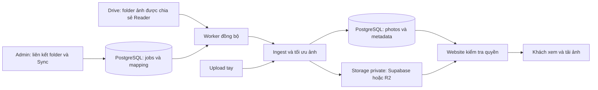

# Kế hoạch tích hợp Google Drive Sync — ChiCong Studio

**Bổ sung đã chốt 20/10/2026:** cho phép dán bất kỳ link folder đã chia sẻ cho tài khoản dịch vụ, duyệt folder con và chọn nguồn album, giữ các bộ đã liên kết. Yêu cầu này thay giới hạn một root chung trong thiết kế ban đầu; kết nối cũ vẫn giữ root mode đến khi studio đổi chế độ. Xem [hợp đồng duyệt folder và kết quả triển khai](google-drive-folder-browser-2026-10-20.md). Phần cập nhật 19/10 dưới đây giữ mốc production trước thay đổi này.

**Cập nhật 19/10/2026 · Code web/worker/backup đã lên VPS; nhập Drive production và lịch vẫn tắt. Worker đang kiểm kết nối; chưa enable khởi động cùng máy. Khóa mới đã cài, khóa cũ đã thu hồi và kiểm lại từ VPS; còn chốt root và nghiệm thu pilot.** Trạng thái hiện tại: [biên bản rollout production](google-drive-sync-production-release-2026-10-17.md). Các mục 17.1–17.5 giữ kết quả lịch sử theo thời điểm chạy. Hướng dẫn dùng thử và vận hành: [vận hành Drive Sync](google-drive-sync-operations.md). Các mục thiết kế dưới đây là hợp đồng nghiệm thu; trạng thái thực tế nằm ở mục 17.

## 1. Các quyết định đã chốt

- Chỉ Drive do studio quản lý; khách hàng không tự kết nối tài khoản.
- Kết nối bằng tài khoản dịch vụ riêng, được chia sẻ folder ở quyền Người xem.
- Ảnh Drive và ảnh upload tay cùng tồn tại trong một album.
- Xóa hoặc chuyển ảnh khỏi folder Drive: giữ ảnh đã đồng bộ trên web và báo trong admin.
- Tách biệt hoàn toàn kết nối này với Google Drive backup website.
- Gắn thủ công một folder cho từng album, chỉ nhập ảnh trực tiếp trong folder. Thông tin album, caption, thứ tự và bìa quản lý trên web.
- Sau khi khách gửi lựa chọn, giữ bản gallery hiện tại; Drive thêm ảnh, sửa nội dung hoặc đổi tên đều chờ studio duyệt.
- Quy mô thực tế khoảng 500–5.000 ảnh/album; nguồn là JPEG full-resolution, có thể vượt 20 MiB/40 megapixel.
- Khách tải JPG tối đa 2400px như hiện tại; ảnh gốc giữ trên Drive, không thêm chức năng tải JPEG gốc trong bản đầu.

Mục tiêu: thêm một nguồn nhập ảnh qua Drive, giữ nguyên quyền truy cập gallery, upload thủ công và khả năng khôi phục website. Những lựa chọn kỹ thuật bên dưới được triển khai và kiểm chứng theo từng giai đoạn.

## 2. Phạm vi và quyền quản lý dữ liệu

| Dữ liệu | Nơi quản lý chính | Hành vi đề xuất |
|---|---|---|
| Nội dung ảnh nhập từ Drive | Folder Drive đã liên kết | Nhập ảnh mới và cập nhật nội dung thay đổi |
| Ảnh upload tay | Admin website | Drive không được sửa hoặc xóa |
| Tiêu đề album, slug, caption, thứ tự, section, ảnh bìa | Admin và PostgreSQL | Đồng bộ ảnh không ghi đè các trường này |
| Published/private/draft, mật khẩu, lựa chọn khách | Website | Không lấy quyền công khai của Drive làm quyền website |
| Các bản ảnh phục vụ web | Storage đang cấu hình | Dùng cùng pipeline tối ưu và kiểm tra quyền hiện có |
| Backup website | Quy trình backup riêng | Không dùng folder nguồn Drive thay cho snapshot website |

Bản đầu đã chốt: một folder ảnh tương ứng một album được chọn trong admin; chỉ nhập file con trực tiếp của folder đó. Folder tổ chức cấp trên có thể chứa nhiều folder album, nhưng không tự tạo album hoặc publish khi phát hiện folder mới. Folder lồng sâu, đồng bộ album.json, RAW, HEIC, video, shortcut và Google Docs để ngoài phạm vi bản đầu. Upload tay vẫn hỗ trợ JPEG/PNG/WebP theo giới hạn hiện có và .ccphoto; Drive chưa nhập loại gói này.

Ảnh gốc vẫn nằm trên Drive. Website tạo WebP 2400px, thumbnail 900px và JPG tải xuống tối đa 2400px theo pipeline hiện hành; tính năng này không biến website thành nơi tải ảnh gốc/RAW.

### 2.1. JPEG nguồn lớn và bộ ảnh 5.000 file

Giới hạn 20 MiB/40 MP hiện tại không đủ làm hợp đồng cho nguồn Drive đã xác nhận. Tách policy đầu vào theo nguồn: giữ giới hạn HTTP upload tay; worker nhận JPEG lớn bằng luồng tải xuống file tạm, kiểm bytes/checksum rồi encode từ đường dẫn file. Tái dùng chuẩn rendition và bước publish, không bắt toàn bộ file gốc đi qua Buffer/Multer của web server. PNG/WebP Drive vẫn giữ giới hạn hiện tại trong MVP.

- Mỗi lần xử lý một ảnh; giới hạn rõ bytes, pixels, thời gian tải/encode, dung lượng thư mục tạm và số tiến trình encode. Không đặt pixel limit vô hạn hoặc coi cấu hình cache Sharp là giới hạn tổng RAM.
- Đo bằng mẫu JPEG đại diện ở P0/P2, gồm ảnh vượt cả 20 MiB và 40 MP; ghi max bytes/pixels được hỗ trợ cùng ngân sách RAM/CPU/disk vào cấu hình trước nghiệm thu. Các con số tối đa chưa chốt vì chưa có mẫu kích thước thực; không tự buộc người dùng xuất toàn bộ ảnh xuống 2400px để lách yêu cầu nguồn lớn.
- Chặn file vượt ngưỡng với lỗi rõ ràng, không retry vô hạn hoặc âm thầm bỏ qua. Preview báo kích thước biết được; pixel/khả năng decode chỉ được xác nhận khi kiểm bytes. Theo dõi OOM và disk-full; encode có watchdog/process isolation để có thể kết thúc thực sự, không chỉ Promise timeout.
- File tạm riêng từng attempt, quyền hạn chế; dọn sau thành công/lỗi và đối chiếu sau restart. Không đưa ảnh gốc vào storage website hoặc backup. Bản gốc vẫn do studio quản lý trên Drive.
- Nghiệm thu ít nhất bộ 500 và 5.000 ảnh Drive cộng ảnh manual, gồm tải gallery đồng thời, gián đoạn giữa job và resume. Không suy từ việc import một vài ảnh thành công rằng đã hỗ trợ 5.000 ảnh.

Sharp hỗ trợ input đường dẫn, giới hạn pixels và cấu hình concurrency/cache; mức RAM thực tế còn phụ thuộc decode và encode. Chốt theo phiên bản trong lockfile và số đo, không chỉ theo mặc định thư viện. [Sharp input](https://sharp.pixelplumbing.com/api-constructor/), [Sharp resources](https://sharp.pixelplumbing.com/api-utility/), [Resize](https://sharp.pixelplumbing.com/api-resize/).

## 3. Kết quả khảo sát code trước triển khai

Đối chiếu working tree ngày 16/10/2026, HEAD local 1ea50e86f78e1de13010c736acdb367b6b35d247 cùng nhiều thay đổi chưa commit. HEAD một mình không đại diện toàn bộ code đang đọc. Không suy từ source/config rằng production đã triển khai tính năng tương ứng.

| Điểm nối | Phát hiện và yêu cầu |
|---|---|
| [photo-upload.mjs](../studio/server/photo-upload.mjs) | Skip/overwrite so tên gốc trên toàn album. Phải tách lõi ingest và giới hạn so tên của upload tay vào source=manual; importer Drive nhận diện bằng Drive ID |
| [image-optimizer.mjs](../studio/server/image-optimizer.mjs) | Hiện nhận Buffer, chặn 20 MiB/40 MP và tạo ba rendition; cần input file/policy riêng cho JPEG Drive lớn, giữ chuẩn đầu ra |
| [storage.mjs](../studio/server/storage.mjs) | Có local/Supabase/R2. Import gọi adapter đang bind với database; không tự chọn R2 |
| [media-control.mjs](../studio/server/media-control.mjs) | Có writer registration, maintenance lease, storage binding và journal ghi chưa xác định; worker mới phải tham gia |
| [photo-deletion.mjs](../studio/server/photo-deletion.mjs) | Xóa hiện tại xóa DB, điều chỉnh bìa/lựa chọn và queue cleanup. Trạng thái missing của Drive không gọi cơ chế xóa này |
| [db.mjs](../studio/server/db.mjs) | SQLite local và PostgreSQL cloud; migration cần hỗ trợ cả hai, dữ liệu cũ mặc định manual |
| [media-backup.mjs](../studio/tools/media-backup.mjs) | Allowlist bảng cố định, gặp bảng lạ thì từ chối backup. Schema Drive và backup/restore phải nâng cấp cùng đợt |
| [app.mjs](../studio/server/app.mjs) | API ảnh trả qua quyền website; các route Drive mới cần auth/admin, Origin và media gate tương ứng |
| [drive-backup.mjs](../studio/tools/drive-backup.mjs) | Công cụ backup một chiều, folder riêng và có quyền ghi/xóa. Không dùng làm connector nhập ảnh |
| [render.yaml](../render.yaml) | Blueprint local chọn Supabase Storage. Đây là bằng chứng cấu hình file, không phải đọc lại env production trong lần lập plan này |
| [gallery-selection.mjs](../studio/server/gallery-selection.mjs) | Submit hiện so ID lựa chọn, chưa so phiên bản nội dung; photoVersion chỉ hash ID. Sửa lựa chọn chuyển submitted về draft, nên không thể dùng mỗi trạng thái này làm khóa duyệt Drive |
| [gallery-download.mjs](../studio/server/gallery-download.mjs) | Request giữ filename rồi mới đọc storage; cleanup hiện xóa ngay. Cần giữ rendition cũ trong thời hạn đọc để replacement không làm đứt tải |
| [app.mjs](../studio/server/app.mjs), [album-sections.mjs](../studio/server/album-sections.mjs), [main.js](../studio/web/main.js) | Reorder giới hạn 2.000, chuyển section tối đa 1.000/lần, JSON mặc định 128 KiB; UI gửi cả danh sách khi reorder. Không đủ cho 5.000 ảnh chỉ bằng sửa worker |

Triển khai Drive không bắt buộc chờ cutover R2 production. Kiểm thử với adapter hiện hành, giữ nguyên ràng buộc storage binding, và thực hiện chuyển kho theo [kế hoạch R2](r2-implementation-plan.md) riêng.

## 4. Kiến trúc đề xuất

HTTP admin chỉ tạo job và trả mã job; xử lý download/encode chạy trong process worker riêng. Gallery khách đọc bản đã đồng bộ, không gọi Drive. Nếu Drive tạm lỗi, những ảnh đã nhập vẫn được phục vụ bình thường.

Queue lưu trong PostgreSQL đang có; bản đầu chưa cần Redis hoặc một dịch vụ cron riêng. Worker xử lý một file tại một thời điểm và có bộ lập lịch theo dữ liệu next_run_at trong DB. Cơ chế scheduler mặc định tắt; chỉ bật sau nghiệm thu. Có runner chạy một lượt trên local/staging trước khi cần worker cloud thường trực.

Đồng bộ áp dụng theo từng ảnh: ảnh đã hoàn tất có thể xuất hiện trong khi các ảnh khác vẫn đang xử lý. Muốn công bố cả bộ cùng lúc thì sync vào album draft, kiểm tra xong mới publish. Không hứa cập nhật nguyên tử toàn bộ album đang public.

## 5. Kết nối Google Drive bằng tài khoản dịch vụ

Quyết định người dùng đã chọn: service account riêng cho Drive Sync, chỉ được chia sẻ folder nguồn ở quyền Reader. Bản đầu không cần luồng consent OAuth người dùng, client Desktop hoặc refresh token của tính năng backup.

1. Dùng project/tài khoản dịch vụ riêng phù hợp môi trường; bật Drive API. Tách credential staging và production.
2. Chia sẻ folder ảnh riêng tư cho email service account với quyền Người xem. Không bật chia sẻ công khai hoặc domain-wide delegation; không cấp vai trò Google Cloud Owner/Editor để đọc Drive.
3. Worker dùng thư viện xác thực Google với scope drive.readonly. Scope giới hạn thao tác; ACL Drive giới hạn dữ liệu mà identity được đọc. Nếu sau này ai chia sẻ thêm tài liệu cho identity đó, quyền API có thể rộng thêm; vì vậy app vẫn giới hạn root folder đã cấu hình.
4. Lưu private key dạng secret file chỉ trên worker/runner; local ngoài Git với quyền 0600. Web không cần key: các bước check/list/download gửi qua job. DB chỉ lưu identity, root folder và trạng thái, không chứa private key. Access token chỉ ở bộ nhớ; log không ghi token, key hay bytes ảnh. Worker không nhận credential backup, email hoặc admin setup không cần thiết.
5. Kiểm tra identity, root, folder album nằm dưới root và khả năng tải một ảnh thử. Reader không đảm bảo tải được mọi file nếu chủ sở hữu giới hạn download hoặc có folder con hạn chế truy cập.
6. Có hướng dẫn thay khóa: nạp khóa mới, kiểm tra đọc thành công, chuyển runner, rồi thu hồi khóa cũ. Ngắt kết nối trong admin dừng job; muốn thu hồi quyền Google thì bỏ chia sẻ folder hoặc vô hiệu credential tương ứng.

Google mô tả quyền folder được kế thừa xuống file/folder con, với ngoại lệ như limited access; việc di chuyển cũng làm quyền được đánh giá lại. Vì vậy test thật phải bao gồm file mới thêm sau khi chia sẻ. [Drive permissions](https://developers.google.com/workspace/drive/api/guides/manage-sharing), [Service account authorization](https://developers.google.com/identity/protocols/oauth2/service-account).

Đính chính hướng OAuth đã cân nhắc: drive.readonly là restricted scope, có thể đọc toàn Drive của người dùng cấp quyền; không phải scope chỉ cho một folder. Tuy nhiên Google có ngoại lệ xác minh cho personal use, nên không khẳng định mọi tích hợp một studio đều bắt buộc qua verification. Refresh token của External Testing có hạn 7 ngày với scope Drive; điều này không áp dụng như vậy cho phương án service account đã chọn. [Scopes](https://developers.google.com/workspace/drive/api/guides/api-specific-auth), [Verification exceptions](https://developers.google.com/identity/protocols/oauth2/production-readiness/restricted-scope-verification), [Token expiration](https://developers.google.com/identity/protocols/oauth2#expiration).

## 6. Quy tắc đồng bộ và xung đột

| Tình huống | Hành vi bản đầu |
|---|---|
| Drive có file mới | Tạo ảnh nguồn google_drive sau khi file vượt kiểm tra và đủ ba rendition |
| File không thay đổi | Không tải/encode/ghi storage lại |
| Chỉ đổi tên | Cập nhật tên nguồn và tên tải xuống; giữ caption, vị trí, bìa và ID ảnh |
| Cùng Drive ID, nội dung đổi | Tạo key rendition mới; đổi mapping trong transaction; giữ photo ID, selections, section, caption và thứ tự |
| Hai Drive file cùng tên | Hai ID khác nhau, hai ảnh độc lập; không ghi đè theo tên |
| Ảnh manual trùng tên Drive | Cùng tồn tại; skip/overwrite thủ công chỉ xét manual |
| Upload tay muốn thay ảnh đang do Drive quản lý | Ngắt liên kết trước, rồi thay đúng photo ID; không suy mục tiêu theo tên khi có nhiều ảnh manual trùng tên |
| File bị xóa/chuyển ra ngoài folder | Sau lượt quét đầy đủ, đánh dấu missing_in_drive; vẫn giữ ảnh web, bìa và selections |
| File trở lại đúng folder | Bỏ cảnh báo missing, cập nhật nếu nội dung đổi, giữ photo ID |
| Mất quyền đọc folder/root | Báo source_unavailable, dừng apply; không biến cả album thành missing |
| Một file không tải được hoặc hỏng | Báo lỗi riêng file; giữ phiên bản tốt đã nhập trước đó; các file độc lập vẫn có thể hoàn tất |
| Ngắt liên kết một ảnh | Chuyển ảnh thành manual, giữ rendition; lưu dấu detached để không tự nhập lại |
| Xóa ảnh Drive trong admin | Xóa bản web theo quy trình hiện tại và lưu dấu suppressed cùng transaction; không xóa trên Google Drive |
| Sync lại sau thao tác xóa/ngắt liên kết | Bỏ qua suppressed/detached đến khi admin chọn nhập lại rõ ràng |
| Di chuyển file giữa hai folder album đã link | Báo conflict, giữ liên kết cũ; MVP hướng dẫn chuyển file về folder cũ. Chuyển quyền quản lý sang album khác cần thiết kế riêng, không tự chuyển lựa chọn hoặc nhập bản trùng |
| Folder đổi tên | Mapping theo ID vẫn giữ; không tự đổi title/slug album |
| Dừng sync album hoặc archive album | Ngừng lịch/job mới của mapping; giữ ảnh và metadata |
| Ngắt liên kết folder | Dừng và thu hồi quyền publish của job đang chạy; giữ ảnh, lịch sử và dấu bỏ qua; không tự hard-delete mapping |
| Gallery đã được khách gửi lựa chọn | Scan và báo thay đổi, nhưng mọi thêm/replace/rename cần studio duyệt đúng preview; nút Sync thường không vượt qua khóa này |

Caption khởi tạo theo tên file khi nhập lần đầu. Thứ tự đợt đầu dùng natural sort theo tên, ID làm khóa phụ; ảnh mới về sau thêm cuối, rename không sắp xếp lại bộ ảnh. Không tự ghép ảnh manual đã có với file Drive bằng tên hoặc checksum; nếu cần chuyển nguồn quản lý cho ảnh cũ sẽ có bước review riêng.

Với album đã có bìa, sync giữ nguyên bìa. Nếu album trống chưa có bìa, ảnh nhập đầu tiên có thể làm bìa theo hành vi hiện tại. Cảnh báo missing nghĩa là không còn quan sát được file trong folder đã liên kết, không phải bằng chứng chắc chắn file bị xóa khỏi toàn bộ Drive.

### 6.1. Khóa duyệt sau khi khách gửi lựa chọn

Lưu cờ drive_review_required bền vững, tách khỏi selection_status. Gửi lựa chọn bật cờ; khách đổi lựa chọn khiến status về draft cũng không tự bỏ cờ. Khi migrate/link, album đang submitted phải có cờ này. Không suy ngược lịch sử đã gửi mà DB cũ không lưu.

Luồng khách phải có hành động “Gửi lựa chọn” rõ ràng: UI hiện lưu chọn/bỏ chọn nhưng chưa nối nút submit. Submit kiểm phiên bản catalog và lựa chọn dưới album lock, lưu receipt idempotent gồm ID ảnh đã chọn và phiên bản nội dung lúc gửi, tăng submission generation và bật khóa. Nếu cùng photo ID nhưng bytes/tên đã đổi, trả conflict để khách xem lại; không coi hash ID là kiểm nội dung.

Khi bị khóa, worker vẫn scan và ghi cảnh báo/missing, nhưng không đổi nội dung hiển thị hoặc tên tải xuống. Admin duyệt một preview xác định: danh sách file/action/version, connection/mapping/source generations, catalog/selection/submission revisions. Approval lưu bền vững, không phải boolean bỏ qua kiểm tra. Nguồn hoặc khách thay đổi sau khi duyệt thì phần việc chưa apply phải dừng và review lại. Job cập nhật expected catalog revision sau chính mỗi commit của nó, tránh tự làm approval stale; thao tác khác không được hưởng quyền duyệt đó.

Sau batch đã duyệt vẫn giữ cờ, các thay đổi Drive tiếp theo tiếp tục chờ duyệt. Giữ ID và danh sách lựa chọn khi replace; đánh dấu lần gửi trước là đã có thay đổi sau khi gửi, không diễn giải rằng khách đã duyệt bytes mới. Receipt chỉ lưu bằng chứng metadata, không hứa giữ ảnh cũ vô thời hạn. Không tự gửi thông báo ra ngoài. Hành vi này bao gồm reimport; thao tác ngắt liên kết/xóa thủ công hiện tại vẫn phải cập nhật revision thích hợp.

### 6.2. Vòng đời nguồn và folder

Connection ID là identity logic ổn định qua thay key hoặc kết nối lại; không tạo ID mới để vô tình bỏ qua tombstone. Link giữ nguyên cặp album/folder trong suốt lịch sử, phân biệt attached, paused và unlinked. Paused vẫn giữ chỗ; unlinked giải phóng ràng buộc link hiện hành nhưng không xóa lịch sử. Liên kết folder khác tạo mapping mới; reattach cùng cặp có thể tái kích hoạt mapping cũ với generation mới. File còn thuộc mapping lịch sử khác vẫn báo conflict, không tự nhận lại.

Mỗi source có source_generation tăng khi delete, detach hoặc explicit reimport; mọi candidate/approval/receipt chụp giá trị này. Nhập lại cùng Drive ID và cùng version vẫn là vòng nhập mới. Reimport detached giữ nguyên ảnh manual và tạo ảnh Drive mới, có request key chống bấm lặp; không dùng imported_version cũ làm bằng chứng rằng vòng mới đã publish.

Reimport tạo intent idempotent và giữ chỗ generation mới trước khi tạo preview; vẫn giữ tombstone trong lúc chờ/tải. Chỉ intent đó, cùng approval nếu album bị khóa, được atomically tạo ảnh Drive mới, gắn photo_id mới và chuyển suppressed/detached sang active tại publish. Hủy/lỗi không xóa tombstone; sync thông thường không được lợi dụng intent để tự nhập. Lưu imported_generation cùng imported_version khi commit để phân biệt dữ liệu vòng trước.

Thay ảnh manual theo photo ID phải kiểm album, source=manual và phiên bản hiện tại trong transaction; duplicate theo tên vẫn bị từ chối khi mơ hồ. Nhờ vậy có thể thay đúng ảnh vừa detach dù album có nhiều ảnh cùng tên.

## 7. Mô hình dữ liệu đề xuất

Không rải cùng một bộ metadata Drive ở nhiều bảng rồi để chúng lệch nhau. Photos giữ nguồn và nội dung hiển thị; bảng liên kết giữ identity/version của nguồn Drive.

| Bảng / thay đổi | Trường chính và ràng buộc |
|---|---|
| photos.source | manual hoặc google_drive, NOT NULL DEFAULT manual; migration không suy nguồn cũ từ tên file |
| drive_connections | id, service_account_email, root_folder_id, status, generation, last_checked_at, last_error_code; bản đầu một kết nối hoạt động/môi trường |
| drive_album_links | id, connection_id, album_id, folder_id, state attached/paused/unlinked, enabled, generation, next_run_at, last_inventory_at, last_success_at; uniqueness album/folder áp dụng link chưa unlinked, không xóa lịch sử để đáp ứng constraint |
| drive_source_files | connection_id + drive_file_id duy nhất; mapping_id, photo_id nullable/unique, source_generation, imported_generation, reimport_intent_id, state, source_name, mime, size, observed_version, imported_version, checksum đã nhập, modified_time, last_seen_scan_id, error_code |
| drive_sync_jobs | id, mapping_id, kind check/preview/apply, status, request_key, attempt, lease_owner, lease_until, fence, cancel_requested, connection_generation, mapping_generation, approval_id, expected_catalog_revision, progress, timestamps; check connection cho phép mapping null |
| drive_sync_job_items | job_id + file_id duy nhất; action, version/checksum, source_generation, ingest_operation_id, kết quả/mã lỗi; giữ bằng chứng từng file sau restart |
| photo_ingest_attempts | operation ID, attempt, source/job item, candidate_prefix, storage_identity, process_id, writer_token, fence, state, timestamps; ghi bền trước PUT, giữ cả candidate stored nhưng chưa publish |
| albums + gallery_submissions | catalog_revision, selection_revision, submission_generation, drive_review_required; receipt lần gửi gồm request key, revisions và danh sách ID/phiên bản đã chọn, trạng thái stale; không lưu bytes ảnh |
| drive_sync_approvals | preview/manifest bất biến, người duyệt/thời điểm, revisions/generations, job được cấp quyền; bị vô hiệu khi điều kiện không còn đúng |
| photo_cleanup | Thêm thời điểm đủ điều kiện xóa và loại candidate chưa publish/rendition đã phục vụ; rendition cũ phải qua retention đọc ở mục 8.4 |

drive_source_files.state phân biệt active, missing_in_drive, detached và suppressed. Lỗi lần sync được ghi riêng: một ảnh active có thể vẫn đang hiển thị bản tốt dù lần cập nhật mới lỗi. File chưa nhập có photo_id null; lỗi không được tạo record ảnh hiển thị giả.

Drive version là chuỗi số 64-bit; không chuyển qua JavaScript Number có thể mất độ chính xác. Nếu cần so phiên bản dùng BigInt, DB/API vẫn lưu/trả dạng chuỗi. observed_version là điều đã thấy; imported_version chỉ đổi cùng transaction publish ảnh. Không đánh dấu đã nhập chỉ vì đã download.

Giữ dấu suppressed/detached bền vững khi photo bị xóa; FK photo_id dùng SET NULL phù hợp, không cascade xóa dấu bỏ qua. Album hiện có workflow archive; không thêm xóa album hàng loạt ngoài scope. Nếu sau này có hard-delete album, phải dừng mapping/job trước và thiết kế retention nguồn rõ ràng.

Migration additive, có kiểm constraint/index và chạy lặp được trên SQLite/PostgreSQL. Các bảng cloud mới áp dụng RLS theo mô hình server-only hiện có; không mở đọc trực tiếp từ trình duyệt. Lock và SELECT FOR UPDATE/SKIP LOCKED chỉ dùng trên nhánh PostgreSQL; SQLite dùng transaction tuần tự cho local/test.

Catalog/selection revisions phải được cập nhật bởi mọi đường ghi liên quan, bao gồm upload/delete, caption/section/order/bìa và chọn/gửi lựa chọn, dưới cùng album lock. Chỉ thêm counter vào Drive sẽ không phát hiện được thay đổi từ route cũ. Schema chi tiết và index chốt ở P1 cùng migration/backup; bảng trên là hợp đồng dữ liệu, không phải DDL đã chạy.

Giữ báo cáo job chi tiết 90 ngày là mặc định đề xuất; không xóa job đang chạy hoặc chưa giải quyết. Dọn báo cáo không được dọn dấu bỏ qua, mapping nguồn, journal ghi chưa xác định hoặc backup snapshot.

## 8. Thuật toán đồng bộ bản đầu

### 8.1. Xem trước và lập inventory

1. Kiểm tra feature flag, identity, root, mapping và album; xác minh folder thuộc cây root đã cho phép. Không coi URL tùy ý là endpoint tải xuống.
2. Liệt kê file con trực tiếp bằng files.list, điều kiện parent ID và trashed=false, dùng fields tối thiểu. Đi đến hết nextPageToken, kể cả khi một trang rỗng nhưng vẫn có token tiếp.
3. Loại folder con, shortcut, Workspace document, RAW, video và định dạng ngoài scope; ghi rõ lý do. Kiểm file bị hạn chế download.
4. So theo Drive ID và version/checksum với bảng nguồn, áp dụng dấu bỏ qua. Nhận diện file đã gắn album khác là conflict.
5. Tạo báo cáo thêm/cập nhật/đổi tên/không đổi/missing/bỏ qua/lỗi. Preview chỉ đọc Drive metadata và ghi báo cáo job; không tải ảnh hoặc ghi storage.

Preview không chứng minh bytes là ảnh hợp lệ và không dự báo chính xác dung lượng sau encode. Lần liên kết đầu yêu cầu review preview trước apply. Nếu inventory/version thay đổi so với preview, báo preview_stale để làm lại; không âm thầm nhập thêm file chưa có trong báo cáo. Sau lần đầu, Sync ngay/lịch đã bật được phép apply tự động chỉ khi album không có khóa duyệt; album bị khóa tạo preview chờ studio. Lưu inventory/job items theo trang trong DB, không gom bytes ảnh hoặc báo cáo 5.000 file vào một response; quy định budget thời gian/số file và báo scan chưa đầy đủ khi chạm budget.

Không đánh dấu missing nếu chưa hoàn thành pagination, có incompleteSearch, lỗi quyền folder hoặc job bị hủy. File không thấy ở một lượt quét không bị xóa/ẩn. Folder listing không phải snapshot nguyên tử của Google Drive; lượt sau phải hội tụ lại nếu nguồn thay đổi trong lúc quét.

### 8.2. Nhập hoặc cập nhật một file

1. Đọc metadata hiện tại; kiểm mapping, state, trashed=false, parent đúng folder album và folder vẫn thuộc root cho phép. Cả hai nhánh bỏ qua tải theo imported_version hoặc checksum đều đòi photo đã publish còn tồn tại, source=google_drive, thuộc mapping này và imported_generation=source_generation; metadata cũ hoặc ảnh manual đã detach không đủ. Không so với observed_version để quyết định bỏ qua: phiên bản đã thấy nhưng download lỗi vẫn phải retry. Nếu chỉ metadata đổi, cập nhật nó qua transaction có fence.
2. Download binary qua Drive API alt=media vào file tạm riêng attempt với timeout, AbortSignal, streaming checksum và giới hạn bytes/disk; không tin Content-Length hoặc MIME do tên file cung cấp. Dùng source descriptor có đường dẫn, số bytes, tên Unicode và policy; không chạy bộ giải mã tên multipart Latin-1 lên tên Drive đã là Unicode.
3. Kiểm checksum nguồn khi Google cung cấp, kiểm magic/decode/format/pixel bằng pipeline. Đọc lại metadata sau download và ngay trước khi bắt đầu publish nếu encode kéo dài; kiểm cả parent/trashed/root lẫn version/checksum. Nếu nguồn đổi thì bỏ candidate, xử lý mapping conflict hoặc thử lại có giới hạn, không publish bytes gắn nhầm phiên bản/folder.
4. Tạo WebP/thumbnail/JPG bằng lõi ingest dùng chung. Truyền policy nguồn qua cả ba nhánh, kể cả JPEG download helper đang dùng 40 MP riêng. Dùng prefix ngẫu nhiên 32 hex mới như storage hiện tại, không ghi đè object đang được gallery tham chiếu.
5. Đăng ký writer media-control cho toàn đoạn ghi object → transaction publish → xử lý cleanup; lưu attempt/candidate prefix, process/writer, fence và storage identity trước PUT đầu tiên; ghi cả ba rendition qua trackedStorage. Khi bị ngắt sau PUT thành công, state=stored chưa đồng nghĩa candidate đã publish.
6. Trong transaction có khóa album, kiểm connection_generation, mapping_generation, source_generation, connection còn hoạt động, mapping enabled, album chưa archive, job fence/cancel, dấu suppressed/detached và imported_version hiện tại. Tombstone chặn sync thường; chỉ reimport intent đúng generation được chuyển trạng thái theo mục 6.2. Kiểm khóa duyệt cùng approval/revisions ở mục 6.1 ngay tại commit, kể cả nếu khách submit lúc đang download. Không cho candidate cũ thay phiên bản mới đã commit. Chỉ commit khi worker còn quyền.
7. Tạo/cập nhật photos, mapping nguồn, imported_version, receipt attempt và kết quả job item trong cùng transaction; tăng revision và trạng thái submission stale khi thích hợp. Với replace giữ photo ID, đổi filename và đưa key cũ vào photo_cleanup có retention cùng transaction.
8. Nếu COMMIT mất phản hồi, chờ khóa và đối chiếu DB/receipt. Không xóa key mới chỉ vì client chưa nhận thành công. Trường hợp không xác định phải giữ journal và báo cần xử lý.

Mỗi operation chống trùng theo connection + file ID + version + connection/mapping/source generations; không tái dùng upload key gửi từ browser để quyết định identity Drive. Một operation có thể có nhiều attempt/prefix riêng; receipt publish chọn đúng attempt thắng. Nếu worker cũ tiếp tục sau khi lease đổi, nó không được publish; các key tạm riêng phải được dọn qua quy trình có kiểm tra tham chiếu. Không xóa attempt/receipt chưa đối chiếu chỉ vì hết thời gian giữ báo cáo.

Thứ tự khóa cho transaction liên quan nhiều bảng: album → connection → mapping → job → source. Claim job là transaction riêng, không giữ job lock rồi quay lại lấy album lock. Đổi connection đơn lẻ khóa connection và commit, không giữ nó để chờ khóa album. Các đường rename-only, missing finalization, pause, detach và delete phải dùng cùng quy ước và kiểm generation thích hợp.

Drive và PostgreSQL không có transaction chung: file vẫn có thể đổi sau lần đọc metadata cuối. Bản web ghi rõ phiên bản quan sát đã nhập; lần sync kế tiếp đối chiếu lại. Không diễn đạt việc kiểm parent/version là đảm bảo nguyên tử với thao tác của người dùng trên Drive.

### 8.3. Hoàn tất và lỗi

Job có các trạng thái queued, running, awaiting_review, completed, completed_with_errors, retry_wait, canceled, failed. awaiting_review là kết quả scan chờ hành động, không tự retry/claim để apply; approval tạo apply job tham chiếu đúng preview. Kết quả một file lỗi không làm mất ảnh tốt đã có. last_success_at chỉ cập nhật khi toàn bộ phần cần áp dụng thành công; last_inventory_at, số thay đổi chờ duyệt và lần kết thúc có lỗi hiển thị riêng.

Retry có exponential backoff và jitter cho rate limit/429/5xx, tôn trọng Retry-After. Phân loại reason của 403; permission denied không retry như quota. 401 chỉ làm mới access token có giới hạn; identity/credential lỗi chuyển kết nối sang cần xử lý. 404 không đủ để kết luận file đã bị xóa. Giới hạn tổng số lần/thời gian retry; admin thấy mã lỗi gọn, không thấy raw token hoặc response chứa bí mật.

### 8.4. Giữ ảnh cũ cho lượt tải đang diễn ra

Mọi đường đọc media/JPG/ZIP có deadline toàn lượt, bắt đầu trước query có thể chụp filename; kiểm elapsed/AbortSignal sau chờ DB và trước mỗi lần đọc storage. Mốc thiết kế ban đầu là 180 giây, cần thực thi nhất quán thay vì chỉ timeout từng GET. Request đã lấy bản cũ có thể hoàn tất bản đó trong deadline; request mới lấy bản hiện hành, quyền truy cập vẫn kiểm lại.

Rendition đã từng phục vụ phải vào cleanup trì hoãn. Cleaner lần đầu quan sát record retirement đã commit sẽ ghi not_before bằng thời gian DB + 5 phút; không lấy timestamp đầu transaction dài làm mốc. Retention luôn lớn hơn deadline đọc cộng biên an toàn và áp dụng cho cả Drive replace, overwrite manual, delete. Candidate chưa từng publish có thể được dọn ngay sau kiểm receipt/reference. Không có tùy chọn force bỏ qua retention; cleanup vẫn phải kiểm unknown writes và tham chiếu hiện hành.

Backup/cutover đang đòi queue cleanup rỗng: giữ điều kiện này, bổ sung bước chờ bounded, gia hạn maintenance lease và chỉ drain mục đã đến hạn. Hết deadline vận hành thì báo rõ đang đợi cleanup, không xóa sớm để đạt trạng thái xanh. Nếu sau này tăng thời gian chuẩn bị ZIP phải tăng retention tương ứng hoặc thiết kế read lease. MVP giữ giới hạn ZIP hiện tại 50 ảnh/100 MiB mỗi lượt; album 5.000 ảnh không có nghĩa tải một ZIP 5.000 ảnh.

## 9. Worker, lịch và phối hợp với backup

- Dùng job lease/heartbeat/fence trong DB để chịu restart và không phụ thuộc biến in-memory. Request key chống bấm Sync liên tục; một mapping chỉ có một job apply đang hoạt động, gồm queued/running/retry_wait. Các request trùng được gộp hoặc nhận job hiện tại.
- Worker có thể nhận việc mới sau restart; cập nhật tiến độ từng file. Process cũ mất lease bị chặn ở transaction publish. Claim job là transaction ngắn, không giữ transaction DB qua download/encode.
- Bắt đầu concurrency=1, giới hạn encode/cache và đo trên JPEG full-resolution vượt ngưỡng cũ theo mục 2.1 trước tăng. Worker poll queue khoảng 5–10 giây; đây là độ trễ nhận việc dự kiến, không phải SLA nhập cả album. Chia việc thành batch hữu hạn, lưu tiến độ và nhường lượt giữa các album tại ranh giới file để một bộ 5.000 ảnh/lỗi lặp không chiếm worker mãi.
- Khi SIGTERM: ngừng claim, hủy download chưa publish, hoàn tất hoặc rollback file đang ghi theo deadline, lưu trạng thái rồi đóng DB. Mất process đột ngột phải để journal chứng minh phần việc chưa rõ.
- Job lease hết hạn không cho phép tự xóa media_writers/media_writes. Cơ chế media hiện có cố tình giữ dấu writer chết; recovery cần chứng minh process đã dừng và đối chiếu storage trước, tránh bỏ qua backup fence.
- Dừng mapping phải tăng mapping generation; ngắt kết nối/đổi identity/root phải tăng connection generation. Mọi apply, kể cả rename-only/missing finalization, kiểm cả hai để chặn job cũ. UI chỉ báo đã dừng sau khi phần việc đang ghi được xử lý. Các route metadata/source mới cũng phải đi qua media-control, vì matcher hiện tại chưa bao phủ mọi đường /drive.
- Backup/cutover lấy maintenance lease: worker dừng trước file tiếp theo, writer đang ghi drain; giữ nguyên luồng khách đọc ảnh. Sau cutover, worker phải khởi động với đúng storage identity.
- Đề xuất chu kỳ tự động 15 phút, bật riêng từng album sau staging. Scheduler nằm trong worker, next_run_at và claim trong DB tránh nhiều instance enqueue trùng. Scheduler tắt mặc định, không liên quan lịch backup hằng ngày chưa chốt.
- Sau downtime, gộp các lịch bị lỡ thành một lượt cần làm, không tạo job cho từng mốc quá hạn. Khi một import dài đang chạy không xếp thêm các bản scan giống nhau; cuối job đánh giá lại nhu cầu scan. Backoff một mapping không chặn mapping khác. Album bị khóa chỉ cập nhật báo cáo chờ duyệt.

Render có mô hình background worker phù hợp tác vụ queue; queue ở PostgreSQL là lựa chọn thiết kế của ứng dụng, không giả định Render cấp sẵn queue Postgres. Runner local giúp kiểm chứng trước khi mua worker. [Render workers](https://render.com/docs/background-workers).

Giá tham chiếu đọc ngày 16/10/2026: bảng compute Render có mức 512 MB khoảng 7 USD/tháng và 2 GB khoảng 25 USD/tháng; đây không phải báo giá đã chốt hoặc bằng chứng đủ RAM cho JPEG lớn. Đo cả disk tạm/CPU/RAM, cộng storage/egress/API và kiểm lại giá Dashboard trước tạo tài nguyên trả phí. Cron theo lịch là phương án tiết kiệm cần đánh giá riêng nếu chấp nhận chờ đến lượt chạy; không gọi đó là sync tức thì. [Render pricing](https://render.com/pricing).

## 10. API và trải nghiệm admin

Các route chính dưới đây đã được triển khai trong working tree; bảng mô tả hợp đồng API, không xác nhận production đã có route mới:

| API | Mục đích |
|---|---|
| GET /api/admin/drive/status | Identity đã cấu hình, kết nối/root, lần kiểm tra, worker heartbeat, trạng thái tắt/bật |
| PUT /api/admin/drive/connection | Lưu email/root cấu hình; không nhận private key từ browser |
| POST /api/admin/drive/check | Tạo job kiểm tra identity và quyền truy cập folder; preview/import kiểm chứng list/download riêng |
| GET /api/admin/albums/:id/drive | Mapping album, trạng thái nguồn và job đang có |
| PUT /api/admin/albums/:id/drive | Gắn folder đã kiểm tra dưới root, chỉ ghi mapping sau khi không xung đột |
| POST /api/admin/albums/:id/drive/preview | Queue inventory và trả 202 + job ID |
| POST /api/admin/albums/:id/drive/sync | Queue apply sau baseline được review; nhận request key và preview ID khi lần đầu |
| POST /api/admin/albums/:id/drive/approve | Duyệt preview cụ thể cho album bị khóa; kiểm revisions, lưu approval và enqueue apply idempotent |
| GET /api/admin/drive/jobs/:id | Tiến độ, số lượng theo kết quả, lỗi từng file; có phân trang |
| POST /api/admin/drive/jobs/:id/cancel | Yêu cầu ngừng, không xóa dấu job/objects để giả kết quả |
| POST /api/admin/photos/:id/drive/detach | Ngắt liên kết ảnh, giữ bản web và dấu bỏ qua |
| POST /api/admin/albums/:id/drive/reimport | Nhập lại file suppressed/detached qua preview; không tự làm mất bản manual đã giữ |
| POST /api/admin/albums/:id/drive/pause | Tạm dừng lịch/job của mapping; hỗ trợ tiếp tục rõ ràng |
| POST /api/admin/albums/:id/drive/schedule | Lưu opt-in lịch cho mapping đã có baseline; global scheduler vẫn phải bật mới enqueue |
| DELETE /api/admin/albums/:id/drive | Unlink, tăng generation và giữ mapping lịch sử; không xóa ảnh |
| POST /api/admin/photos/:id/replace | Multipart thay đúng ảnh manual với expected revision; không cần chọn bằng tên |

Sau detach, hành động nhập lại tạo một ảnh Drive mới bên cạnh ảnh manual được giữ, trừ khi có một quy trình chuyển nguồn riêng được review sau này. Không tự nối lại và ghi đè ảnh manual.

Giao diện album có khối Google Drive: folder đang liên kết, nút kiểm tra/xem trước/sync, trạng thái hàng đợi, số đã hoàn tất/tổng, thời gian sync thành công và lỗi cần xử lý. Mỗi ảnh có nhãn nguồn; bộ lọc ảnh lỗi, missing và đã ngắt liên kết giúp quản lý.

Gallery cần nút gửi lựa chọn, trạng thái đã gửi/đã thay đổi sau lần gửi và xử lý conflict nội dung. Admin cần màn hình preview có phân trang, duyệt thay đổi và nhãn đang chờ duyệt; không dùng “Sync thành công” cho batch chưa được áp dụng.

### 10.1. Giao diện và API cho 5.000 ảnh

- Đổi thao tác chuyển vị trí sang move-by-ID/neighbour kèm expected catalog revision; không gửi 5.000 ID chỉ để chuyển một ảnh. Nếu vẫn hỗ trợ full reorder, cấp body limit riêng và test cả giới hạn DB parameters; không chỉ nâng số 2.000.
- Submit dùng request key + expected catalog/selection revisions, server lấy danh sách đã lưu; tránh gửi lại toàn bộ 5.000 ID qua JSON 128 KiB. Endpoint cần danh sách lớn phải có allowance riêng, không tăng vô hạn giới hạn toàn ứng dụng.
- Giữ batch chuyển section/xóa hữu hạn; UI thể hiện số đã chọn, phạm vi và giới hạn, hoặc tạo tác vụ batch có tiến độ/lỗi từng phần. Không tự chia một thao tác được mô tả là nguyên tử thành nhiều commit mà không báo. Không bắt buộc xóa 5.000 ảnh trong một request để đạt sức chứa album.
- Phân trang/window admin grid và preview, giữ selection ngoài DOM, dùng map ID→position tránh findIndex lặp bậc hai. Gallery private hiện dựng từng 90 ảnh nhưng tích lũy DOM/layout; public hiện dựng cả bộ. Kiểm desktop/mobile đến cuối bộ, bổ sung bounded rendering/layout cho cả hai.
- Đo kích thước metadata/API, giảm polling không đổi bằng revisions; nếu thêm pagination phải giữ đúng tổng số, lọc ảnh đã chọn, lightbox, thứ tự/section và selections ngoài trang hiện tại. Không suy rằng chỉ render trang đầu là đã đạt yêu cầu.

Không yêu cầu người dùng paste private key vào UI hoặc chat. Các endpoint phải đi qua admin authentication, Origin/CSRF protection hiện có, validation, rate limit và no-store. Guest không được đọc root/folder/file IDs, đường dẫn nội bộ, credential hoặc kết quả job. Tên ảnh đã nhập/được duyệt có thể hiển thị và dùng làm tên tải xuống theo hành vi gallery hiện tại; không đưa metadata quản trị nguồn vào payload public.

## 11. Backup, restore và khả năng quay lại

Đây là điều kiện bắt buộc cùng migration, không để sau khi tính năng đã chạy:

1. Nâng snapshot database lên schemaVersion mới, khai báo bảng Drive trong allowlist theo đúng thứ tự FK. Đọc được snapshot v1 cũ: mặc định ảnh manual, các bảng Drive rỗng.
2. Snapshot mới phải giữ mapping, source_generation/imported_version, dấu suppressed/detached, cờ khóa duyệt/submission receipts và trạng thái cần đối chiếu. Bao gồm các bảng attempt/approval mới trong schema contract. Private key và ảnh nguồn tạm nằm ngoài website backup.
3. Restore phải tắt connection/mapping/schedule, hủy mọi job chưa terminal (bao gồm queued, running, retry_wait, awaiting_review), vô hiệu preview/approval cũ, tăng connection/mapping generations và reset leases/heartbeats/cursor. Giữ ảnh, mapping, source generations và khóa duyệt; bắt buộc preview mới trước resume. Không tự kết nối Drive hoặc chạy lại việc cũ chỉ vì đã restore.
4. Backup media theo photos.filename thực tế; photo ID vẫn giữ nguyên sau replace nên không thể lấy ID làm tên object.
5. Diễn tập restore offline: xem được manual + Drive photos, selections, bìa, caption; sau cấu hình lại credential, preview không nhập trùng hoặc hồi sinh ảnh đã bỏ qua.

Quay lại vận hành: tắt scheduler/claim, yêu cầu worker drain, đối chiếu unknown writes, rồi tắt tính năng trong admin. Ảnh đã nhập vẫn là photos bình thường nên gallery tiếp tục phục vụ. Giữ migration và code hiểu schema mới; không deploy mù bản cũ có backup allowlist thiếu bảng. Chỉ restore database khi cần xử lý sự cố dữ liệu đã xác định, tránh mất các upload/lựa chọn mới phát sinh.

Export JSON ở /api/admin/export vẫn chỉ là export metadata theo phạm vi hiện có, không trở thành bản khôi phục toàn hệ thống. Hợp đồng restore đầy đủ thuộc media-backup; tài liệu/UI phải phân biệt hai việc này.

## 12. Đồng bộ tăng dần và webhook — sau bản đầu

MVP dùng full metadata scan của từng folder đã link; chỉ tải bytes khi cần. Điều này đơn giản hơn cho lượng album ban đầu và dễ kiểm chứng missing.

Khi đo được chi phí scan cao, thêm changes.list. Lấy startPageToken trước inventory ban đầu, sau inventory replay thay đổi từ token đó để không bỏ lỡ cập nhật giữa lúc scan. Feed theo identity/corpus, không theo từng folder: phải lọc theo các mapping đã cho phép, xử lý move và thay đổi quyền ở folder tổ tiên.

Checkpoint chỉ tiến khi các thay đổi đã được ghi thành công hoặc đã chuyển thành work item retry bền vững; không đánh dấu bỏ qua file lỗi rồi mất việc. Kiểm tra lại nguồn khi áp dụng sự kiện cũ. Giữ full reconciliation định kỳ để phát hiện membership thay đổi.

Đính chính: tài liệu Drive API v3 ghi nextPageToken và newStartPageToken của changes.list không hết hạn. Không thiết kế quanh giả định token định kỳ hết hạn/410. Khi cursor thực sự bị từ chối, sai identity/corpus hoặc mất trạng thái, pause và dựng lại inventory có kiểm soát. Điều này khác token phân trang files.list và hạn channel webhook. [changes.list](https://developers.google.com/workspace/drive/api/reference/rest/v3/changes/list).

Webhook chỉ là tín hiệu enqueue đọc changes, không là dữ liệu ảnh. Cần xác minh channel ID/resource/token, endpoint HTTPS, gia hạn channel, chịu notification trùng/bỏ lỡ; polling/reconcile vẫn cần. Chưa cần webhook để nghiệm thu MVP. [Drive push notifications](https://developers.google.com/workspace/drive/api/guides/push).

## 13. Ma trận kiểm thử và tiêu chí nghiệm thu

Các mục dưới đây là ma trận nghiệm thu, không tự đại diện cho kết quả đã chạy. Đối chiếu kết quả thực tế ở mục 17; đặc biệt không gộp fixture nội bộ với staging Drive thật.

| Nhóm | Tình huống tối thiểu | Kết quả phải đạt |
|---|---|---|
| Migration | DB cũ, DB mới, migration lặp; SQLite và PostgreSQL | Ảnh cũ manual, ID/metadata/selection nguyên vẹn; constraints hoạt động |
| Ingest regression | JPEG/PNG/WebP, .ccphoto thủ công, Unicode, skip/overwrite/retry | Hành vi hiện tại được giữ; không phát sinh duplicate/ghi đè chéo nguồn |
| Cùng tên | Manual và hai Drive ID cùng tên; detach rồi replace theo photo ID | Ba ảnh riêng, thay đúng ảnh; upload theo tên mơ hồ vẫn từ chối |
| Identity | Rename, thay nội dung cùng ID, file mới dùng tên cũ | Rename không nhân bản; update giữ photo ID; ID mới không nhận nhầm ảnh cũ |
| Source validation | MIME giả, bytes hỏng, RAW/HEIC/video, ảnh động; JPEG Drive >20 MiB/>40 MP trong policy mới; vượt policy mới; download quá dài | JPEG lớn hợp lệ nhập được, loại ngoài scope/vượt giới hạn bị từ chối rõ; không OOM hoặc tạo ảnh thiếu rendition; manual giữ giới hạn cũ |
| File tạm/encode | Disk-full, timeout, kill process lúc download/encode, restart có file tạm cũ | Không upload bytes dở; dọn đúng attempt khi process đã dừng; không xóa file của worker còn sống |
| Nguồn đổi trong lúc tải | Version đổi trước/sau download, checksum sai, file biến mất | Giữ bản web tốt; thử lại có giới hạn và báo đúng version đã nhập |
| Pagination | Nhiều trang, trang rỗng có token, lỗi trang giữa, incompleteSearch | Không bỏ sót file; scan thiếu không được mark missing |
| Quyền thật | Share root Reader, ảnh thêm sau share, folder hạn chế, cấm download, thu hồi share | Đọc đúng tập được cấp; không mở rộng quyền; folder lỗi không làm cả album missing |
| Missing | Trash, move khỏi folder, khôi phục cùng ID, root bị mất quyền | Website vẫn xem/tải được; cảnh báo chính xác và bỏ cảnh báo khi tìm lại |
| Cross-album move | File chuyển giữa hai folder mapped; rename folder | Báo conflict mapping; không tự di chuyển selections hoặc sinh duplicate |
| Manual actions | Detach/delete → preview/approve → reimport cùng version; bấm lặp, restart, sync thường/candidate cũ đang chạy | Intent tạo đúng một ảnh Drive mới; tombstone chặn sync thường đến publish; ảnh manual không bị nhận lại quyền quản lý |
| Link lifecycle | Pause/unlink, link folder khác, reattach, đổi key cùng identity | Link lịch sử không chặn link hợp lệ; pause giữ reservation; tombstone không bị lách; conflict có hướng xử lý |
| Job concurrency | Hai lần Sync, hai worker, lease hết hạn, cancel/pause/đổi root giữa PUT và commit | Một publish hợp lệ; worker cũ không overwrite kết quả mới; cả metadata-only cũng bị fence |
| Database/storage failures | PUT timeout/ghi muộn, COMMIT mất phản hồi, DB tắt trước cleanup | Không xóa ảnh đã commit; unknown journal được giữ; retry không tạo bản trùng |
| Crash recovery | Kill sau ba PUT thành công trước commit; không có maintenance owner; có writer khỏe khác | Đối chiếu cả stored-unpublished và unknown; chỉ retire writer đã chứng minh dừng; backup readiness được phục hồi |
| Media controls | Manual upload, Drive apply, backup, cleanup và cutover xen kẽ | Writer đúng phạm vi; backup không snapshot nửa file; sai provider bị chặn |
| Quyền gallery | Draft/public/private có và không mật khẩu; đổi mật khẩu, HEAD/304/JPG/ZIP | Ảnh Drive đi qua cùng kiểm tra quyền hiện có |
| UX/khách hàng | Update ảnh đang là bìa/được chọn/ở section, reload admin đang sync | Giữ ID/bìa/caption/vị trí/selection; tiến độ đọc lại từ server; không mất job |
| Submit và khóa duyệt | Submit đồng thời add/rename/replace ở cả hai thứ tự commit; gửi lặp; khách sửa lựa chọn sau gửi | Conflict đúng nội dung hoặc worker chờ duyệt; một receipt idempotent; cờ khóa không tự mất khi draft |
| Approval | Nguồn/selection/submission/root đổi sau duyệt; apply một phần rồi restart | Không apply ngoài manifest hoặc approval cũ; own-commit không tự làm stale; lần gửi cũ được đánh dấu đã thay đổi; batch mới vẫn phải duyệt |
| Reader/cleanup | Giữ request trước GET hoặc trước file ZIP cuối, replace và cleanup ở process khác; DB query chậm | Lượt cũ đọc được trong deadline, lượt mới thấy key mới; hết hạn hủy rõ; cleanup không xóa sớm |
| Deferred cleanup | Backup/cutover gặp not_before chưa đến, restart cleaner, timeout maintenance | Gia hạn/chờ có hạn, không bypass retention; queue thực sự rỗng trước chuyển kho |
| Backup restore | Snapshot v1/v2 có job queued/running/retry_wait; restore offline rồi preview khi nối lại | Mở được media; v2 giữ mapping/dấu bỏ qua; hủy work cũ và preview cũ; lịch không tự kích hoạt |
| 5.000 ảnh | 500, 2.001 và 5.000 ảnh + manual: reorder, section, chọn/gửi/export, lọc/lightbox, cuộn đến cuối trên mobile | Không 413/giới hạn 2.000 ngoài ý muốn; đúng selection qua trang; UI thao tác được, không dựng DOM không giới hạn |
| Hiệu năng | JPEG nguồn lớn, initial import/no-op/thay đổi ít; nhiều album và tải gallery cùng worker | Ghi RSS/CPU/disk tạm, thời gian/file/cả bộ, DB locks, browser heap/DOM, API bytes/latency; chọn instance theo số đo |
| Scheduler | Downtime nhiều chu kỳ, import lâu hơn chu kỳ, một album retry, nhiều scheduler | Gộp lịch lỡ, không trùng apply, album khác có lượt; chờ duyệt không lặp download/encode |
| Cleanup fixture | Dọn đúng job/album/object do lần thử tạo | Queue/writer/unknown không còn sau xử lý; ảnh và nguồn thật không bị đụng |

Unit/integration dùng Drive client giả để điều khiển pagination, race và lỗi. Test cloud opt-in dùng service account, root, DB và bucket staging riêng. Không gọi createApp/openDatabase với production để kiểm tra chỉ đọc vì có thể chạy migration/khởi động cleanup.

Gate release bắt buộc chạy thật các test PostgreSQL concurrency/constraint/backup ở môi trường test; báo skip vì thiếu URL không được tính là đạt. Fixture browser nhỏ hiện có không thay cho test 5.000 ảnh. Ghi ngân sách hiệu năng và policy JPEG đã đo trước P5; chưa có số đo thì chưa tuyên bố sẵn sàng nhập cả bộ production.

Bộ live test bắt đầu bằng một album draft có ảnh giả và ảnh upload tay trùng tên. Chạy hai vòng: nhập lần đầu; thêm/sửa/đổi tên/move/xóa/ngắt liên kết rồi sync lại. Thêm vòng chạy không thay đổi: không download/encode/put lại ảnh. Sau đó diễn tập restart, mất quyền và backup/restore.

Mỗi lần nghiệm thu lưu commit/fingerprint source, môi trường, cấu hình đã che secret, thời gian Việt Nam, kết quả từng case và số liệu tài nguyên. Kiểm chứng R2/Drive backup trước đây không được tính là đã kiểm thử Drive Sync.

## 14. Các giai đoạn thực hiện

| Giai đoạn | Việc phải xong | Cổng hoàn thành |
|---|---|---|
| P0 — Chốt thiết kế và baseline | Ghi lựa chọn đã chốt; chọn baseline gồm R2/backup hiện có; kiểm git diff/tạo nhánh codex; lên fixture 5.000 ảnh và mẫu JPEG lớn | Scope rõ; bảo toàn thay đổi; có cách đo bytes/pixels/RAM/disk trước chốt policy, không dùng HEAD cũ một mình |
| P1 — Schema và backup | Source/mapping generations, lịch sử link, jobs/attempts, approvals/submission revisions và cleanup retention; snapshot version mới | Migration + backup/restore v1/v2 qua SQLite/PostgreSQL; restore hủy approval/work cũ; feature flag tắt |
| P2 — Lõi ingest và tính nhất quán | Tách input Buffer/file policy; JPEG lớn; source/fence, manual replace-by-ID, attempt journal; revisions ở mọi writer, reader deadline/cleanup trì hoãn | Regression upload, nguồn lớn, cross-source/commit ambiguity, submit race và cleanup qua; đo policy nguồn, chưa cần credential Drive thật |
| P3 — Connector và runner | Auth service account, list/metadata/download có giới hạn, preview/apply theo ID, CLI chạy một lượt, report | Mock Drive test qua; nguồn lỗi không làm hỏng bản web; chạy lặp không trùng |
| P4 — Worker, admin và gallery | Jobs/recovery/fairness; link/preview/sync/approve; gửi lựa chọn và khóa duyệt; nâng UI/API cho 5.000 ảnh | HTTP trả job; restart theo dõi tiếp; flow duyệt đầy đủ; không vướng body/reorder/batch limits; permissions đúng |
| P5 — Staging thật | Credential/test root riêng, Reader download; live matrix, 500/5.000 ảnh, JPEG lớn, đo RAM/CPU/disk/UI, backup/restore và dọn fixture | Hai chu kỳ + no-op + kill/recovery + submitted approval qua; PostgreSQL không skip; chốt tài nguyên/chi phí từ số đo |
| P6 — Pilot production | Review config/snapshot; triển khai theo thứ tự mục 15 với flag tắt; chỉ bật sau mọi web/worker/backup runner tương thích; một mapping draft | Xác minh code cũ đã drain, backup mới chạy được, rollback revision tương thích; ảnh/selection đúng trước mở rộng |
| P7 — Tự động hóa | Bật lịch riêng các mapping đã duyệt, thêm cảnh báo trong admin, theo dõi queue/last success | Lượt theo lịch + restart qua; dừng lịch và giữ gallery hoạt động được; runbook bàn giao |
| P8 — Tùy nhu cầu | Delta changes, webhook, nested folder/section, album.json hoặc đa tài khoản | Thiết kế riêng dựa trên nhu cầu và số đo, không chặn MVP P0–P7 |

Các file mới dự kiến: drive-client.mjs, photo-ingest.mjs, drive-sync.mjs, drive-jobs.mjs, drive-routes.mjs, drive-worker.mjs và runner trong studio/tools. Đây là tên dự kiến; giữ module nhỏ theo trách nhiệm, không cần tạo tất cả ngay trong P1.

Cập nhật tối thiểu khi triển khai: db.mjs, image-optimizer.mjs, photo-upload.mjs, photo-deletion.mjs, media-control.mjs, gallery-selection.mjs, gallery-download.mjs, album-sections.mjs, app.mjs, media-backup.mjs/media-ops.mjs, UI admin/gallery/layout, scripts/package lock, .env.example, cấu hình deploy và tài liệu vận hành. Phần Drive backup giữ credential và mục đích riêng; chỉ cập nhật khả năng backup schema mới ở lớp chung.

P1/P2 có thể kiểm chứng bằng dữ liệu giả trước khi tạo service account. Mọi thao tác cloud/tài nguyên trả phí được chuẩn bị cụ thể ở P5/P6; lựa chọn phương án trong plan không có nghĩa đã phát hành khóa, chia sẻ folder hoặc mua worker.

## 15. Triển khai production và xử lý sự cố

Trước pilot phải có:

- Bản code baseline đã review, test đạt và ghi rõ commit; migration/backup tương thích.
- Xác minh provider, database và storage binding thực tế; staging tách khỏi production.
- Root/folder nguồn, identity Reader và quyền download đã kiểm chứng.
- Thông số worker sau đo, ngân sách được chốt, secrets được lưu đúng nơi.
- Snapshot khôi phục được trước migration; các thao tác nhập/backup không chạy song song trái media gate.
- Feature flag và lịch mặc định tắt; chỉ một album draft trong pilot.

Thứ tự rollout bắt buộc: chốt revision tương thích và migration owner duy nhất → dừng claim/schedule và các backup runner cũ → snapshot baseline → migration có kiểm soát và deploy web hiểu source/revisions với flag tắt → xác minh mọi instance cũ đã drain → cập nhật/pin worker cùng mọi runner backup/restore về revision tương thích → test upload/backup → bật mapping pilot. openDatabase hiện tự migrate; không để worker/runner cũ tùy tiện mở DB rồi coi đó là kiểm tra chỉ đọc. Nếu không bảo đảm được khoảng chuyển phiên bản thì dùng maintenance cho thao tác ghi.

Giữ sẵn rollback revision hiểu toàn bộ schema/source mới. Tắt flag không làm bản web cũ biết tránh overwrite ảnh Drive theo tên; do đó không có bước quay lại runtime cũ trong khi DB vẫn chứa nguồn Drive. Kiểm web/gallery vẫn khởi động khi không có service-account key.

| Sự cố | Hành động vận hành |
|---|---|
| Drive/quota tạm lỗi | Retry có giới hạn, hiện lỗi/last success; website tiếp tục dùng ảnh đã nhập |
| Credential hoặc share bị thu hồi | Pause connection, sửa quyền/key, check lại rồi preview; không reimport toàn kho mù |
| Worker chết hoặc queue bị kẹt | Theo quy trình 15.1; đối chiếu unknown và stored-unpublished, không xóa khóa để ép chạy |
| DB/storage mất phản hồi | Giữ journal; đối chiếu receipt/references trước cleanup/retry |
| Import sai folder | Pause và tăng generation; kiểm danh sách ảnh theo job/source; không xóa hàng loạt bằng tên file |
| Drive file thiếu | Hiện missing và giữ ảnh web theo lựa chọn đã chốt; studio tự quyết định detach/delete |
| Muốn ngừng tính năng | Tắt schedule/claim, drain/cancel job, giữ ảnh; thu hồi share/credential nếu ngừng hẳn |

Đề xuất cảnh báo trong admin: worker mất heartbeat, job không có tiến độ, connection không đọc được, lần sync gần nhất có lỗi, storage write chưa xác định. Nếu muốn thông báo email/Slack sẽ chốt người nhận và kênh riêng; không tự gửi tin ra ngoài.

### 15.1. Khôi phục worker chết có stale media writer

1. Tắt schedule/claim, giữ job/attempt/journal. Lấy maintenance lease bình thường để chặn writer mới; không cần tạo giả một lease hết hạn.
2. Xác định process/deployment từ attempt/writer record; dừng process đó và có bằng chứng đã dừng. Fence job cũ; cho writer khỏe khác drain.
3. Dùng thao tác `retire-writers` có phạm vi dưới lease hợp lệ: chỉ retire các writer thuộc process đã xác minh. Bản mới đã bổ sung thao tác này; không dùng `recover` để thay thế khi maintenance lease vẫn còn hạn. Xem cú pháp và điều kiện trong runbook.
4. Đối chiếu receipt/current references cùng storage identity cho unknown writes và các candidate stored nhưng chưa publish. Chỉ queue orphan đã chứng minh; giữ nguyên bằng chứng nếu COMMIT vẫn chưa xác định. Không quét xóa mọi object không thấy trong photos.
5. Drain cleanup đã đến hạn, gia hạn lease khi đợi retention, kiểm không còn writer/unknown không giải quyết và chạy kiểm backup readiness. Release maintenance rồi resume với fence mới. Không xóa file tạm của process còn sống.

## 16. Xác nhận đã đủ và thông số cần đo khi triển khai

Các quyết định ở mục 1 đã được người dùng trả lời ngày 16/10/2026, bao gồm folder thủ công, khóa duyệt, 500–5.000 JPEG full-resolution và tải JPG 2400px. Không cần xác nhận lại các quyết định này. Quy mô mới làm P2/P4 lớn hơn bản plan đầu; hỗ trợ nguồn lớn và UI 5.000 ảnh là phần nghiệm thu bắt buộc, không đẩy sang P8.

| Điểm còn lại | Mặc định đề xuất / thời điểm xử lý |
|---|---|
| Root và album đầu tiên | Folder người dùng cung cấp đã check/list/download thật vào album cách ly; lấy folder production cụ thể ở P6 |
| JPEG lớn nhất thực tế | Bộ thật 346 JPEG có file lớn nhất 8.165.163 bytes; fixture riêng vượt 20 MiB/40 MP đã có. Cần thêm mẫu đại diện workload lớn trên staging trước chốt ngân sách máy |
| Chu kỳ tự động | Đề xuất 15 phút sau nghiệm thu; chưa bật lịch |
| Instance/cost worker | Đo P5, trình cấu hình và chi phí trước tạo worker production |
| Bộ ảnh lớn | Đã chốt 500–5.000 ảnh; đo initial import, no-op, batch thay đổi, số album chạy đồng thời và browser/mobile trước nhận production; không hứa sync tức thì |
| Dùng Shared Drive | MVP thử folder được share trực tiếp của studio; nếu nguồn là Shared Drive cần kiểm corpus/driveId/permission và bổ sung test trước hỗ trợ |

Không còn câu hỏi sản phẩm nào chặn triển khai. Người dùng đã cung cấp folder và credential để kiểm thử thật; quyền đọc/list/download đã được xác minh. Khóa thử từng được gửi trong chat phải được thay và thu hồi trước production, không tái sử dụng làm khóa vận hành. Mức JPEG đại diện, cấu hình/chi phí và bật lịch vẫn là cổng kiểm chứng tương ứng, không phải lý do hỏi lại phạm vi đã chốt.

## 17. Trạng thái triển khai và kiểm chứng

- Đã đọc chat tham chiếu “Connect Google Drive - Sync Data” và đối chiếu yêu cầu hybrid với code.
- Đã kiểm nguồn Google/Render chính thức cho scope, quyền folder, service account, changes token, webhook và cấu hình worker.
- Đã ghi nhận câu trả lời người dùng vào mục 1, tách lựa chọn đã chốt khỏi đề xuất triển khai.
- Review bổ sung đã đối chiếu vòng đời reimport/link, trùng tên khi detach, source lớn, giới hạn UI 5.000 ảnh, submit/approval race, reader/cleanup, crash recovery và rollout nhiều phiên bản. Có kiểm tra độc lập luồng dữ liệu và vận hành; các phát hiện đã cập nhật vào quy tắc/schema/test/giai đoạn, không chỉ để trong ghi chú.
- Code P0–P4 đã có trong nhánh `codex/google-drive-sync`, gồm migration SQLite/PostgreSQL, snapshot v2 đọc v1, queue bền vững và receipts, service-account client readonly, inventory/preview/approval, process encode riêng, source fences, revision submissions, API/admin và phân trang UI. Working tree còn thay đổi R2 từ trước; HEAD không đại diện bản triển khai chưa commit.
- Policy local: JPEG Drive 128 MiB / 120 MP, watchdog 120 giây; PNG/WebP và upload tay giữ 20 MiB / 40 MP. Đã có fixture JPEG thật 6500×6500 vượt 20 MiB/40 MP. Đây chưa phải kết quả sizing worker production.
- Đã kiểm tra luồng trình duyệt cấu hình → check → link → preview → approve → import với Drive giả, 5.000 ảnh metadata và nguồn manual/Drive cùng tồn tại. Admin giới hạn 120 ảnh/trang, gallery lớn 90 ảnh/trang; mobile 320/390px. Kiểm submit stale và các regression proofing/gallery cũ bằng trình duyệt thật.
- Có test SQLite/PostgreSQL cho nguồn, jobs, backup/restore, submit race, request replay, pause/cancel, kill sau PUT, recovery writer có phạm vi và retention. Lượt nội bộ trước kiểm thử Drive thật bằng Node 24 + PostgreSQL 16 đạt **321/321, 0 fail, 0 skip, 44,1 giây**. Đây là kết quả lịch sử; source đã có điều chỉnh metadata trong live validation sau lượt đó, cần phân biệt với kết quả hồi quy trên revision bàn giao.
- P5 đạt phần local live: service account đã có credential và đọc/list/download folder thật thành công; đã nhập 346 JPEG, kiểm 1.038 rendition và chạy lại no-op không tải/ghi trùng. Chi tiết và phạm vi bằng chứng ở mục 17.2. P5 cloud vẫn chưa hoàn thành: chưa đo full-resolution 500/5.000 ảnh trên staging, chưa chốt RAM toàn bộ cây process/CPU/disk hoặc chi phí cloud.
- P6/P7 chưa kích hoạt: chưa deploy/push, chưa đổi production, chưa tạo worker trả phí và chưa bật lịch. API opt-in lịch đã có; global scheduler mặc định tắt. Còn thay khóa đã gửi trong chat và các cổng rollout ở mục 15.
- Runbook: [google-drive-sync-operations.md](google-drive-sync-operations.md). Ảnh kiểm chứng local được lưu ngoài Git tại `output/drive-sync/`.

### 17.1. Kiểm chứng nội bộ ngày 16/10/2026, trước live validation

| Kiểm tra | Kết quả thực tế |
|---|---|
| `node --test studio/tests/*.test.mjs` với `STUDIO_TEST_POSTGRES_URL` riêng | Exit 0, 321 pass, 0 fail/skip; cùng lượt chạy gồm SQLite và PostgreSQL |
| `node studio/tests/check-syntax.mjs` | Exit 0, server và frontend hợp lệ |
| `drive-sync-browser.smoke.mjs` | Exit 0; configure/check/link/preview/approve/import, lịch opt-in khi global tắt, admin poll cập nhật detach ngoài tab, replace-by-ID, 5.001 ảnh, submit race, 320/390px không tràn ngang/lỗi JS |
| `admin-proofing-browser.smoke.mjs` | Exit 0; lựa chọn realtime, giữ DOM/focus/scroll, lọc/bulk/CSV, sửa album giữ pending upload, desktop/mobile |
| `gallery-sync-browser.smoke.mjs` | Exit 0; đồng bộ nhiều viewer, mất acknowledgement/offline, session hết hạn, lightbox/zoom/touch, hủy/retry upload không trùng |
| `git diff --check` | Không lỗi whitespace |

Review độc lập đã phát hiện và sửa hai lỗi giao diện: phản hồi lưu lựa chọn không được nâng catalog revision khi chưa tải nội dung ảnh mới; admin polling phải nhận biết thay đổi ownership Drive → manual. Đã thêm regression trình duyệt cho cả hai rồi chạy lại ba smoke trên. Kết quả 321 tests ghi nhận source của lượt nội bộ đó; các sửa metadata phát hiện từ Drive thật diễn ra sau lượt này, nên không gắn kết quả cũ với source bàn giao nếu chưa chạy lại.

Nguồn thử nội bộ dùng ảnh giả, local storage và PostgreSQL container riêng đã gắn nhãn của tác vụ. JPEG 6500×6500 thực được encode qua process con; test giới hạn/watchdog mất khoảng 11,4 giây trong lượt đầy đủ. Không diễn giải con số này thành tốc độ hoặc RAM của worker cloud. Báo cáo fingerprint và trạng thái live nằm ngoài Git tại `output/drive-sync/verification-2026-10-16.json`; credential không có trong báo cáo.

### 17.2. Drive thật trên local ngày 16/10/2026

Harness `studio/tests/drive-sync-live.smoke.mjs` hoàn tất với `passed: true`, báo cáo ngoài Git tại `output/drive-live-2026-10-16-r7/report.json`. Thời gian 18:54:29–19:45:22 giờ Việt Nam (11:54:29–12:45:22 UTC). Database SQLite và storage local cách ly; credential chỉ được đọc từ đường dẫn explicit, không sao chép vào output.

| Bằng chứng | Kết quả |
|---|---|
| Inventory hoàn chỉnh | 346 JPEG trực tiếp, một trang; 0 unsupported/restricted/oversized/unknown size |
| Dung lượng nguồn | 1.986.196.647 bytes; min 3.757.413, p50 5.735.203, p95 7.286.637, max 8.165.163 bytes |
| Connection và link | Đều `completed`; preview 346 `add`, `awaiting_review` trong 2.198 ms |
| Import qua approval | `completed`, 346/346 ảnh; 346 lượt tải, 1.038 PUT; 2.641.274 ms (~44 phút 1 giây) |
| Rendition | 1.038/1.038 decode thành công, tổng 411.983.664 bytes; WebP/JPG cạnh dài ≤2400px, thumbnail ≤900px |
| Sync lần hai | `completed` trong 374.133 ms (~6 phút 14 giây); 346 `unchanged`, 0 ảnh mới, 0 tải ảnh, 0 PUT; 1.038 object hashes giữ nguyên |
| Resume giữa batch | Batch 1 ảnh; mỗi lượt 346 batch và 345 resume; worker được tạo lại 690 lần trong cùng Node process |
| Yêu cầu Drive quan sát được | 3.127 GET, tất cả HTTP 200; 2.781 metadata + 346 media; không gồm OAuth token exchange |
| RAM giới hạn phép đo | Node cha RSS đỉnh 304.218.112 bytes (~290 MiB), chưa đo RSS process encode |
| Ảnh gốc giữ trong output | 0 |
| Tổng thời gian | 3.053.041 ms (~50 phút 53 giây) |

Số đo phản ánh máy local và cấu hình batch 1 để kiểm tiến độ bền vững. Không suy rộng thời gian/RAM sang Render, không coi giới hạn `--max-files 5000` là đã chạy 5.000 ảnh, và không dùng worker recreation trong một process để thay bằng chứng kill/restart/restore cloud. Bộ thật này cũng chưa đại diện JPEG trên 20 MiB/40 MP; mức đó được kiểm riêng bằng fixture nội bộ.

Hướng dẫn UAT nằm ở mục 9 của [runbook](google-drive-sync-operations.md): kiểm admin/gallery, lightbox, JPG, sync lại không trùng và submission; dùng folder bản sao riêng cho thay đổi nguồn. Cổng còn lại: nghiệm thu UAT, hồi quy trên revision bàn giao, thay khóa thử đã gửi trong chat, workload full-resolution 500/5.000 trên staging, đo tài nguyên đầy đủ, rehearsal restart/restore cloud, chốt ngân sách rồi mới pilot production và bật lịch theo mapping.

### 17.3. Source và bản thử bàn giao cuối ngày 16/10/2026

Đã rà soát và sửa cửa sổ chuyển file khỏi folder sau inventory: `files.get` có thể không trả parents, nên worker dùng lookup theo folder + tên (đối chiếu ID, có pagination và giới hạn) khi cần. Kiểm lại trước tải, sau tải và trước publish; không dựa vào giả định version luôn đổi khi di chuyển. Một lookup metadata Drive thật đã xác minh hành vi; regression bao phủ chuyển file trong lúc tải, sau PUT và giữa batch, cả trường hợp có/không có parents.

Source cuối đã qua **328/328 test, 0 fail/skip** bằng Node 24.19.0, SQLite và PostgreSQL 16 trong container riêng. Cú pháp/diff check và các smoke Drive Sync, admin proofing, gallery sync đều đạt. Log local: `output/drive-final-regression.log`; kết quả này thay cho yêu cầu hồi quy còn mở ở mục 17.2. Lượt r7 không được chạy lại toàn bộ sau bổ sung membership; số đo hiệu năng của r7 chỉ áp dụng cho revision lúc chạy.

Đã thêm `npm run drive:preview` để tạo và phục vụ bản sao cách ly của bằng chứng live. Bản thử đã chạy tại `http://127.0.0.1:4175/admin`, gồm 346 ảnh, worker thủ công và lịch tắt; người dùng tự tạo tài khoản admin local. Runner chỉ bind loopback, không đọc `.env`, sao chép thay vì sửa DB/rendition bằng chứng; có regression auth/media/remap foreign key. Chi tiết khởi động bằng Node 24 và checklist tại mục 9–10 của runbook.

Chưa đóng các cổng: UAT người dùng, thay/thu hồi khóa đã gửi qua chat, staging 500/5.000 full-resolution và tổng tài nguyên process, kill/restart/restore cloud, cấu hình worker theo hạ tầng thực tế, pilot production và lịch. Không phát hành production trong lượt rà soát này.

### 17.4. Rà soát UI/UX và hiệu năng ngày 17/10/2026

Đã sửa luồng khám phá tính năng khi tạo album, các trạng thái gắn folder/xem trước/duyệt, giữ focus/draft/xác nhận, chống request trùng và bảng mobile. Tối ưu catalog gzip, cache poll gallery theo revision, truy vấn inventory theo nhóm, xử lý unchanged và thời gian nhường batch worker. Hồi quy mới **342/342 đạt, 0 fail/skip**; chi tiết phép đo 500/5.000 metadata, smoke trình duyệt và giới hạn nằm trong [báo cáo review](google-drive-sync-ui-perf-review-2026-10-17.md). Các cổng workload full-resolution/cloud ở mục 17.3 vẫn còn mở.

### 17.5. Hoàn thiện workflow ngày 17/10/2026

Đã triển khai trạng thái Drive trên danh sách album; thống kê/lọc/phân trang preview; so sánh ảnh hiện tại và ảnh Drive qua endpoint riêng tư; retry chỉ file lỗi; tạo album và liên kết folder atomically sau kiểm tra trong cùng form. Không tự duyệt import hoặc bật lịch. Review bổ sung đã xử lý biên nhận chứa mật khẩu, loại cache ảnh khỏi pg_dump và polling hồi phục qua lỗi mạng.

Người dùng xác nhận dùng bộ 346 ảnh thật hiện có và kiểm 5.000 ảnh giả trước. Hồi quy source cuối đạt **373/373, 0 fail/skip** trên SQLite/PostgreSQL 16. Quy trình local và VPS Linux cách ly với 5.000 ảnh giả đều đạt: tiếp tục sau ảnh 1.007, không tải/ghi trùng, backup/export/restore offline và kiểm bytes đủ 15.000 rendition; cache so sánh không chặn hoặc lọt vào snapshot. Lượt VPS giới hạn 25% CPU/512 MiB RAM hoàn tất trong 317,997 giây; thư mục/service thử đã dọn, production chưa đổi. Chi tiết bằng chứng, cách thử và giới hạn triển khai ở [báo cáo workflow](google-drive-sync-workflow-2026-10-17.md); các cổng production không được đánh dấu hoàn tất chỉ dựa trên fixture.

### 17.6. Rollout mã production ngày 17/10/2026 — nhập Drive chưa bật

Web/worker/backup đã cập nhật cùng source; PostgreSQL/Supabase giữ 8 album/1.190 ảnh/1 admin, 0 mapping Drive. Baseline media verify đủ 3.287 object; maintenance đã mở lại sau kích hoạt. Worker systemd chạy riêng giới hạn CPU 50%, MemoryMax 768 MiB, JPEG pilot 60 MP/128 MiB; chưa enable khởi động cùng máy. Đã đo encoder synthetic 42,25 MP/51,2 MiB trên VPS trong khoảng 69 giây/lượt, cgroup đỉnh 283 MiB, không thay cho nghiệm thu 5.000 JPEG full-resolution.

Tại mốc 17/10, P6 đã hoàn tất phần staging/kích hoạt source và kiểm hạ tầng, **chưa hoàn tất pilot import**. Web Drive flag và scheduler còn tắt. Khóa thay thế đã cài, khóa cũ đã được người dùng chấp thuận thu hồi nhưng chưa xóa. Folder mới đọc được 160 JPEG song nằm ngoài root; còn xác nhận folder cha studio muốn dùng. Chi tiết và bằng chứng: [biên bản rollout](google-drive-sync-production-release-2026-10-17.md).

### 17.7. Tiếp tục ngày 19/10/2026

Đã thu hồi khóa cũ theo xác nhận và kiểm lại khóa mới từ user worker trên VPS; đọc/list thành công root 346 file và folder mới 160 file. Website vẫn giữ 8 album/1.190 ảnh, nhập Drive và lịch production vẫn tắt. Bản local đã khởi động lại, giữ tài khoản và dữ liệu. Còn chốt folder cha chung và nghiệm thu pilot; các kết quả phục hồi baseline và hướng dẫn UI được ghi tại [biên bản ngày 19/10](google-drive-sync-followup-2026-10-19.md).
