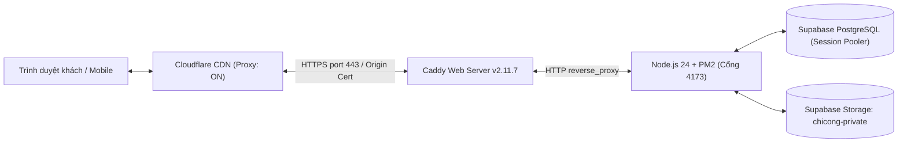

# Báo cáo chuyển đổi hạ tầng sang Cloud Server iNET — 16/10/2026

> **Biên bản triển khai ngày 16/10/2026:** Website chính thức [chicongphoto.vn](https://chicongphoto.vn) đã chuyển đổi hoàn toàn sang máy chủ ảo riêng (Cloud Server) tại iNET (Việt Nam), giải quyết triệt để vấn đề giới hạn băng thông của Render.

---

## 1. Bối cảnh & Nguyên nhân chuyển đổi

* **Hạ tầng cũ:** Render Web Service (Gói Free / Hobby).
* **Sự cố:** Ngày 16/10/2026, Render gửi email thông báo studio đã sử dụng hết **5 GB băng thông tải ra (Outbound Bandwidth)** miễn phí trong tháng và tạm ngưng (suspended) toàn bộ dịch vụ.
* **Nguyên nhân cốt lõi:** Website nhiếp ảnh có lưu lượng ảnh lớn (hơn 1.190 ảnh và các bộ album khách). Render làm trung gian truyền tải trực tiếp ảnh tới trình duyệt mà không được Cloudflare cache, khiến 5 GB bị cạn kiệt rất nhanh.
* **Quyết định đầu tư:** Chủ studio quyết định đầu tư gói **Cloud Server Linux 2 (2 GB RAM) trong 3 năm** tại nhà cung cấp **iNET** (Việt Nam) để có máy chủ riêng, băng thông không giới hạn và tốc độ tải trang nhanh nhất.

---

## 2. Thông số kỹ thuật máy chủ mới

| Hạng mục | Chi tiết cấu hình |
| :--- | :--- |
| **Nhà cung cấp** | iNET Software Co., Ltd (Việt Nam) |
| **Gói dịch vụ** | Cloud Server Linux 2 (Thời hạn 3 năm: 16/10/2026 – 16/10/2029) |
| **Địa chỉ IP** | `103.56.162.182` |
| **Cổng SSH** | `24700` (đổi từ cổng 22 để chống quét brute-force) |
| **Hệ điều hành** | Ubuntu 24.04 LTS (x86_64, Kernel 6.8.0-generic) |
| **Phần cứng** | 1 vCPU, 2 GB RAM vật lý + **2 GB Swap RAM ảo trên SSD** (2 GB RAM vật lý; swap không tương đương RAM) |
| **Băng thông mạng** | **200 Mbps trong nước, không giới hạn lưu lượng truy cập** |
| **Vị trí đặt máy chủ** | Hà Nội IDC (Viettel / VNPT) |

---

## 3. Kiến trúc phần mềm & Cấu hình triển khai



### 3.1. Thư mục ứng dụng
* Đường dẫn mã nguồn: `/var/www/chicongphoto`
* Môi trường thực thi: **Node.js v24.22.0 LTS** & **npm 11.x**
* Quản lý tiến trình: **PM2** (`chicong-photo`), được đăng ký dịch vụ `systemd` (`pm2-root.service`) tự động khởi động cùng hệ thống khi máy chủ khởi động lại.

### 3.2. Web Server & Tối ưu mạng (Caddy)
* File cấu hình: `/etc/caddy/Caddyfile`
* Lắng nghe cổng `80` (HTTP) và `443` (HTTPS) với chuẩn nén **Gzip** và **Zstandard (zstd)**.
* Chuyển tiếp lưu lượng (Reverse Proxy) vào ứng dụng nội bộ tại `http://127.0.0.1:4173`.

### 3.3. Chứng chỉ bảo mật SSL/TLS
* Sử dụng **Cloudflare Origin CA Certificate**:
  * Chứng chỉ: `/etc/caddy/chicongphoto.crt`
  * Khóa riêng tư: `/etc/caddy/chicongphoto.key`
  * Thời hạn bảo mật: **15 năm** (hết hạn ngày 12/10/2041).
  * Chế độ mã hóa Cloudflare: cần đối chiếu chế độ thực tế; không coi Full và Full (Strict) là tương đương về xác thực origin.

### 3.4. Tường lửa máy chủ (UFW Firewall)
Chỉ cho phép 3 cổng thiết yếu, chặn mọi truy cập trái phép khác:
* `24700/tcp`: Quản trị SSH từ xa.
* `80/tcp`: Lưu lượng Web HTTP.
* `443/tcp`: Lưu lượng Web HTTPS bảo mật.

### 3.5. Biến môi trường (`.env` trên VPS)
File `/var/www/chicongphoto/.env` cấu hình:
* `PORT=4173`
* `NODE_ENV=production`
* `SITE_URL=https://chicongphoto.vn`
* `TRUST_PROXY=1`
* `DATABASE_URL`: Kết nối Supabase PostgreSQL qua SSL `verify-full`.
* `NODE_EXTRA_CA_CERTS=/var/www/chicongphoto/certs/supabase-root-2021.crt`
* `SUPABASE_URL`, `SUPABASE_SERVICE_ROLE_KEY`, `SUPABASE_BUCKET=chicong-private`.
* `RESEND_API_KEY`, `NOTIFICATION_EMAIL`, `EMAIL_FROM`.
* `GOOGLE_CALENDAR_ICS_URL`, `GOOGLE_CALENDAR_INCLUDE_FREE=true`.

---

## 4. Kết quả nghiệm thu thực tế (Smoke Test)

Ngày 16/10/2026 21:22 GMT+7, đã kiểm tra kết nối từ bên ngoài qua internet:

1. **Kiểm tra Health API:**
   ```bash
   curl -fsS https://chicongphoto.vn/api/health
   # Kiểm body kỳ vọng: {"ok":true}; -I chỉ lấy header, không kiểm body.
   ```
2. **Kiểm tra Trang chủ:**
   ```bash
   curl -I https://chicongphoto.vn/
   # Trả về: HTTP/2 200 OK (HTML 17.4 KB, Content-Type: text/html)
   ```
3. **Kiểm tra API danh mục Album:**
   ```bash
   curl -I https://chicongphoto.vn/api/portfolio
   # Trả về: HTTP/2 200 OK (Dữ liệu 91.3 KB JSON)
   ```
4. **Kiểm tra Tải ảnh từ Storage:**
   ```bash
   curl -I https://chicongphoto.vn/media/60a6cd7a221d5a122f8e94653d9a7d76?size=thumb
   # Trả về: HTTP/2 200 OK (Content-Type: image/webp)
   ```
5. **Kiểm tra Trang quản trị:**
   ```bash
   curl -I https://chicongphoto.vn/admin
   # Trả về: HTTP/2 200 OK
   ```

---

## 5. Hướng dẫn kết nối SSH & Quản trị nhanh

Máy tính đã được cấu hình SSH key chuyên dụng (`~/.ssh/id_ed25519_chicong_vps`) và bí danh `chicong-vps`. Bạn có thể kết nối ngay chỉ bằng một lệnh:

```bash
ssh chicong-vps
```

*(Hoặc kết nối trực tiếp: `ssh -p 24700 root@103.56.162.182`)*

### Các lệnh thường dùng trên VPS:
* **Xem trạng thái website:** `pm2 status`
* **Xem log hoạt động realtime:** `pm2 logs chicong-photo`
* **Khởi động lại website:** `pm2 restart chicong-photo`
* **Xem tài nguyên máy chủ:** `free -h` (xem RAM) hoặc `htop` (xem CPU)
* **Khởi động lại Caddy web server:** `systemctl restart caddy`
* **Kiểm tra nhật ký Caddy:** `journalctl -u caddy -n 50 --no-pager`

---

## 6. Chuẩn bị release VPS — cập nhật theo source 17/10/2026

Script hiện tại dùng `npm run deploy:vps -- --stage` để upload release riêng và cài dependencies; chưa kích hoạt production. `npm run deploy:vps` không tham số bị từ chối. Xem `node scripts/deploy-vps.mjs --help` để đọc quy trình; lệnh help không kết nối VPS.

PM2 chạy app fork, nên activation có gián đoạn ngắn. Mô tả deploy tự động/zero-downtime trước đây không còn áp dụng. Cần lease/drain, dừng worker và runner cũ, backup DB + media đã verify, migration một owner với Drive tắt, rồi cập nhật web/worker/backup cùng revision. Giữ env/secret/data và rollback revision tương thích schema. Chi tiết ở [script hiện tại](../scripts/deploy-vps.mjs) và [handbook cập nhật](handbook/04-cap-nhat-du-an-2026-10-17.md).

---

## 7. Cơ chế Sao lưu Cơ sở dữ liệu Tự động (Automated Daily Backup)

Để bảo vệ toàn vẹn dữ liệu album, khách hàng và danh mục ảnh:

* **Công cụ sao lưu:** `/var/www/chicongphoto/scripts/backup-db.sh`
* **Phiên bản PostgreSQL Client:** `postgresql-client-17` chính thức từ PostgreSQL PGDG repo (khớp hoàn toàn với phiên bản PostgreSQL 17 của Supabase).
* **Chứng chỉ CA:** Tự động sử dụng chứng chỉ gốc Supabase tại `/root/.postgresql/root.crt`.
* **Lịch sao lưu tự động (Cron job):** Chạy hàng ngày vào lúc **03:00 AM (giờ Việt Nam)**:
  ```bash
  0 3 * * * /var/www/chicongphoto/scripts/backup-db.sh >> /var/log/chicong-backup.log 2>&1
  ```
* **Nơi lưu trữ backup:** `/var/backups/chicongphoto/db_YYYYMMDD_HHMMSS.sql.gz` (phân quyền `0600` chỉ root đọc được).
* **Chính sách lưu trữ (Retention):** Tự động dọn dẹp các bản sao lưu cũ hơn 14 ngày.
* **Lệnh chạy thủ công từ máy tính:**
  ```bash
  npm run backup:db
  ```
* **Lệnh tải file backup về máy cá nhân:**
  ```bash
  scp chicong-vps:/var/backups/chicongphoto/db_*.sql.gz ./
  ```

---

## 8. Cache ảnh — đính chính 17/10/2026

Không áp rule cache toàn bộ `/media/*` kèm override TTL. Route này phục vụ cả ảnh công khai và riêng tư; source kiểm quyền và trả `private,no-cache` hoặc `private,no-store`. Cache theo prefix có thể làm response được phục vụ mà không đi qua kiểm quyền hiện hành.

Thiết kế cache public cần phân tách đối tượng được cache, cache key và cơ chế vô hiệu khi album đổi trạng thái/ảnh thay thế. Chưa có bằng chứng nghiệm thu thiết kế đó. Nếu rule cũ đã được áp dụng, cần kiểm tra cấu hình thực tế và xử lý cache còn lưu; lượt chuẩn hóa tài liệu này chưa đọc hoặc thay dashboard Cloudflare. Không cam kết latency 10–20 ms từ cấu hình cache.

---

## 9. Biên bản Thanh lý & Dọn dẹp Hạ tầng cũ (Render)

* **Trạng thái:** Dịch vụ Web Service `chicong-photo-studio` trên Render đã được xóa bỏ hoàn toàn.
* **Bảo mật:** Biên bản ghi đã xóa web production cũ; chưa đủ dữ liệu trong tài liệu này để kết luận mọi service/DB staging hoặc credential Render đã được dọn.
* **Chi phí định kỳ:** Giảm về 0 đối với Render; hạ tầng VPS iNET đã thanh toán trọn gói 3 năm.
