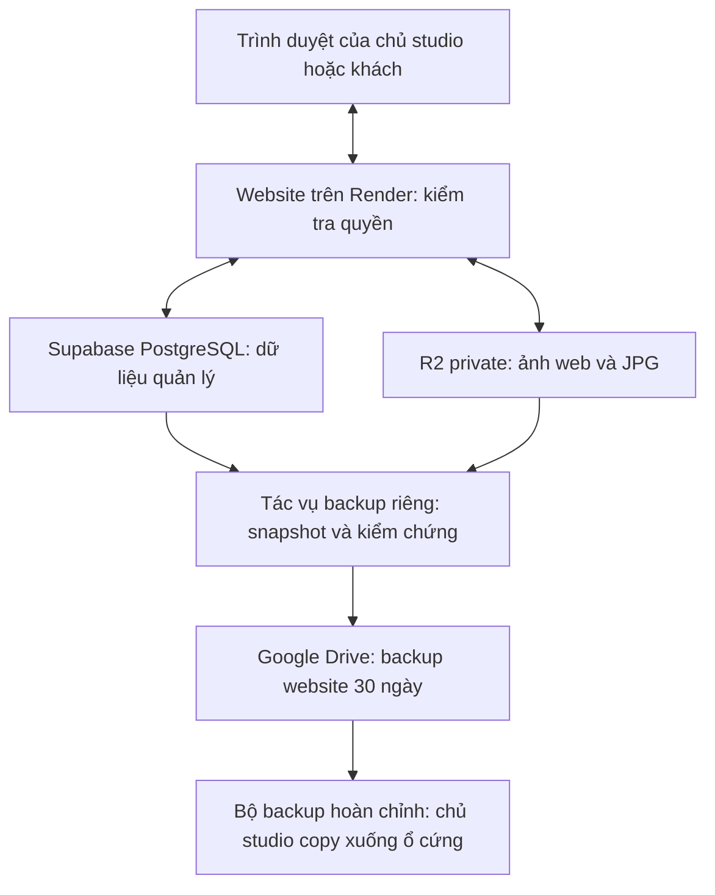

# Kế hoạch triển khai Cloudflare R2 và backup website — ChiCong Studio

**Cập nhật triển khai ngày 16/10/2026, giờ Việt Nam. Source đã triển khai; kiểm thử với R2 thật đã đạt trên bucket riêng bằng ảnh giả. Drive thật đã qua upload/refresh/restore bằng ảnh giả; chưa bật lịch hoặc chuyển production. Xem kết quả local tại mục 16 và cloud tại mục 17.**

Đây là tài liệu chính để chủ website đọc và AI tiếp tục công việc. Nội dung đã hợp nhất kế hoạch, biên bản xác minh, checklist và các câu trả lời của chủ website từ 14–16/10/2026. Ba tài liệu cũ được giữ làm lịch sử, không cần đọc lại để hiểu kế hoạch hiện hành.

Mục 1–15 giữ các quyết định và bằng chứng của giai đoạn lập kế hoạch. Sau khi chủ website yêu cầu triển khai, source đã được cập nhật theo mục 16; tài nguyên cloud thử được ghi tại mục 17. Các số liệu ở mục 14 vẫn là kiểm thử lịch sử; không dùng chúng thay cho kết quả triển khai mới. Chưa đăng ký gói trả phí mới, bật lịch chạy hoặc thay đổi production.

**Cách đọc:** chủ website ưu tiên mục 1–4, 9 và 13; người triển khai đọc toàn bộ, đặc biệt mục 5–12 và 14. “Đã chốt” là lựa chọn của người dùng; “đã kiểm chứng” luôn đi kèm phạm vi/baseline; “đề xuất” là hướng triển khai cần thử, chưa phải chức năng đang chạy.

## 1. Quyết định đã chốt — không hỏi lại nếu nhu cầu không đổi

| Nội dung | Quyết định / thông tin đã nhận |
|---|---|
| Quy trình | Review, giải thích và làm rõ trước; chỉ bắt đầu code khi người dùng yêu cầu triển khai |
| Nội dung đợt đầu | Ảnh portfolio và gallery khách; kiểm kê cả ảnh chân dung hiện dùng để giữ chức năng |
| Phiên bản ảnh | Chỉ các bản web/JPG như hiện tại; không bổ sung kho ảnh gốc hoặc RAW |
| Kiến trúc | R2 private; website tiếp tục kiểm tra quyền trước khi trả ảnh; database vẫn ở Supabase, server vẫn trên Render |
| Lượng ảnh mới | Người dùng ước tính dưới 1.000 ảnh/tháng; chưa đo dung lượng trung bình |
| Chi phí | Ưu tiên miễn phí, chấp nhận một ít phí vượt hạn mức; chưa đặt con số, trần hóa đơn hoặc tự dừng upload |
| Thời hạn gallery | Giữ đến khi chủ website chủ động xóa; không tự xóa theo ngày. Ẩn/lưu trữ vẫn chiếm dung lượng |
| Quyền xem | Giữ cách hiện tại: album có mật khẩu thì nhập mật khẩu; không thêm OTP, tài khoản khách hoặc bắt mọi album có mật khẩu |
| Lỗi cấp phiên cũ | Người dùng đồng ý review/cải thiện, đưa thành hạng mục riêng trước nghiệm thu; chưa sửa trong giai đoạn lập kế hoạch |
| Cloudflare | Người dùng mới có tài khoản; chưa kích hoạt R2 |
| Backup ảnh hiện có | Chủ yếu ảnh gốc/ảnh xuất Lightroom trên Google Drive và ổ cứng, copy thành các bản riêng; xóa một nơi không tự xóa nơi kia |
| Backup website mới | Ưu tiên tự động hằng ngày lên Drive, tận dụng hạ tầng hiện có nếu phù hợp |
| Bản website trên ổ cứng | Người dùng copy thêm khi thuận tiện; không yêu cầu tự động có cả Drive và ổ cứng mỗi ngày |
| Drive đích | Gmail cá nhân đã được người dùng chỉ định; còn khoảng 5TB theo người dùng, chưa truy vấn xác minh quota |
| Lịch sử backup website | 30 ngày lịch gần nhất nếu đủ dung lượng; độc lập với thời hạn gallery |
| Ngoài đợt đầu | Video, RAW, CDN public, URL có chữ ký để khách đọc trực tiếp, upload trực tiếp R2, UI restore một chạm |

Danh tính tài khoản Drive cuối cùng được đối chiếu lúc chủ tài khoản cấp quyền, không hard-code email hoặc credentials vào ứng dụng. Không cần hỏi lại loại tài khoản, dung lượng ước tính hoặc thời hạn backup. Có 5TB trên Drive không tăng hạn mức miễn phí của R2 và không đồng nghĩa được tự dùng hết dung lượng đó.

“Giữ đến khi tôi xóa” áp dụng cho dữ liệu hoạt động trên website. Xóa album không tự xóa ảnh gốc trên Drive/ổ cứng hoặc mọi mốc backup website ngay lập tức. Một mốc backup còn trong thời hạn giữ có thể giúp cứu dữ liệu xóa nhầm; không tự phục hồi album lên website.

## 2. Hệ thống hoạt động như thế nào?

### 2.1. Phân biệt database với kho file

| Thành phần | Hình dung trong studio | Nhiệm vụ |
|---|---|---|
| Trình duyệt | Quầy giao dịch | Xem trang, upload, chọn và tải ảnh |
| Website Node.js trên Render | Nhân viên xử lý | Kiểm tra quyền, xử lý ảnh, trả ảnh/JPG/ZIP |
| Supabase PostgreSQL | Sổ quản lý | Album, thông tin ảnh, mật khẩu đã băm, lựa chọn khách, booking và trạng thái tác vụ |
| Supabase Storage hiện tại | Kho file cũ | Giữ nội dung ảnh thực tế |
| Cloudflare R2 dự kiến | Kho file mới | Giữ và trả nội dung ảnh theo yêu cầu có xác thực của server |
| Google Drive backup | Bản lưu để khôi phục | Lưu database tại một thời điểm và các file đúng phiên bản của thời điểm đó |
| chicongphoto.vn | Địa chỉ studio | Tên miền website, không cần đổi cho phương án này |

Database ghi “ảnh A thuộc album B, khách đã chọn”, nhưng không chứa bytes của ảnh A. Vì thế ta thay Supabase Storage bằng R2 mà vẫn giữ Supabase PostgreSQL. Chỉ giữ ảnh gốc hoặc chỉ xuất database đều chưa đủ khôi phục website.

Bucket là một kho; object là file cùng tên khóa và thông tin loại/kích thước. API/SDK là cách server làm việc với kho. Access Key ID và Secret Access Key dành cho server, khác hoàn toàn mật khẩu album và không được gửi xuống trình duyệt. Manifest là danh mục kiểm kê; SHA-256 là mã tính từ nội dung để kiểm chứng bản sao; snapshot là dữ liệu tại một thời điểm; staging là môi trường thử; rollback là quay lại phương án vận hành đã kiểm chứng.



Đường backup là thiết kế dự kiến, chưa hoạt động. Ảnh gốc/Lightroom đang được lưu riêng theo cách người dùng đã có, không bị đưa vào vòng xóa/dọn của hệ thống mới.

### 2.2. Upload, xem và tải ảnh

Upload thường đi qua website: kiểm tra admin → kiểm tra đầu vào → tạo các bản ảnh → ghi kho → ghi database/biên nhận → báo kết quả. Gói `.ccphoto` đã chuẩn bị được kiểm chứng rồi giữ nguyên bytes của các bản hợp lệ, không encode lại. Retry, bỏ qua ảnh trùng tên và ghi đè phải giữ hành vi hiện tại.

Khách gọi URL của website. Server kiểm tra trạng thái album và phiên mở khóa nếu album có mật khẩu, sau đó đọc R2 rồi trả ảnh. Gallery private không đặt mật khẩu hiện cho người giữ link vào; “bucket private” chỉ nói server là bên có quyền đọc kho, không tự biến mọi album thành album có mật khẩu.

Tải ảnh đã chọn và tải riêng một ảnh là hai luồng khác nhau. Tải riêng không bắt buộc ảnh đã được chọn; nhiều ảnh được đóng ZIP theo giới hạn hiện tại. Server kiểm tra lại quyền và, với tải lựa chọn, danh sách ảnh trước lúc gửi. File ZIP tạm được dọn trên server, không lưu lâu dài trong R2.

Không bật `r2.dev`, không gắn domain media public, không cần trình duyệt gọi trực tiếp R2 trong đợt đầu. Do đó không cần cấu hình browser-to-R2 CORS. CORS không thay thế kiểm tra quyền. [Cloudflare CORS](https://developers.cloudflare.com/r2/buckets/cors/)

## 3. Đánh giá phương án và những giới hạn thực tế

| Phương án | Điểm thuận lợi | Giới hạn / đánh đổi | Kết luận cho website này |
|---|---|---|---|
| Giữ Supabase Storage | Ít thay đổi, không cần chuyển kho | Phải kiểm tra gói, dung lượng và egress thực tế; chưa tạo thêm backup website | Là nguồn hiện tại và một lựa chọn quay lại nếu còn đủ chỗ |
| R2 private qua server | Phù hợp kiểm tra mật khẩu hiện có, có dư địa dung lượng Standard miễn phí, R2 không thu egress trực tiếp | Ảnh vẫn đi qua Render; thêm một dịch vụ và công việc migration/backup | Phương án đợt đầu đã chọn |
| R2 public/CDN | Có thể giảm tải server và đưa ảnh gần người xem | Đổi quyền phải xử lý bản public/cache; link trực tiếp có thể bỏ qua kiểm tra của website | Để riêng giai đoạn sau nếu có nhu cầu |

Đây là đánh giá phù hợp với kiến trúc và lựa chọn của chủ website, không phải khẳng định R2 tốt nhất cho mọi hệ thống. R2 tương thích nhiều API S3 nhưng không phải toàn bộ Amazon S3; chỉ dùng các thao tác được hỗ trợ và thử SDK thực tế. [S3 compatibility](https://developers.cloudflare.com/r2/api/s3/api/)

R2 không tự làm CPU encode ảnh nhanh hơn, không bỏ băng thông Render→khách và Render→R2, cũng không giải quyết cơ chế ngủ của Render Free. [Render outbound](https://render.com/docs/outbound-bandwidth), [Render Free](https://render.com/docs/free)

Báo cáo [upload production ngày 14/10](upload-production-diagnostics-2026-10-14.md) từng ghi lỗi 180 giây chưa rõ nguyên nhân cuối cùng. Workspace đã có các thay đổi sau đó; chưa xác minh commit/config production trong review này. Không suy ra lỗi đang còn hoặc đã hết. Cần đo riêng truyền ảnh, encode/kiểm chứng `.ccphoto`, ghi storage, ghi DB trên cùng tập ảnh/cấu hình; không vừa đổi chất lượng/timeout vừa dùng kết quả để chứng minh R2 nhanh hơn.

CDN sau này cần thiết kế riêng việc công bố, ngừng phục vụ và xóa cache khi ẩn album. URL có chữ ký có hạn dùng riêng, đổi mật khẩu trong DB không tự làm mọi URL đã cấp hết hiệu lực. Upload trực tiếp còn cần kiểm tra file, xử lý ảnh và dọn file bỏ dở. Video cần player, định dạng, poster và quyết định chuyển mã; chỉ có R2 chưa cung cấp các chức năng đó. [Public buckets](https://developers.cloudflare.com/r2/buckets/public-buckets/), [Presigned URLs](https://developers.cloudflare.com/r2/api/s3/presigned-urls/)

## 4. Dung lượng và chi phí

Các số nhà cung cấp dưới đây được tổng hợp từ đối chiếu tài liệu chính thức ngày 15–16/10/2026; phải kiểm tra lại trước cấu hình/thanh toán. Chưa kiểm quota hoặc hóa đơn tài khoản thực tế.

R2 **Standard** có 10GB-month lưu trữ, 1 triệu Class A và 10 triệu Class B miễn phí mỗi tháng. Giá vượt mức được công bố: $0,015/GB-month, $4,50/triệu Class A, $0,36/triệu Class B; có quy tắc làm tròn đơn vị tính phí. GB-month là mức sử dụng tính theo thời gian, không đơn giản chỉ nhìn dung lượng ngày cuối tháng. Free tier không áp dụng giống vậy cho Infrequent Access. R2 không thu phí egress trực tiếp; đây không phải trần hóa đơn hay cam kết miễn phí vĩnh viễn. [Giá R2](https://developers.cloudflare.com/r2/pricing/)

Một ảnh mới có ba bản; ảnh cũ có thể chỉ hai WebP. Dự toán dùng tổng bytes các bản, ảnh chân dung, file dư/chờ dọn và bucket thử; không lấy dung lượng ảnh Lightroom làm dung lượng trên R2. Album ẩn/lưu trữ vẫn được tính nếu giữ file.

Ví dụ **minh họa, chưa đo**: tổng các bản trung bình 2MB/ảnh thì 500 ảnh mới/tháng thêm khoảng 1GB, 900 ảnh thêm khoảng 1,8GB. Sau sáu tháng thêm khoảng 6GB hoặc 10,8GB, chưa cộng kho sẵn có. Vì giữ gallery tới khi tự xóa, dưới 1.000 ảnh/tháng vẫn có thể vượt miễn phí. Dùng phép đo để dự toán và cảnh báo, không tự rút ngắn thời hạn gallery.

| Khoản cần tính riêng | Việc cần kiểm tra |
|---|---|
| R2 | Dung lượng trung bình theo thời gian, requests ghi/đọc/list, thử nghiệm và dữ liệu dư |
| Render | Băng thông gửi ảnh cho khách và gửi file mới sang R2; CPU/RAM xử lý ảnh/ZIP |
| Chuyển từ Supabase | Quota egress còn lại, số lượt đọc cho copy/hash/backup/diễn tập |
| Backup | Dung lượng Drive, quota API, thời gian và quota runner, phần lưu tạm và các phiên bản cũ |
| Giai đoạn giữ hai kho | Chi phí nguồn còn giữ, bản mới trên R2 và việc đồng bộ nếu quay lại |

Trước đọc toàn kho, tính số lượt tải nguồn. Ưu tiên runner riêng có nơi lưu bền vững đủ chỗ: đọc một lượt, tính hash trong lúc đọc, tái dùng bản đã kiểm chứng cho copy/diễn tập khi phù hợp; vẫn phải đối chiếu delta cuối. Không chạy copy lớn trên Render đang phục vụ khách và không mặc định quota còn nguyên. [Supabase egress](https://supabase.com/docs/guides/platform/manage-your-usage/egress)

Dùng số liệu nhà cung cấp để đối chiếu hóa đơn; số bytes trong ứng dụng chỉ là ước tính. Budget alert của Cloudflare là cảnh báo usage theo chi phí, không phải giới hạn thanh toán hay cảnh báo đúng mốc 10GB. Chưa chọn ngưỡng/người nhận, chưa tạo cảnh báo. Không tự xây billing phức tạp, tự mua gói hoặc chặn upload khi vượt free tier từ câu “chấp nhận phí nhỏ”. [Cloudflare budget alerts](https://developers.cloudflare.com/billing/manage/budget-alerts/)

## 5. Baseline code và các hành vi phải bảo toàn

### 5.1. Mốc tham chiếu

HEAD được đối chiếu gần nhất: `1ea50e86f78e1de13010c736acdb367b6b35d247`. Đây là code local, không xác nhận production. Khi bắt đầu triển khai phải chốt lại commit cùng mọi thay đổi chưa commit được chọn, ghi hash và bảo toàn công việc đang làm song song.

| Hành vi hiện có | Ràng buộc cho triển khai |
|---|---|
| Upload JPEG/PNG/WebP | Giữ kiểm tra tối đa 20MiB và 40MP; không lưu file nguồn lâu dài |
| Bản dẫn xuất mới | WebP lớn tối đa 2400px, thumbnail 900px, JPG tải tối đa 2400px; giữ chất lượng hiện hành |
| Ảnh legacy | Có thể chỉ hai WebP; tạo JPG từ WebP lớn khi tải. Không coi thiếu JPG legacy là mất file, không hứa phục hồi chi tiết ảnh gốc |
| `.ccphoto` | Kiểm chứng decode/định dạng, kích thước, checksum và giữ nguyên bytes hợp lệ |
| Skip/overwrite/retry | Giữ `photo_upload_receipts`, cơ chế chống trùng và xử lý COMMIT mất phản hồi |
| Overwrite | Giữ photo ID, lựa chọn, bìa, caption, section và thứ tự; đổi `photos.filename`, URL version và ETag theo phiên bản file |
| Tên object | Các key hiện hành theo phần tên 32 ký tự hex với `.webp`, `-thumb.webp`, `-download.jpg`; lấy mapping thật, không suy từ tên gốc hoặc photo ID |
| Xóa | DB transaction xóa tham chiếu và ghi queue; ngừng hiển thị trước, bytes có thể dọn sau; storage lỗi không biến một lần xóa DB đã thành công thành báo “chưa xóa” |
| Download | Tải riêng một JPG và tải lựa chọn; legacy/new, tên Unicode, thứ tự section, HEAD không đọc bytes, hủy/giải phóng slot và file tạm |
| Giới hạn tải lựa chọn | Hiện 50 ảnh / 100MiB; tối đa 2 job mỗi process và 1 job mỗi album, không trình bày thành giới hạn toàn cụm |
| Portfolio UI tại HEAD này | Đã ẩn nút tải/phóng to trên portfolio, giữ trong gallery; API tải riêng album public vẫn tồn tại. Giữ UI mới, không coi ẩn nút là chặn API |

**`photo.id` không nhất thiết bằng `photos.filename` sau overwrite.** Manifest, backup, delta và rollback đều theo filename hiện hành. `upload_hash`, receipt `file_hash` và `.ccphoto sourceHash` không thay SHA-256 nội dung từng object.

### 5.2. Bản đồ mã nguồn

| File / nhóm | Vai trò cần đọc trước sửa |
|---|---|
| [storage.mjs](../studio/server/storage.mjs), [start.mjs](../studio/server/start.mjs) | Adapter, timeout, cấu hình và kiểm tra startup |
| [app.mjs](../studio/server/app.mjs), [db.mjs](../studio/server/db.mjs) | Quyền, routes, transaction, schema, phiên, khởi động worker, export |
| [photo-upload.mjs](../studio/server/photo-upload.mjs), [prepared-photo.mjs](../studio/server/prepared-photo.mjs) | Upload, overwrite, receipts, kết quả ghi chưa rõ, package |
| [photo-deletion.mjs](../studio/server/photo-deletion.mjs) | Queue cleanup, retry và điều phối worker |
| [gallery-download.mjs](../studio/server/gallery-download.mjs), [gallery-selection.mjs](../studio/server/gallery-selection.mjs) | Tải JPG/ZIP, lựa chọn, kiểm tra lại quyền; không có module server riêng tên photo-download.mjs |
| [request-security.mjs](../studio/server/request-security.mjs), [main.js](../studio/web/main.js) | Bảo vệ request, UI, cache/version, thông báo export |
| [package.json](../package.json), [package-lock.json](../package-lock.json) | Dependencies, scripts và phiên bản SDK sẽ khóa |
| [check.yml](../.github/workflows/check.yml) | CI test hiện có; chưa có workflow backup |
| [README](../README.md), [OPERATIONS](../OPERATIONS.md), [HOSTING](../HOSTING.md) | Cấu hình, vận hành, hosting cần cập nhật sau triển khai |

Adapter hiện có `init`, `put`, `get(name, { signal })`, `remove`, `cloud`. Việc chọn storage hiện liên quan `SUPABASE_URL`; production startup còn yêu cầu cấu hình Supabase. Phải kiểm lại mã mới rồi chuyển sang lựa chọn rõ `local/supabase/r2`, vì Supabase database vẫn được giữ khi bỏ Supabase Storage. Không tự rơi về local/ổ tạm nếu cấu hình production thiếu.

`createApp/openDatabase` không phải công cụ chỉ đọc: có thể chạy migration/defaults/worker. Kiểm kê phải dùng kết nối đọc riêng, không khởi động app với DB thật để “xem thử”.

## 6. Những phát hiện review phải xử lý hoặc giữ đúng giới hạn

| Mã | Phát hiện | Yêu cầu trong kế hoạch |
|---|---|---|
| V01 | `photo_cleanup` không có provider/bucket; worker dùng adapter đang chọn và tự khởi động | Drain đúng nguồn, queue rỗng và dừng worker trước đổi provider |
| V02 | Client ngắt hoặc `server.close` không chứng minh handler hết ghi | Khóa bền vững, mọi process tuân thủ, đếm tác vụ thực và đối chiếu kết quả chưa rõ |
| V03 | Bucket thử riêng nhưng DB thật vẫn gây sửa/xóa dữ liệu thật | Tách DB/schema, bucket, secrets, worker, email/calendar; restore riêng |
| V04 | ID ảnh không đổi khi filename thay | Manifest và delta theo mapping hiện hành, gồm thêm/thay/xóa/portrait |
| V05 | Unlock cũ có thể cấp phiên hợp lệ sau đổi mật khẩu | Sửa riêng và test thứ tự đồng thời trước nghiệm thu quyền |
| V06 | Private album có thể không có mật khẩu | Giữ cả gallery bằng link và gallery có mật khẩu |
| V07 | Có prepared upload, receipts, skip/overwrite và tải JPG riêng | Không thu hẹp kiểm thử chỉ còn upload đơn giản/xem ảnh |
| V08 | Đọc nguồn nhiều lần và outbound vẫn phát sinh | Dự toán trước copy, runner riêng, quota thực tế |
| V09 | Kiểm chứng private và MIME/size không thể suy từ tên provider | Audit đường public và kiểm tra ứng dụng; không áp trần 24MiB tùy ý |
| V10 | GET stream/retry/checksum/PUT chưa rõ kết quả cần thử R2 thật | SDK pin, deadline toàn thao tác, abort, đối chiếu ghi chưa xác định |
| B01 | Dump DB và copy media độc lập có thể tạo backup thiếu file | Snapshot nhất quán, bảo vệ mọi bytes được tham chiếu, không công bố bản lỗi |
| B02 | JSON export hiện tại không phải backup toàn website | Xây quy trình DB + media + manifest + restore độc lập |

Bằng chứng V01 local: nguồn có 3 object, đích rỗng, queue 1 job. Chạy worker bằng adapter đích làm queue về 0 nhưng nguồn vẫn 3 object. Không tự hiện lại ảnh do DB record đã mất, nhưng mất việc dọn kho nguồn. Worker xử lý theo lô 24; phải test nhiều hơn một lô. Không xóa job để ép queue rỗng. Ghi provider/bucket vào job là phương án thay thế cần thiết kế nếu muốn đổi khi còn queue, chưa có trong baseline.

Upload lỗi có thể đánh thức worker qua callback `onCleanup` và cũng có đường xóa trực tiếp khi rollback. Chỉ tạm dừng worker không bảo vệ được mọi thao tác xóa bytes. Cần phối hợp cả handler và đường rollback trực tiếp trong migration/backup.

### 6.1. Lỗi mật khẩu và hướng sửa nhỏ

Thứ tự đã tái hiện: unlock đọc mật khẩu cũ → admin đổi mật khẩu và xóa phiên → unlock cũ tiếp tục ghi phiên mới → phiên đó đọc ảnh được. Tại HEAD `1ea50e8`, UPDATE mật khẩu và DELETE sessions **đã nằm trong transaction**, có khóa album ở PostgreSQL; luồng unlock chưa tham gia cùng cơ chế. Chỉ thêm transaction cho PATCH không giải quyết được lỗi này.

Đề xuất: đọc trạng thái/mật khẩu hiện hành, kiểm tra và ghi phiên trong cơ chế transaction/khóa album thống nhất với đổi mật khẩu; chỉ trả cookie sau commit. Nếu unlock hoàn tất trước, đổi mật khẩu phải vô hiệu phiên đó; nếu đổi trước, mật khẩu cũ không được cấp phiên hợp lệ. Bổ sung test có điều khiển thứ tự trên SQLite và PostgreSQL, bao gồm bật mật khẩu từ album trước đó không có mật khẩu. Sửa tiêu đề album đơn thuần không được vô tình thu hồi phiên.

Giữ logic truy cập: admin có quyền; published công khai; private không mật khẩu mở bằng link; private có mật khẩu cần phiên đúng album; draft/archived chặn khách thường. GET/HEAD, ETag và cache phải đi qua đúng kiểm tra quyền hiện hành, không để phản hồi 304/cache dùng sai quyền.

Giới hạn cần nói rõ: request media đã được cho phép và đang đọc có thể kết thúc sau khi đổi quyền; request mới dùng phiên cũ phải bị chặn. JPG/ZIP có bước kiểm tra lại trước gửi nhưng không đảm bảo chặn nguyên tử mọi thay đổi trong lúc truyền. Không thể thu hồi file khách đã nhận. Mục tiêu sửa lỗi là không cấp phiên mới còn hợp lệ từ dữ liệu mật khẩu lỗi thời, không thêm hệ thống đăng nhập phức tạp.

## 7. Thiết kế kỹ thuật cần triển khai

### 7.1. Adapter và xử lý lỗi

- Chọn provider tường minh; giữ database bền vững và validate cấu hình riêng từng provider. Khi chuyển R2 không bắt buộc credentials Supabase Storage chỉ vì DB vẫn là Supabase; không fallback sang ổ tạm hoặc đọc Supabase để che lỗi R2.
- Pin phiên bản `@aws-sdk/client-s3` đã thử; region `auto`, endpoint tài khoản/jurisdiction phù hợp, credentials tường minh. Runtime không tự tạo/xóa bucket và không dùng nhầm AWS credential chain.
- Giữ contract `init/put/get/remove/cloud`; `remove` an toàn khi object đã không tồn tại. Phân biệt lỗi cấu hình, quyền, file thiếu, timeout và lỗi mạng bằng thông báo/log đã làm sạch.
- GET hiện có ngân sách 30 giây làm baseline. Deadline tổng phải bao gồm kết nối, retry và đọc hết body; tín hiệu hủy đóng stream, giải phóng slot/file tạm. Không nhân thời gian tổng ngoài ý muốn theo số retry.
- Retry hữu hạn cho lỗi phù hợp; không lặp lỗi quyền/validation hoặc tạo writer cạnh tranh cùng key. Thử checksum mặc định của SDK đã chọn với R2 thật, không tắt checksum do phỏng đoán. [Cloudflare JS SDK](https://developers.cloudflare.com/r2/examples/aws/aws-sdk-js-v3/), [AWS checksums](https://docs.aws.amazon.com/sdk-for-javascript/v3/developer-guide/s3-checksums.html)
- Kiểm tra key, MIME/nội dung thật, input 20MiB/40MP và output tương thích dữ liệu đã kiểm kê. `24MiB` trong cấu hình Supabase là mức nâng tối thiểu, vẫn giữ cấu hình lớn hơn/unlimited; không chứng minh mọi file cũ dưới mức đó. R2 không tự thay chính sách MIME/size của Supabase. Chưa cần multipart chỉ để chuyển các ảnh này. [R2 limits](https://developers.cloudflare.com/r2/platform/limits/)

PUT timeout/abort có thể đã hoặc sẽ hoàn tất ở provider. Một HEAD trả 404 ngay sau timeout chưa chứng minh thao tác đã kết thúc mà không ghi. Giữ trạng thái chưa xác định, đối chiếu key/checksum và DB/receipts trước khi retry hoặc dọn. COMMIT mất phản hồi cũng không chứng minh DB chưa ghi; không xóa bytes DB còn tham chiếu. Phải theo dõi những trường hợp này qua restart và giải quyết trước khi chốt snapshot/cutover, không chỉ đếm HTTP handler về 0. [R2 consistency](https://developers.cloudflare.com/r2/reference/consistency/)

### 7.2. Khóa thay đổi media và kiểm soát worker

“Khóa media” là tạm ngừng thao tác thay đổi ảnh, không phải thêm mật khẩu gallery. Trạng thái phải lưu bền vững qua restart, dùng chung giữa các process và chỉ cho tác vụ đúng quyền điều khiển; mọi đường ghi phải kiểm tra cùng cơ chế để tránh lọt thao tác giữa kiểm tra khóa và đăng ký tác vụ.

Phạm vi gồm upload thường/package, overwrite, xóa một/nhiều ảnh/album, portrait và thay tham chiếu portrait trong settings, các thay đổi metadata liên quan snapshot. Theo dõi handler thực sự, kể cả khi client đã bỏ cuộc; đợi rollback trực tiếp và worker. Có ID/chủ sở hữu/deadline của lượt vận hành, cách khôi phục khi runner chết và cách ngăn runner cũ tiếp tục công bố sau khi mất quyền giữ khóa. Tên bảng/cấu trúc cụ thể do triển khai chọn và kiểm thử, chưa coi đã tồn tại.

Cổng chuyển provider chỉ đạt khi: mọi instance đều hiểu khóa, không còn writer đang chạy, không còn PUT/COMMIT chưa xác định liên quan, queue nguồn rỗng và worker đã dừng. Không chứng minh được thì dừng chuyển, giữ nguồn hiện tại và báo trạng thái; không bỏ queue hoặc tự mở ghi để vượt bước.

### 7.3. R2 và staging

Bucket thử và thật tách riêng, Standard, private; ghi region Render trước khi chọn vị trí. Automatic/location hint là gợi ý, không cam kết gần khách hay nhanh nhất; đường Render↔R2 cần đo. [Data location](https://developers.cloudflare.com/r2/reference/data-location/)

Runtime dùng Object Read & Write chỉ cho bucket cần dùng. Kiểm tra control plane bằng Dashboard hoặc credential chỉ đọc riêng: `r2.dev` tắt, không custom domain public, không Worker/route có sẵn vô tình phát ảnh. Thử object vô hại chắc chắn tồn tại qua từng đường đã cấu hình. Bucket root không liệt kê hoặc S3 có xác thực thành công không đủ chứng minh private. [R2 tokens](https://developers.cloudflare.com/r2/api/tokens/), [Public access](https://developers.cloudflare.com/r2/buckets/public-buckets/)

Staging phải tách DB/schema, credentials, bucket, dữ liệu thử, worker và tích hợp gửi email/calendar. Không kế thừa `.env` production. Restore vào đích riêng, worker tắt tới khi kiểm chứng mapping/queue đúng đích. Quyền runtime website không được xóa kho backup. Secrets chỉ nhập vào nơi quản lý của server/runner; Git/tài liệu chứa placeholders, không in secret/cookie/URL có thông tin xác thực ra log.

## 8. Quy trình kiểm kê và chuyển kho

### 8.1. Kiểm kê trước khi copy

Chốt baseline ứng dụng và đối chiếu commit/config production qua quyền truy cập phù hợp. Lấy danh mục bằng đường đọc riêng cho mọi trạng thái album, ảnh legacy/mới và portrait trong settings. Đối chiếu file thiếu/dư, queue cleanup, dung lượng, số object, quota nguồn/đích và chi phí đọc trước khi tải toàn kho.

Manifest phải có: snapshot/run ID; album ID; photo ID; filename hiện hành; object key và vai trò từng bản; Content-Type/metadata cần thiết; bytes; SHA-256 nội dung; provider/bucket nguồn/đích; trạng thái copy/verify và thời điểm. Portrait có tham chiếu riêng. File chờ cleanup hoặc không được tham chiếu được báo riêng, không tự xóa trong inventory.

Backup đầy đủ và khả năng restore cần sẵn sàng trước cutover. DB phải có schema/dữ liệu cần thiết, receipts, quyền/phiên và queue tương ứng; media đúng snapshot. Snapshot có sessions để đầy đủ không đồng nghĩa được kích hoạt lại sessions cũ khi restore.

### 8.2. Runbook chuyển có điểm dừng rõ ràng

| Bước | Thực hiện | Điều kiện đi tiếp / dừng |
|---|---|---|
| 1. Bản tương thích | Triển khai bản hiểu Supabase + R2, upload/receipts hiện tại, khóa/drain nhưng vẫn chọn Supabase | Mọi instance hiểu khóa; giữ bản này làm đích rollback code |
| 2. Backup và diễn tập | Có bộ DB/media/manifest đầy đủ, thử restore riêng và phương án rollback | Chưa restore đạt thì chưa chuyển thật |
| 3. Copy nền | Runner riêng, giữ key/bytes/Content-Type; đích rỗng hoặc được quản lý bởi manifest cùng đợt | Retry hữu hạn, concurrency giới hạn, có resume; key khác nội dung/không rõ nguồn phải báo, không ghi đè tùy ý |
| 4. Verify đích | Đối chiếu toàn bộ file cần dùng bằng bytes + SHA-256 | Không dùng ETag mặc định làm checksum mọi kiểu upload; thiếu/sai thì sửa trước |
| 5. Khóa và drain | Bật khóa bền vững; đợi mọi writer/rollback; giải quyết PUT/COMMIT chưa rõ; drain cleanup trên Supabase rồi dừng worker | Writer = 0, unknown liên quan = 0, queue = 0; timeout hoặc job lỗi thì chưa chuyển |
| 6. Snapshot/delta cuối | Lấy DB snapshot và manifest cuối, copy/verify thêm/thay/xóa/portrait, xác minh backup phủ các tham chiếu | Không chỉ so ID, ngày tạo hoặc số lượng; phân loại object thừa và giữ danh mục xóa để đối chiếu nguồn |
| 7. Đổi provider | Giữ khóa qua restart/deploy, chọn R2; worker đích chỉ chạy khi queue/trạng thái đúng | Không để process Supabase cũ và R2 mới cùng nhận ghi; DB hiện hành được giữ |
| 8. Kiểm tra khi còn khóa | Xem ảnh, quyền, portrait, lựa chọn, JPG/ZIP trên website | Không đạt thì quay lại theo mục 10; có thể gián đoạn ngắn khi deploy |
| 9. Ghi thử có kiểm soát | Cửa thử giới hạn người vận hành/album thử; upload thường/package, overwrite/retry | Không mở toàn bộ ghi chỉ để thử; mọi dữ liệu thử mới phải được ghi vào kế hoạch rollback |
| 10. Mở ghi và theo dõi | Chỉ mở sau các kiểm tra đạt; theo dõi storage, queue, upload, backup và chi phí | Lưu báo cáo đủ file và các sai lệch đã giải thích |
| 11. Giữ rồi dọn nguồn | Chọn thời hạn giữ nguồn sau nghiệm thu và xác minh backup | 7–14 ngày chỉ là ví dụ chưa chốt. Không xóa Supabase project vì DB vẫn dùng |

Trong cửa sổ khóa media, booking/lựa chọn có thể tiếp tục ngoài khoảng restart; snapshot dùng cho backup không được đè vào DB hiện hành chỉ để đổi storage. Chưa cam kết không gián đoạn tuyệt đối hoặc thời gian khóa cụ thể; phải đo qua diễn tập. Chỉ dọn object thừa thuộc đợt chuyển sau khi chứng minh không còn cần, không dùng migration để xóa file lạ hàng loạt.

## 9. Backup website hằng ngày, Drive 30 ngày và bản local

### 9.1. Backup đầy đủ phải có những gì?

Một bộ khôi phục gồm snapshot database nhất quán, manifest của chính snapshot đó, toàn bộ bytes được manifest tham chiếu và thông tin phiên bản/hướng dẫn restore. Bao gồm ảnh legacy, các bản bắt buộc của ảnh mới và portrait. Những bảng vận hành như admin, sessions, receipts và cleanup không được bỏ qua chỉ vì không xuất hiện trên giao diện. Khi restore phải xử lý lại trạng thái vận hành và vô hiệu sessions cũ, không bật worker ngay trên dữ liệu vừa nhập.

Endpoint `/api/admin/export` hiện xuất lần lượt tám bảng: `settings`, `albums`, `photos`, `selections`, `inquiries`, `blocked_dates`, `album_slugs`, `album_sections`. Không có bytes ảnh, admin, sessions, receipts hoặc cleanup; các lượt đọc cũng chưa tạo thành một snapshot toàn DB nhất quán. Giao diện đã nhắc phải sao lưu ảnh/admin riêng. Đây là export một phần, chưa phải quy trình backup/restore đầy đủ. Backup database của Supabase cũng không chứa bytes Storage. [Supabase backups](https://supabase.com/docs/guides/platform/backups)

Ảnh gốc/Lightroom trên Drive và ổ cứng rất hữu ích nhưng không chứa mapping album, lựa chọn khách hoặc booking. Giữ nguyên cách backup ảnh nguồn đang có và tạo thư mục backup website riêng, không đồng bộ lệnh xóa website sang kho ảnh gốc.

### 9.2. Nơi chạy và quyền kết nối — đang đề xuất

Ưu tiên một job GitHub Actions trên Linux nếu kiểm chứng phù hợp với hạ tầng hiện có. Repo hiện chỉ có CI test Node 24/PostgreSQL 16, chưa có workflow backup, schedule hoặc script restore. Trước chọn phải kiểm Actions/remote, quota dùng chung của chủ repository, kết nối DB/R2, thời gian chạy, chỗ lưu tạm và quyền Drive. Không dùng Actions artifacts làm kho ảnh lâu dài; không đặt scheduler chỉ trong vòng đời web process Render. [GitHub Actions billing](https://docs.github.com/en/billing/concepts/product-billing/github-actions)

GitHub schedule có thể trễ/bỏ lượt và có điều kiện theo nhánh/trạng thái repository. Cần theo dõi tuổi **bản thành công cuối**, không chỉ nhận thông báo job lỗi: job không khởi động có thể không sinh thông báo lỗi. Có cách chạy bù thủ công. Nếu hạ tầng hiện có không đạt, báo kết quả và phương án thay thế cụ thể trước khi chọn dịch vụ tốn phí. [Schedule limitations](https://docs.github.com/en/actions/reference/workflows-and-actions/events-that-trigger-workflows#schedule)

Drive là Gmail cá nhân, hướng kết nối dự kiến là OAuth do chủ Drive cấp quyền. Ưu tiên `drive.file` cho file công cụ tạo/quản lý, thêm kiểm tra folder ID; scope này không phải ranh giới quyền riêng một folder. Không mặc định service account sở hữu được kho trong My Drive hoặc cần nâng lên Workspace. Kiểm chứng refresh token hoạt động lâu dài trên runner; cấu hình External Testing có thể khiến refresh token hết hạn sau bảy ngày với các scope này, không phù hợp để bỏ mặc vận hành. Xử lý mất/revoke quyền, không chỉ thử đăng nhập một lần. [Drive scopes](https://developers.google.com/workspace/drive/api/guides/api-specific-auth), [OAuth expiration](https://developers.google.com/identity/protocols/oauth2#expiration)

Tại lần đối chiếu 16/10, tài liệu Drive API nói standard usage không thu phí thêm, đồng thời đề cập kế hoạch tính phí vượt quota trong năm 2026. Kiểm tra lại quota/billing lúc thiết lập, không cam kết API miễn phí mãi hoặc tự bật billing. Khoảng 5TB trống là thông tin người dùng cung cấp, chưa kiểm chứng. [Drive API limits](https://developers.google.com/workspace/drive/api/guides/limits)

Backup chứa dữ liệu khách và dữ liệu xác thực: dùng folder riêng không chia sẻ public, secrets riêng ngoài Git/chat, runtime website không được xóa backup. Nếu chọn mã hóa backup, dùng công cụ/thư viện chuẩn, giữ khóa khôi phục ở nơi chủ website có thể lấy khi mất server/Drive và thử giải mã; không tự phát minh cơ chế mã hóa hoặc lưu khóa duy nhất cùng bộ backup. Quyết định kỹ thuật này cần ghi rõ trong hướng dẫn vận hành, không bắt người dùng chọn thuật toán.

### 9.3. Luồng một lượt backup

1. Tạo run ID, trạng thái và deadline; kiểm chỗ trống dự phòng; không chạy chồng backup hoặc migration. Khóa phải có cách nhận biết chủ sở hữu/mất quyền giữ khóa và phục hồi khi runner chết.
2. Khóa media, đợi mọi handler/rollback thật sự kết thúc và đối chiếu PUT/COMMIT chưa xác định; chờ/dừng cleanup. Chỉ dừng worker không đủ vì có đường xóa trực tiếp của upload thất bại.
3. Lấy snapshot DB nhất quán. Dựng manifest từ **chính snapshot đó**, không ghép dump với danh mục vừa đọc lại từ DB đã thay đổi. Booking/lựa chọn phát sinh sau snapshot thuộc lượt sau.
4. Bảo vệ toàn bộ file snapshot cần cho tới khi sao lưu xong. Chỉ mở lại ghi sớm nếu đã chứng minh key bất biến và mọi đường xóa bytes tuân thủ bảo vệ. Nếu chưa chứng minh được, bản đầu giữ khóa media suốt copy; đo và thông báo thời gian ảnh hưởng, không hứa backup không ảnh hưởng upload.
5. Sao lưu media mới/thay đổi, tái dùng bytes không đổi đã kiểm chứng. Đối chiếu đủ file bắt buộc và checksum; không biến việc xóa ở kho hoạt động thành xóa ngay bản backup. Ghi tiến độ để biết phần chưa hoàn tất.
6. Thiếu file, sai checksum, mất bảo vệ, Drive đầy/mất quyền hoặc quá deadline thì không công bố thành công, không thay con trỏ bản tốt gần nhất. Lượt đã mất quyền giữ khóa không được tiếp tục công bố thành công dù kết nối hồi phục.
7. Chỉ công bố bộ hoàn chỉnh sau khi đủ DB/manifest/media, rồi giải phóng bảo vệ theo cơ chế đã kiểm thử. Runner chết/restart phải có phục hồi trạng thái; không treo quản trị ảnh vô thời hạn hoặc âm thầm bỏ bảo vệ rồi tiếp tục dùng snapshot đó.
8. Dọn lịch sử theo mục 9.4, lưu báo cáo và tuổi bản thành công cuối. Có hướng dẫn chạy lại và diễn tập restore định kỳ phù hợp; lịch/quyền/nhắc việc chưa được bật từ tài liệu này.

### 9.4. Giữ 30 ngày nhưng không nhân cả kho lên 30 lần

Đã chốt **30 ngày lịch gần nhất nếu đủ dung lượng**, không phải luôn có đúng 30 bản thành công. Mỗi mốc giữ DB/manifest; các mốc có thể dùng chung bytes ảnh không đổi. Dung lượng gồm media hiện hành, các phiên bản đã thay/xóa còn được lịch sử cần, DB các mốc, metadata và dự phòng cho lượt đang chạy.

Ví dụ minh họa: 5GB ảnh hiện hành + 1GB các bản cũ còn được tham chiếu + 30 DB mỗi bản 10MB ≈ 6,3GB trước phần dự phòng, thay vì 150GB. Đây chưa phải số đo thực tế hoặc cam kết dung lượng.

Dọn theo thời điểm snapshot và **tham chiếu của những snapshot còn giữ**. File đã một năm tuổi nhưng vẫn được snapshot hôm nay dùng thì không được xóa chỉ vì quá 30 ngày. Chỉ loại bytes không còn mốc được giữ nào cần; ưu tiên dọn sau khi có bản mới hoàn chỉnh. Giữ ít nhất bản tốt gần nhất khi các lượt mới thất bại, kể cả đã quá cửa sổ; báo backup quá cũ thay vì xóa bản tốt cuối.

Cần dự phòng dung lượng để hoàn tất lượt mới trước khi dọn. Nếu Drive đầy, giữ bản tốt trước, báo lỗi và xử lý capacity có kiểm soát; nếu chỉ lặp job mà không giải quyết thiếu chỗ thì nó có thể tiếp tục thất bại. Không tự mua thêm chỗ, xóa gallery, xóa ảnh gốc hay hạ thời hạn đã chốt. Chính sách này chỉ áp dụng bộ backup website, không áp lên R2 hoạt động hoặc kho Lightroom.

### 9.5. Bản copy xuống ổ cứng phải tự khôi phục được

Vì các snapshot có thể dùng chung bytes, tải riêng folder ngày hôm nay hoặc một JSON chưa chắc đủ. Cần công cụ/lệnh xuất một **bộ độc lập** của snapshot thành công đã chọn: DB, manifest, mọi file được tham chiếu kể cả bytes dùng chung từ lần trước, phiên bản ứng dụng/schema và hướng dẫn restore. Mặc định chọn bản thành công mới nhất, không chọn lượt đang chạy; có thể chọn mốc cũ khi cứu dữ liệu.

Tiêu chí đạt: restore vào môi trường riêng bằng bộ local, không lấy file bổ sung từ Drive hoặc R2 nguồn. Nếu mã hóa phải có cách chủ website lấy khóa riêng và giải mã. Người dùng tự copy khi thuận tiện nên bản local có thể cũ hơn Drive. Đợt đầu ưu tiên công cụ/hướng dẫn, chưa thêm UI backup/restore một chạm.

### 9.6. Giới hạn mất dữ liệu và phạm vi khôi phục

Ví dụ backup thành công lúc 03:00, khách chọn ảnh lúc 10:00 và sự cố lúc 14:00: bản 03:00 không chứa lựa chọn 10:00. 03:00 chỉ là ví dụ, chưa phải giờ chạy. Nếu lỡ lịch, khoảng dữ liệu chưa sao lưu có thể hơn một ngày. Lịch daily đã chốt chưa phải cam kết mất tối đa 24 giờ dữ liệu hoặc khôi phục trong một thời gian cụ thể.

| Sự cố | Cách khôi phục dự kiến |
|---|---|
| Thiếu một file, DB đúng | Lấy đúng key/phiên bản sau đối chiếu; không thay cả DB |
| Xóa nhầm album/lựa chọn | Restore snapshot vào môi trường riêng, so với hiện tại rồi lấy phần cần; không đè website về hôm qua |
| Mất DB/kho file diện rộng | Restore trọn bộ đã kiểm chứng, công bố mốc dữ liệu và phần thay đổi sau mốc có thể mất |

Khôi phục một album phải xét ID, slug, bìa, sections, lựa chọn, receipts và cleanup cùng quyền/mật khẩu. Bảo toàn booking/lựa chọn mới còn trong DB hiện hành; không tự merge khi xung đột chưa được giải thích. Không hứa cứu được thay đổi sau snapshot nếu mọi nguồn của chúng đã mất. Không tái kích hoạt sessions cũ; giữ worker tắt tới khi trạng thái phục hồi hợp lệ.

## 10. Rollback khi chuyển kho khác với restore dữ liệu cũ

| Tình huống | Hướng xử lý |
|---|---|
| Chưa có ghi mới, hai kho còn khớp | Giữ khóa, xác nhận trạng thái rồi đổi provider về Supabase và kiểm tra lại |
| Đã có upload/overwrite/xóa trên R2, kể cả ghi thử | Khóa/drain trên R2, đối chiếu unknown writes, xử lý queue đúng R2; đồng bộ mapping hiện hành cùng portrait về nguồn đủ chỗ, gồm thêm/thay/xóa; verify rồi mới đổi |
| Code có lỗi nhưng R2 và dữ liệu đúng | Rollback về bản code tương thích đã kiểm chứng, tiếp tục dùng R2 và DB hiện hành |
| Cần cứu dữ liệu mất/xóa nhầm | Dùng quy trình restore theo mục 9.6, không coi là thao tác đổi provider đơn thuần |

Supabase cũ không tự có ảnh đăng sau chuyển và có thể không đủ chỗ chứa kho đã tăng trên R2. Phải kiểm sức chứa trước khi chọn đồng bộ ngược; nếu không đủ, không mặc định rollback dữ liệu về Supabase là khả thi. Bản rollback code phải hỗ trợ R2, prepared upload, overwrite và receipts hiện hành, không chỉ có adapter.

Giữ DB hiện hành khi rollback storage để không mất booking/lựa chọn mới hoặc làm sống lại ảnh đã xóa. Snapshot trước cutover là tài nguyên khôi phục sự cố, không phải file DB để đè vào mỗi khi đổi provider. Chưa chọn thời hạn giữ nguồn; không dọn nguồn trước khi đủ bằng chứng và quyết định vận hành.

## 11. Thứ tự triển khai và điều kiện hoàn thành

Các giai đoạn dưới đây xác định thứ tự và điều kiện hoàn thành; tiến độ source sau yêu cầu code nằm ở mục 16. Không cần đợi tài khoản cloud hoặc lịch bảo trì để viết phần local, nhưng không được bỏ điều kiện trước thử cloud/chuyển thật.

| Giai đoạn | Đầu ra phải có | Điều kiện hoàn thành |
|---|---|---|
| A. Chốt baseline | Bản source/hash, đối chiếu thay đổi song song, checklist cấu hình/đo hiện trạng | Không dùng test cũ làm chứng nhận code mới |
| B. Quyền và cơ chế điều phối | Sửa race mật khẩu riêng; khóa media/drain/khôi phục khi tác vụ chết, điều khiển worker | Test đồng thời trên SQLite/PostgreSQL; không tăng thao tác cho khách |
| C. Provider R2 | Adapter, startup, secrets mẫu, lỗi/timeout/abort/checksum | Local regression và thử bucket riêng đạt |
| D. Công cụ dữ liệu | Inventory, manifest, copy/resume/verify/delta; dry run và báo cáo | Đầy đủ legacy/new/overwrite/portrait/unknown writes, không ghi nhầm nguồn |
| E. Backup/restore | Snapshot nhất quán, incremental Drive, retention, offline export, theo dõi lần tốt cuối | Thử lỗi, OAuth refresh và restore độc lập đạt; quota/runner phù hợp |
| F. Diễn tập | Chuyển rồi quay lại trên môi trường riêng, cùng smoke test và đo thời gian | Có báo cáo đủ file, chi phí dự kiến, thời gian khóa/restart/restore |
| G. Review bản thử | Người dùng xem luồng thực tế và các điểm còn cần chốt ở mục 13 | Có cửa sổ chuyển, vai trò, tiêu chí dừng/quay lại cụ thể |
| H. Production | Bản tương thích vẫn dùng nguồn → copy → khóa/delta → đổi → kiểm tra → mở | Từng cổng mục 8 đạt, không tự bỏ qua để hoàn thành nhanh |
| I. Theo dõi | Báo cáo sau chuyển, backup đang chạy, lỗi/quota/queue; quyết định giữ/dọn nguồn | Không coi chỉ xem được vài ảnh là nghiệm thu migration |

Có thể tách các phần thành thay đổi nhỏ dễ review. Không nhất thiết đổi schema `photos` để thay kho; trạng thái điều phối có thể cần schema mới. Nếu cần thông báo bảo trì trong admin thì thêm phạm vi UI nhỏ tương ứng, không hứa tuyệt đối không sửa frontend. Chưa ước lượng ngày công hoặc số phút khóa khi chưa kiểm kê/diễn tập.

## 12. Ma trận kiểm chứng trước nghiệm thu

| Nhóm | Tình huống cần kiểm chứng | Điều kiện đạt |
|---|---|---|
| Public và portrait | Home/hero/portfolio/thumbnail/OG, portrait hiện hành và URL cũ sau thay/ẩn | URL hiện có đúng; yêu cầu mới theo quyền mới; giữ UI portfolio hiện tại |
| Gallery | Có/không mật khẩu, chưa mở khóa, cookie album khác, admin, draft/archived | Đúng ma trận quyền, không bắt password cho album đang bằng link |
| Thu hồi quyền/cache | Bật/tắt/đổi mật khẩu, published→private có/không mật khẩu, ẩn/lưu trữ; GET/HEAD/ETag | Không trả dữ liệu/304 trái quyền cho yêu cầu mới; không hứa thu hồi bytes cũ |
| Race mật khẩu | Unlock cũ chồng với đổi mật khẩu theo cả hai thứ tự; no-password→password; sửa title | Không tạo phiên cũ còn hợp lệ; title-only không revoke; SQLite và PostgreSQL |
| Upload | Thường/package, invalid bytes/checksum, skip/overwrite, retry receipt cũ sau overwrite | Không trùng sai; giữ lựa chọn/bìa/caption/section/thứ tự; preview đúng phiên bản |
| Ghi thất bại | Hỏng từng bản ảnh, mất xác nhận COMMIT, PUT timeout rồi ghi trễ, HEAD404 tạm thời | Không báo thành công sai hoặc xóa bytes DB dùng; unknown được theo dõi/đối chiếu |
| JPG/ZIP | Tải một ảnh chưa chọn, tải lựa chọn, legacy/new, Unicode, thứ tự, 50 ảnh/100MiB, slot chung | Quyền/lựa chọn được recheck, HEAD không đọc bytes; giới hạn đúng phạm vi process |
| Hủy tải | Client dừng giữa GET body/ZIP, timeout/retry | Dừng đọc, đóng stream, giải phóng slot và file tạm |
| Provider | Thiếu/sai credentials/bucket, object thiếu, lỗi mạng/quyền, restart | Không fallback local/nguồn cũ; deadline toàn thao tác; log không lộ secret |
| Gate/cleanup | Client ngắt nhưng writer còn chạy, rollback xóa trực tiếp, nhiều process, restart, hơn 24 job, xóa lỗi giữa ba file | Mọi writer tuân thủ; queue đúng kho; unknown=0 trước chuyển; runner chết không treo vĩnh viễn |
| Migration | Mọi trạng thái album, ID khác filename, overwrite giữa copy, delta xóa/portrait, conflict/resume/checksum | Manifest nguồn/đích đúng nội dung, không chỉ khớp số lượng |
| Isolation/private | DB/bucket/email/calendar riêng, restore không cleanup nguồn, runtime không xóa backup; public route audit | Không tác động production; object tồn tại không lộ qua đường public đã cấu hình |
| Backup đồng thời | Snapshot dùng A khi overwrite sang B/xóa A, cleanup/restart, thiếu thumbnail/JPG bắt buộc, mất lease | Đúng snapshot và bytes, không công bố thiếu file hoặc mất bảo vệ |
| Backup vận hành | Drive đầy/mất quyền/refresh hết hạn, runner chết, lỡ lịch, retry; retention 30 ngày có file dùng chung | Giữ bản tốt cuối, phát hiện quá cũ, dọn theo tham chiếu; có chỗ dự phòng |
| Restore/rollback | Restore local không dùng Drive/R2; thiếu file/album/toàn hệ thống; ghi mới sau cutover; nguồn hết chỗ | Không đè DB hiện hành để đổi kho; xử lý xung đột/phiên/queue và giới hạn dữ liệu rõ |
| Thực tế | Browser desktop/mobile, SDK R2 thật, metadata/checksum và tập ảnh đại diện | Local/mock không thay cloud; so tốc độ cùng cấu hình, ghi số đo và giới hạn |

Tận dụng các test hiện có trong `studio/tests/`: `storage`, `prepared-photo`, `photo-management`, `security`, `gallery-download`, `photo-download`, `gallery-selection`. `migration.test.mjs` hiện chủ yếu kiểm schema DB, không thay test chuyển object storage. Chạy kiểm thử phù hợp sau từng thay đổi và các kiểm tra dự án yêu cầu; báo rõ những gì chưa chạy. Nghiệm thu của người dùng không thay thế kiểm chứng dữ liệu/quyền/restore.

## 13. Chủ website cần chuẩn bị, review và trả lời gì?

### 13.1. Trước bắt đầu code

Phạm vi chính đã đủ rõ. Không cần hỏi lại thời hạn gallery, có dùng mật khẩu không, Drive loại gì, dung lượng ước tính hoặc giữ backup bao lâu. Chủ website đọc phần giải thích và chỉ bổ sung nếu có nhu cầu khác; bắt đầu code khi có yêu cầu thực hiện. Chưa cần gửi tài khoản, toàn bộ ảnh khách hoặc chốt lịch chuyển website để viết/test local.

Các lựa chọn như SDK, schema khóa, OAuth và cách dọn bytes dùng chung thuộc trách nhiệm bên triển khai. Không bắt chủ website tự tính request hoặc chọn một số tiền tùy ý để kế hoạch được tiếp tục. Nếu xuất hiện đánh đổi thực tế khác với nhu cầu đã chốt, trình bày bằng số đo và phương án cụ thể rồi mới hỏi.

### 13.2. Việc chuẩn bị theo từng mốc

| Mốc | Chủ website chuẩn bị / quyết định | Bên triển khai phải làm trước |
|---|---|---|
| Thử R2 | Truy cập đúng tài khoản Cloudflare, tự xử lý bước kích hoạt/thanh toán nếu được yêu cầu | Hướng dẫn bucket private, token đúng quyền, nơi nhập secrets và môi trường riêng |
| Thử Drive | Chủ Gmail cấp quyền đúng tài khoản/thư mục, kiểm dung lượng thực tế | Chuẩn bị OAuth/quyền hạn chế, thử refresh và lưu bí mật; không đụng kho ảnh nguồn |
| Kiểm kê thật | Xác định đúng website/dự án đang chạy, dữ liệu nào được dùng diễn tập | Kiểm commit/config/region/quota và ngân sách đọc trước khi tải toàn kho |
| Review bản thử | Thử thao tác studio trên điện thoại/máy tính, xem thông báo khi lỗi/bảo trì | Cung cấp kịch bản, dữ liệu thử, kết quả kỹ thuật/chi phí/thời gian |
| Trước chuyển thật | Chọn cửa sổ, người deploy/quyết định rollback, mức gián đoạn có thể chấp nhận | Đưa kết quả diễn tập và quy trình có điểm dừng cụ thể |
| Vận hành backup | Chọn giờ ít ảnh hưởng, người/kênh theo dõi backup lỗi/quá cũ | Kiểm quota runner, refresh, thời gian copy/restore, cách chạy bù và offline export |
| Sau chuyển | Chọn thời hạn giữ kho cũ và người theo dõi chi phí | Báo cáo đủ file, backup đạt, dữ liệu mới và khả năng quay lại thực tế |

Ảnh thử đại diện là hữu ích khi thử thật: ảnh dọc/ngang, nhiều chi tiết, dung lượng lớn và `.ccphoto` nếu dùng. Test local có thể dùng fixture tự tạo. Không cần gửi secret, số thẻ, DB dump hoặc ảnh khách nhạy cảm qua chat. Không cần bật `r2.dev`, domain media public hay đổi DNS cho phương án này.

### 13.3. Những câu hỏi còn mở — hỏi đúng lúc, không coi đã được trả lời

| Câu hỏi | Khi nào cần chốt / dữ liệu cần có trước |
|---|---|
| Có chấp nhận khoảng dữ liệu chưa backup giữa các lượt daily khi sự cố, hay thực sự cần dày hơn? | Trước đưa backup vào vận hành; đã chọn daily nhưng chưa cam kết mức mất dữ liệu tối đa |
| Khi gặp sự cố, cần phục hồi trong bao lâu để không ảnh hưởng giao ảnh? | Sau diễn tập restore có số đo; chưa có SLA |
| Giờ backup và khoảng khóa admin có thể chấp nhận? | Sau đo lượt đầu/lượt tăng thêm; 03:00 chưa được chọn |
| Ai nhận cảnh báo, kênh nào dùng được và ngưỡng nào cần hành động? | Khi có số đo quota/chi phí/tuổi backup; cảnh báo không phải trần hóa đơn |
| Cửa sổ chuyển thật, người deploy và người quyết định quay lại? | Sau bản thử và diễn tập đạt |
| Giữ Supabase Storage cũ bao lâu, với dung lượng/chi phí nào? | Trước kết thúc cutover; 7–14 ngày chỉ là ví dụ |

Nơi chạy backup là lựa chọn kỹ thuật cần xác minh trước, không phải câu hỏi buộc người dùng chọn nhà cung cấp ngay. Nếu GitHub Actions đáp ứng nhu cầu và quota hiện có thì triển khai theo hướng này trong phạm vi được giao; nếu cần dịch vụ/gói mới, đưa phương án cụ thể để quyết định. Các câu hỏi vận hành trên không ngăn chuẩn bị code local sau khi được yêu cầu.

### 13.4. Những việc chủ website review trên bản thử

- Link album đã gửi vẫn đúng; gallery có/không mật khẩu và thao tác đổi mật khẩu/ẩn/lưu trữ đúng nhu cầu.
- Upload thường/package, thử lại, skip/overwrite hoạt động; ghi đè giữ lựa chọn, bìa, caption, section và thứ tự.
- Khách xem/chọn/tải JPG/ZIP đúng trên điện thoại và máy tính; ảnh cũ và mới đều dùng được; portfolio giữ UI hiện tại.
- Home/portfolio/portrait đúng hình; không âm thầm giảm chất lượng để tạo kết quả tốc độ đẹp hơn.
- Thông báo storage lỗi hoặc tạm khóa media đủ rõ; không báo thành công khi chưa xác nhận đủ dữ liệu.
- Báo cáo chi phí tách số đo với ước tính; biết bản backup thành công cuối, cách lấy bộ local và nhờ khôi phục.

Không yêu cầu chủ website đọc source hoặc tự tính checksum. Bên triển khai chịu trách nhiệm chứng minh tính đúng và báo rõ hạn chế trước tác động production.

## 14. Bằng chứng review và giới hạn xác minh

### 14.1. Những gì đã chạy trước lần hợp nhất

| Mốc | Phạm vi | Kết quả / giới hạn |
|---|---|---|
| Snapshot `0c6a493` + thay đổi chưa commit, ngày 15/10 | Bản sao riêng với hash; Node 24.19.0; sáu file test storage/prepared-photo/photo-management/security/gallery-download/photo-download | **69 pass, 0 fail, 0 skip**, khoảng 8,3 giây. SQLite/local/mock; không phải toàn bộ suite, PostgreSQL, browser hoặc cloud |
| Snapshot trên, fixture riêng | Ba tình huống quyền và queue đổi provider bằng SQLite/Map storage | Tái hiện lỗi/giới hạn có sẵn; chạy thành công script tái hiện không có nghĩa đã sửa lỗi |
| Bản sao HEAD `1ea50e8`, review bổ sung | Chạy lại riêng ba tình huống quyền với Node 24.19.0, SQLite/Map; không đọc `.env`, credentials hoặc dữ liệu khách | Stale unlock vẫn tái hiện; hai request media/portrait đang chạy vẫn hoàn tất, request mới bị chặn. Không chạy lại 69 tests |
| Đối chiếu source mới | So hash 18 file server với snapshot trước | `app.mjs` và `photo-upload.mjs` thay đổi; callback đánh thức cleanup được đọc diff, chưa được coi là đã test |
| Ngày 16/10 và hợp nhất tài liệu | Cập nhật lựa chọn Drive/30 ngày, quy trình backup/restore, loại bỏ câu hỏi đã trả lời | Không chạy thêm kiểm thử ứng dụng, không xác minh production |

Kết quả cụ thể trên fixture mới: ngay sau đổi mật khẩu số session là 0; unlock cũ đang chạy trả 200 và cookie mới đọc media được 200; yêu cầu mới nhập mật khẩu cũ trả 401; có 1 session cũ được tạo trễ. Request media/portrait đã bắt đầu trả 200, yêu cầu mới sau đổi quyền trả 404. Đây là bằng chứng local, không phải bằng chứng khai thác production.

Chưa có: adapter R2, sửa lỗi quyền, khóa/drain đã triển khai, kiểm kê kho thật, thử R2/Supabase/Render thật, quota thực tế, backup Drive đang chạy, diễn tập chuyển/rollback/restore. **69 test cũ không chứng minh những hạng mục này đã hoàn thành.**

### 14.2. Vị trí bằng chứng và cách tái hiện

Bằng chứng nằm dưới `output/r2-plan-verification-2026-10-15/`, đang được Git ignore nên không đảm bảo có trong clone mới. Tài liệu này đã giữ kết quả/cách hiểu cần thiết; không cần mở log để biết phạm vi đã kiểm. Nếu bàn giao sang máy khác, lưu bằng chứng đã làm sạch phù hợp hoặc dựng lại fixture trên baseline mới, không bịa rằng log cũ tồn tại.

| Bằng chứng local | Nội dung |
|---|---|
| [summary.json](../output/r2-plan-verification-2026-10-15/summary.json), [baseline-tests.log](../output/r2-plan-verification-2026-10-15/baseline-tests.log), [snapshot-sha256.json](../output/r2-plan-verification-2026-10-15/snapshot-sha256.json) | Kết quả 69 test và hash snapshot cũ |
| [cleanup-provider-switch-repro.json](../output/r2-plan-verification-2026-10-15/cleanup-provider-switch-repro.json), [script queue](../output/r2-plan-verification-2026-10-15/source/cleanup-provider-switch-repro.mjs) | Nguồn 3 file, đích 0; queue mất job khi worker đổi kho |
| [script auth cũ](../output/r2-plan-verification-2026-10-15/source/auth-race-reproduction.mjs), [log auth cũ](../output/r2-plan-verification-2026-10-15/auth-race-reproduction.log) | Các thứ tự chồng lấn quyền ở snapshot cũ |
| [README chạy lại tại 1ea50e8](../output/r2-plan-verification-2026-10-15/current-auth-review-1ea50e8/README.md), [metadata](../output/r2-plan-verification-2026-10-15/current-auth-review-1ea50e8/metadata.json), [log](../output/r2-plan-verification-2026-10-15/current-auth-review-1ea50e8/auth-race-reproduction.log), [hash](../output/r2-plan-verification-2026-10-15/current-auth-review-1ea50e8/source-sha256.json) | Lần tái hiện riêng trên source mới, không thay chứng cứ cũ |

Fixture dùng dữ liệu tổng hợp và dependencies tương ứng. Với Node 24, chạy từ thư mục `source` chứa bản sao ứng dụng để app tìm đúng web assets. Không thêm `--env-file` hoặc dùng cấu hình production. Ví dụ từ repository root, khi thư mục bằng chứng còn đầy đủ:

```sh
cd output/r2-plan-verification-2026-10-15/current-auth-review-1ea50e8/source
node auth-race-reproduction.mjs
```

Ở `output/r2-plan-verification-2026-10-15/source`, có thể chạy `node auth-race-reproduction.mjs` và `node cleanup-provider-switch-repro.mjs` cho snapshot cũ. Symlink `node_modules` hiện dựa vào dependencies workspace; khi di chuyển cần chuẩn bị dependencies phù hợp. Sau khi sửa lỗi, cần test mới xác nhận hành vi mong muốn, không dùng script khẳng định lỗi cũ làm tiêu chí regression thành công.

## 15. Hướng dẫn bàn giao cho AI triển khai sau này

1. Đọc tài liệu này trước, đối chiếu yêu cầu mới nhất của người dùng. Trạng thái “chưa code” mô tả thời điểm 16/10; nếu người dùng đã yêu cầu thực hiện trong hội thoại tiếp theo, dùng quyền đó, không hỏi lại những lựa chọn đã chốt.
2. Kiểm `git status`, hướng dẫn repository và source hiện tại; không ghi đè thay đổi song song. Chốt baseline gồm các sửa chưa commit được chọn, cập nhật nhận định khi code khác HEAD tham chiếu.
3. Phân biệt lựa chọn sản phẩm đã nhận, hành vi đọc từ code, kết quả test có baseline và tài khoản cloud chưa xác minh. Không biến đề xuất hoặc câu hỏi còn mở thành quyết định của chủ website.
4. Giữ kiến trúc private R2 qua server, Supabase DB, ảnh web/JPG, mật khẩu tùy album, gallery tới khi tự xóa, daily Drive/30 ngày và local copy thủ công. Không tự mở rộng sang video/RAW/CDN/OTP/UI restore.
5. Triển khai theo mục 11, kiểm chứng theo mục 12, giữ các cổng dữ liệu ở mục 8–10. Sửa race quyền riêng, không gán lỗi có sẵn cho R2. Không bỏ qua unknown writes, filename khác ID, cleanup hoặc bảo vệ snapshot chỉ vì test đơn giản đã qua.
6. Chuẩn bị kết quả cụ thể có thể review trước khi yêu cầu quyết định triển khai production. Không coi tài liệu này là lệnh kích hoạt billing, tạo lịch, chuyển dữ liệu hoặc dọn nguồn; đồng thời không hỏi lại quyền đã được người dùng cấp trong phiên làm việc tiếp theo.
7. Cập nhật chính file này khi có quyết định/kiểm chứng mới: ngày, baseline, điều đã làm, test thực sự chạy, hạn chế, cấu hình không bí mật và bước tiếp. Tài liệu cũ chỉ giữ lịch sử; không tạo nhiều bản kế hoạch cạnh tranh.

### Tình trạng đầu ra sau triển khai local

- [x] Phạm vi và các câu trả lời của chủ website được hợp nhất.
- [x] Kiến trúc, phát hiện review, provenance kiểm thử và giới hạn được ghi rõ.
- [x] Quy trình migration/rollback/backup/restore và điều kiện nghiệm thu được đặc tả.
- [x] Source baseline local chốt lại tại `1ea50e86f78e1de13010c736acdb367b6b35d247`; các sửa tài liệu có sẵn được giữ.
- [ ] Commit/config/quota production được đối chiếu trước chuyển thật.
- [x] Sửa race quyền, adapter R2, gate/drain và công cụ dữ liệu được viết/test local; xem phạm vi bên dưới.
- [ ] Cloud/quota/private/SDK và OAuth/runner được xác minh thực tế.
- [x] Backup → bộ offline → restore độc lập và copy/switch local bằng dữ liệu giả đạt.
- [ ] Backup/restore/rollback trên tài khoản cloud riêng đạt, có số đo thời gian/quota thực.
- [ ] Người dùng review bản thử, chốt vận hành và yêu cầu chuyển production.
- [ ] Chuyển thật, theo dõi và quyết định dọn nguồn hoàn thành.

### Nguồn lịch sử

Hợp nhất từ [kế hoạch 14/10](r2-migration-plan-2026-10-14.md), [biên bản xác minh 15/10](r2-plan-verification-2026-10-15.md), [checklist 15/10 và bổ sung 16/10](r2-preimplementation-checklist-2026-10-15.md), cùng các câu trả lời trong cuộc trao đổi. Những câu cũ như “chưa biết dung lượng Drive/chưa chọn retention” đã được thay bằng quyết định hiện hành ở mục 1 và 9.

Các liên kết nhà cung cấp đặt ngay cạnh nhận định tương ứng. Đây là căn cứ thiết kế tại thời điểm review, không thay kiểm tra chính sách/quota/config thực tế lúc triển khai. Khi cập nhật phải ghi ngày xác minh mới và không mang kết quả local sang khẳng định cloud đã đạt.


## 16. Kết quả triển khai local ngày 16/10/2026

Chủ website đã yêu cầu triển khai trong phiên này. Không hỏi lại các quyết định ở mục 1. Code ban đầu không có sửa chưa commit; những sửa chưa commit trong `docs/` là công việc tài liệu có sẵn và được giữ nguyên. Node dùng kiểm thử: **24.19.0**; PostgreSQL 16 chạy trong container riêng trên loopback, mỗi test dùng schema riêng. Không nạp `.env`, không đọc ảnh khách hoặc dùng DB/bucket/email/calendar production.

### 16.1. Phần đã viết

| Nhóm | Kết quả source hiện tại | Giới hạn còn phải xác minh |
|---|---|---|
| Quyền gallery | Unlock đọc lại mật khẩu/trạng thái và INSERT session trong cùng transaction/album lock với PATCH; chỉ gửi cookie sau commit; giữ gallery không mật khẩu và sửa title không revoke | Request đã được cấp bytes vẫn có giới hạn như mục 6.1 |
| Chọn kho | `MEDIA_STORAGE_PROVIDER=local/supabase/r2`; production bắt buộc chọn cloud tường minh; DB vẫn độc lập | Trước deploy tương thích phải thêm `MEDIA_STORAGE_PROVIDER=supabase` trên Render |
| R2 | Pin `@aws-sdk/client-s3` **3.1152.0**; region auto, endpoint/credentials tường minh, không bucket-create hoặc fallback; giữ checksum mặc định SDK; GET gồm cả body trong deadline 30 giây, abort đóng stream; tối đa hai lần thử đọc trong cùng deadline, PUT một lần | Chưa thử R2 thật, location, quyền token, public routes, checksum SDK/metadata hay tốc độ thực tế |
| Khóa media | `media_control`, `media_writers`, `media_writes`, `backup_runs`, có RLS trên PostgreSQL; đăng ký writer và kiểm khóa nguyên tử; theo dõi handler tới khi kết thúc dù client ngắt; dừng ứng dụng đợi writer; worker có thể tắt bằng `MEDIA_CLEANUP_ENABLED=false` | Mọi instance phải chạy bản hiểu khóa; không dùng triển khai cuốn chiếu để cho process phiên bản cũ tiếp tục nhận ghi |
| Unknown writes | Journal ghi trước PUT, giữ pending/unknown/commit_unknown qua restart; chặn cleanup cùng prefix và chặn backup/switch khi chưa đối chiếu; không suy từ HEAD404 | Lệnh xác nhận provider đã kết thúc là thao tác vận hành có chứng cứ, không tự quyết theo thời gian chờ |
| Cleanup/binding | DB gắn với danh tính provider/endpoint/bucket; process kho cũ bị chặn ghi sau switch; queue phải rỗng trước switch; drain nhiều lô; portrait cũ được queue khi thay/xóa tham chiếu | Không dọn nguồn sau migration tự động; vẫn cần quyết định giữ nguồn |
| Công cụ dữ liệu | Inventory không tải bytes, mapping theo filename hiện hành và portrait; backup snapshot DB nhất quán; manifest + SHA-256; copy resume, báo conflict, verify bytes/MIME/size; báo object dư, không tự xóa | Chưa kiểm kê nguồn thật hoặc tính chi phí/quota thực |
| Backup/restore | Khóa media toàn lượt; blobs theo hash dùng chung; bộ offline chứa DB và tất cả blobs; restore vào thư mục mới, reset sessions/queue/locks/journal; không cần R2/Drive nguồn | Restore tự động hiện nhắm local SQLite để diễn tập/cứu dữ liệu; nhập có chọn lọc hoặc phục hồi cloud cần đối chiếu riêng, không tự merge |
| Drive | OAuth Desktop + PKCE/loopback, scope drive.file, refresh token lưu file riêng 0600; kiểm đúng tài khoản và folder do tool tạo, chỉ owner; upload resumable từng object và kiểm bytes tải lại; 30 ngày lịch Việt Nam, giữ bản tốt cuối, dọn theo tham chiếu | Chưa cấp quyền Gmail thật, thử refresh dài hạn, đo quota/thời gian/runner hoặc chọn giờ/cảnh báo |
| Vận hành | CLI `media-ops.mjs`, endpoint admin `media-status`, thông báo 503 tạm khóa; probe-upload chỉ trong draft album có lease; workflow Actions thủ công và lệnh kiểm tuổi backup | Chưa bật schedule; monitor độc lập phát hiện job không chạy/kênh cảnh báo vẫn chờ chốt vận hành |

Backup local/Drive chứa dữ liệu khách và hash xác thực. Bản đầu dùng TLS, folder Drive chỉ chủ sở hữu và quyền local hạn chế; **chưa mã hóa phía client**. Không copy OAuth secrets vào bộ offline. Runtime website không có quyền Drive. Thư mục Drive cho ảnh gốc/Lightroom không nằm trong các lệnh dọn.

### 16.2. Kiểm chứng đã thực hiện

| Lượt | Kết quả | Phạm vi |
|---|---|---|
| Baseline trước sửa | 238 pass, 0 fail, 2 skip / 240 test | SQLite; hai bài PostgreSQL chưa có URL tại lượt baseline |
| Toàn suite sau triển khai chính | 260 pass, 0 fail, 7 skip / 267 test | SQLite; bảy bài chỉ PostgreSQL được skip |
| Toàn suite với PostgreSQL riêng | 274 pass, 0 fail, 0 skip | Có các ca PG hiện hữu và ca mới cho lock/session/backup |
| Sau chỉnh startup/thông báo bảo trì | 29 pass / 29, ở cả lượt SQLite và lượt PostgreSQL | Security, upload-optimization API, backup; kiểm cả 503 có thông báo và client abort |
| Sau bổ sung giữ lease khi backup cuối | 6 pass / 6 trên PostgreSQL | Backup/restore, conflict/resume, unknown PUT, giữ khóa giữa backup và switch |
| Toàn suite cuối cùng | **276 pass, 0 fail, 0 skip trên PostgreSQL**; **262 pass, 0 fail, 7 skip / 269 trên SQLite** | Source bàn giao; bảy bài PostgreSQL được skip ở lượt chỉ SQLite |
| Diễn tập CLI bằng process riêng | Đạt với ba object từ ảnh giả | Lock → controlled upload → drain → backup giữ lease → verify → export → restore local → copy → switch giữ khóa; không xóa nguồn |
| Chromium, dữ liệu giả | Hai smoke script đạt | Gallery có/không password, đổi/bỏ password, chọn/tải; prepared + ảnh thường, checksum/bytes, retry mất response, responsive layout |
| Cấu hình | Syntax JS đạt; Blueprint khớp JSON Schema Render; workflow YAML parse được | Không gọi deploy/sync hoặc chạy workflow GitHub thật |

Log, baseline hash và script diễn tập nằm tại `output/r2-implementation-2026-10-16/` (Git ignore). Các test hồi quy mới nằm trong `studio/tests/` và được CI hiện tại chạy. Test cloud giả lập không được coi là chứng nhận Cloudflare hoặc Google Drive thật. Blueprint được kiểm theo [schema chính thức Render](https://render.com/schema/render.yaml.json); SDK theo [Cloudflare S3 JS](https://developers.cloudflare.com/r2/examples/aws/aws-sdk-js-v3/) và [AWS checksum](https://docs.aws.amazon.com/sdk-for-javascript/v3/developer-guide/s3-checksums.html); OAuth theo [Google drive.file](https://developers.google.com/workspace/drive/api/guides/api-specific-auth) và [offline OAuth](https://developers.google.com/identity/protocols/oauth2/web-server#offline).

### 16.3. Lệnh chạy thử và backup

Chạy từ repository với Node 24 và `npm ci`. Công cụ không tự đọc `.env`. Dùng file env riêng, ngoài Git, và kiểm đúng DB/schema/bucket trước khi chạy. Runner giả định schema đã được bản ứng dụng tương thích khởi tạo; không chạy migration schema trong lệnh inventory/backup. Tên thư mục dưới đây chỉ là ví dụ local.

```sh
npm run media -- help
node --env-file=.env.runner studio/tools/media-ops.mjs inventory --output output/inventory.json
node --env-file=.env.runner studio/tools/media-ops.mjs status
node --env-file=.env.runner studio/tools/media-ops.mjs backup --repository output/website-backup
node studio/tools/media-ops.mjs verify --repository output/website-backup
node studio/tools/media-ops.mjs export --repository output/website-backup --target output/offline-copy
node studio/tools/media-ops.mjs restore --repository output/offline-copy --target output/restored-test
```

`export`/`restore` yêu cầu thư mục đích **chưa tồn tại**. `restore` không đọc `DATABASE_URL` hiện hành và không kết nối R2/Drive. Khởi động bản khôi phục bằng env riêng chỉ local, `DATA_DIR` trỏ đúng thư mục restored, không dùng `npm start` với `.env` production có sẵn. Bộ khôi phục còn cần mã ứng dụng và dependencies tương ứng `appRevision`; không cần bổ sung ảnh từ nguồn.

`backup` mặc định tự lấy/trả lease (1 giờ), giữ khóa media trong toàn lượt copy. Với `--lease`, dùng lease operator hiện hành và **giữ nguyên khóa khi kết thúc**, phù hợp snapshot/delta cuối. Nếu writer chưa drain, unknown hoặc queue lỗi thì không vượt cổng. Deadline hết hoặc process chết thì lock giữ lại để vận hành kiểm tra, không tự mở ghi.

### 16.4. Thử và vận hành Drive

Tạo Google OAuth **Desktop client**, cấu hình consent/scope và nhập client ID/secret vào môi trường riêng. Không gửi refresh token qua chat. Chạy:

```sh
node --env-file=.env.oauth-client studio/tools/drive-authorize.mjs .env.backup-drive
node --env-file=.env.backup-drive studio/tools/media-ops.mjs drive-init
```

Mở URL công cụ in ra, chọn đúng Gmail đích. Tool kiểm OAuth state/PKCE, lấy tài khoản qua Drive API rồi lưu token vào file mới 0600; không in token. Nếu đã đặt `BACKUP_DRIVE_ACCOUNT_EMAIL`, tài khoản phải khớp. `drive-init` tạo thư mục website backup riêng và trả folder ID để thêm vào `BACKUP_DRIVE_FOLDER_ID`; không chỉ tới folder ảnh nguồn. Kiểm refresh token sau khi đóng/mở runner và cấu hình consent trước vận hành dài hạn; External Testing không được mặc định coi là token vĩnh viễn.

Sau khi đã đối chiếu quota, staging và quyền folder:

```sh
node --env-file=.env.runner --env-file=.env.backup-drive studio/tools/media-ops.mjs backup --repository output/website-backup --drive yes
node --env-file=.env.backup-drive studio/tools/media-ops.mjs drive-status
node --env-file=.env.backup-drive studio/tools/media-ops.mjs drive-export --repository output/from-drive
node studio/tools/media-ops.mjs verify --repository output/from-drive
node studio/tools/media-ops.mjs export --repository output/from-drive --target output/drive-offline-copy
```

Có thể chọn `--run ID` khi export/restore để cứu mốc cũ. `drive-status --max-age-hours N` trả exit code 2 khi quá ngưỡng hoặc chưa có bản tốt; `N` cần chốt theo vận hành, không mặc định suy thành SLA 24 giờ. Snapshot có đủ bytes vẫn được giữ nếu việc retention lỗi; runner báo `retention: needs-attention` và exit 2.

Workflow `.github/workflows/media-backup.yml` dùng environment `website-backup`, secrets riêng, concurrency không hủy lượt đang chạy, không upload DB/ảnh lên Actions artifacts, timeout job 50 phút. **Chỉ có workflow_dispatch**. Sau khi chốt giờ ít ảnh hưởng, quota và kênh cảnh báo mới thêm lịch daily cùng monitor độc lập; chính workflow backup không thể tự báo khi scheduler bỏ cả lượt. Ephemeral runner lấy cache từ snapshot Drive trước; cần đo băng thông Drive đọc lại và chỗ trống, chưa khẳng định runner này đủ cho kho thật.

### 16.5. Chuyển kho, ghi thử có kiểm soát và khôi phục khóa

Chỉ thực hiện sau các cổng mục 8–10. File `.env.runner` trỏ kho đang hoạt động. File `.env.target` dùng `TARGET_MEDIA_STORAGE_PROVIDER`, `TARGET_R2_*` hoặc `TARGET_SUPABASE_*`. Không gộp Drive secrets vào website.

```sh
# Copy nền từ backup đã verify, có report riêng cho từng snapshot/đích.
node --env-file=.env.target studio/tools/media-ops.mjs copy --repository output/website-backup --report output/copy-background.json

# Snapshot cuối: giữ khóa xuyên suốt backup, copy/verify và đổi binding.
node --env-file=.env.runner studio/tools/media-ops.mjs lock --lease output/cutover-lease.json
node --env-file=.env.runner studio/tools/media-ops.mjs drain --lease output/cutover-lease.json
node --env-file=.env.runner studio/tools/media-ops.mjs backup --repository output/website-backup --lease output/cutover-lease.json
node --env-file=.env.runner --env-file=.env.target studio/tools/media-ops.mjs switch --repository output/website-backup --report output/copy-final.json --lease output/cutover-lease.json
```

`switch` kiểm mapping hiện hành, reverify bytes/MIME/size ở đích, chặn queue/unknown/writer rồi chỉ đổi binding; **không đè DB**. Sau đó restart toàn bộ instance với provider mới, giữ khóa, kiểm quyền/read/download/portrait. Cập nhật Blueprint cùng provider để lần sync sau không đổi lại. Dữ liệu ngoài manifest ở đích được báo, không bị xóa.

Tạo draft album thử trước cửa sổ khóa. Với env đã trỏ provider hiện hành, `probe-upload --lease output/cutover-lease.json --album ID --file FILE --policy skip|overwrite --upload-key KEY` chỉ cho ghi vào draft album đó; dùng ảnh thường và `.ccphoto`, giữ key khi retry. Lệnh không mở khóa toàn bộ admin. Drain lại sau ghi thử, bổ sung backup/delta và ghi nhận dữ liệu mới vào rollback. Chỉ `unlock --lease ...` sau nghiệm thu cửa thử.

Nếu copy có `pending` sau PUT timeout, lần sau bị chặn dù GET/HEAD trả 404; cần đối chiếu provider và xác nhận thực sự đã hết writer trước khi dùng `--provider-settled yes`. Với journal runtime, dùng `reconcile --lease ... --provider-settled yes`; nội dung khác checksum hoặc file DB dùng đang thiếu vẫn bị chặn. Không tự truyền cờ này trong workflow.

Nếu runner chết: kiểm status; chỉ sau lease hết hạn mới `recover --lease output/recovery-lease.json`. Lệnh cấp lease/generation mới và vẫn giữ khóa; runner cũ không còn quyền publish. Nếu có writer mồ côi, dừng mọi process cũ và xác minh trước `--writers-stopped yes`; sau đó reconcile, drain và unlock bằng lease mới. Không xóa bảng để thoát khóa.

Rollback storage dùng backup/mapping **hiện hành**, kể cả ghi mới sau cutover, copy ngược vào kho còn đủ chỗ và lặp cổng switch. Giữ DB hiện hành. Restore snapshot cũ chỉ dành cho cứu dữ liệu vào môi trường riêng. Không xóa Supabase project hoặc tự dọn kho nguồn.

### 16.6. Các cổng nghiệm thu cloud (trạng thái mới tại mục 17)

1. Kích hoạt R2 bởi chủ tài khoản nếu Cloudflare yêu cầu billing; tạo bucket thử private, kiểm region Render/public routes và nhập secrets đúng nơi. Chạy SDK thật với tập ảnh đại diện, đo dung lượng/request/deadline/checksum và abort/PUT muộn.
2. Cấp OAuth đúng Gmail, xác minh quota/folder/refresh trên runner riêng. Đo backup đầu, lượt tăng thêm, restore offline và dung lượng dự phòng; kiểm tác động giữ khóa media.
3. Đối chiếu production commit/config/quota và inventory thật trước tải toàn kho. Diễn tập chuyển/rollback trên DB/bucket riêng; thử khôi phục thiếu file/album qua môi trường local trước khi merge có kiểm soát.
4. Review bản thử, chốt giờ backup, monitor/nguỡng/người nhận, cửa sổ chuyển và thời hạn giữ nguồn. Sau đó mới bật schedule và thực hiện cutover production.

Các bước này cần quyền tài khoản/bằng chứng cloud còn thiếu; không phải yêu cầu xác nhận lại phạm vi đã chốt. Tại thời điểm kết thúc triển khai local, chưa có tài nguyên cloud; phần tiếp tục dưới đây thay thế trạng thái đó. **Chưa deploy, bật lịch hoặc chuyển/xóa dữ liệu production.**

## 17. Triển khai và kiểm chứng cloud ngày 16/10/2026

### 17.1. Render và bucket R2 thử

Đã chọn workspace Render `chicong-studio` theo xác nhận của chủ tài khoản. Khi đối chiếu baseline, workspace chỉ có web service `chicong-photo-studio`, region Singapore, gói Free, auto-deploy tắt, preview tắt. Sau đó đã tạo staging riêng như mục 17.5. Deploy đang live dùng commit `1ea50e86f78e1de13010c736acdb367b6b35d247`. Chỉ đọc metadata, chưa đổi env, build/deploy hoặc dữ liệu production.

R2 đã được kích hoạt trong tài khoản khi kiểm tra thực tế. Đã tạo bucket **`chicong-staging`**, Standard, vị trí APAC, private: `r2.dev` tắt, không custom domain/CORS; không có quy tắc tự hết hạn ảnh. Quy tắc mặc định hủy multipart upload bỏ dở sau 7 ngày không phải TTL gallery.

Token thử `chicong-staging-validation-2026-10-16` chỉ có Object Read & Write trên bucket thử, hết hạn **23/10/2026**. Credentials được lưu theo xác nhận của chủ tài khoản trong `.env.r2-staging`, quyền 0600, bị Git ignore. Chưa tạo bucket hoặc token production.

### 17.2. Kết quả R2 thật

Script opt-in `studio/tests/r2-live.smoke.mjs` dùng SQLite mới, server HTTP loopback và ảnh tự sinh. Script không mở `DATABASE_URL` hoặc thư mục dữ liệu thông thường. Lệnh thử yêu cầu bucket có thành phần tên `staging`, khớp env và thư mục output chưa tồn tại:

```sh
node --env-file=.env.r2-staging studio/tests/r2-live.smoke.mjs \
  --bucket chicong-staging --output output/r2-live-new-run
```

Lượt đầy đủ `live-r2-04` đạt **9/9 bước**, từ 09:31:37 đến 09:32:01 giờ Việt Nam. Báo cáo: `output/r2-implementation-2026-10-16/live-r2-04/report.json`.

| Kiểm tra | Kết quả |
|---|---|
| SDK thực, HeadBucket, listing, checksum SHA-256/MIME/size | Đạt với SDK/config mặc định đã pin |
| Upload JPEG và `.ccphoto` qua API ứng dụng | Đạt; bytes prepared giữ nguyên |
| Retry biên nhận và overwrite | Không PUT thêm khi retry; overwrite giữ ID/lựa chọn và dọn file cũ |
| Portrait, ảnh cũ chỉ có hai WebP, download JPEG | Đạt |
| Quyền đọc | Chưa unlock nhận 404; đúng phiên đọc được; HEAD không tải object; URL S3 không ký bị từ chối |
| Backup có khóa và lượt tăng thêm | 9 object, 4.966.632 bytes; media write nhận 503; giữ lease đúng; lượt sau không GET lại ảnh |
| Dọn ảnh giả qua ứng dụng | Đạt; bucket còn 0 object |
| Restore offline sau khi đã xóa object nguồn | Khôi phục đúng 3 ảnh, 9 file, 1 lựa chọn; phiên đăng nhập reset; copy sang local khác được verify |

JPEG đầu vào 849.146 bytes; `.ccphoto` 2.045.354 bytes. Trên ảnh texture tự sinh này, prepared lớn hơn JPEG; không dùng nó để suy ra tỷ lệ nén kho ảnh thật. Lượt đầy đủ dùng 12 lời gọi PUT, 25 GET (gồm kiểm file vắng mặt), 3 stat, 2 list, 13 remove; đây là bộ đếm adapter, không phải hóa đơn Cloudflare. Hai upload đầu mất 7,347 giây, bước backup và export 3,323 giây. Đây là phép thử **máy local → R2**, chưa phải đo từ Render Singapore hoặc benchmark trên tập ảnh khách đại diện.

Ba lượt đầu dừng do giả định sai trong script diễn tập: cleanup đã bị tắt, thiếu MIME portrait và dùng route xóa album không tồn tại. Đã sửa script, dọn đúng các key ảnh giả được journal từng lượt và chạy lại thành công; không cần sửa mã runtime ứng dụng cho các lỗi đó. Chưa diễn tập PUT muộn/abort thật ở nhà cung cấp hoặc chuyển/rollback cloud từ service Render riêng.

### 17.3. Google Drive thử đã kiểm chứng

Đã tạo project `chicong-website-backup`, app **ChiCong Website Backup**, External Testing. Chủ tài khoản đã chấp thuận chính sách Google API Services và việc tạo/lưu Desktop client **ChiCong Backup Runner Desktop**. Client ID/secret nằm trong `.env.oauth-client`, quyền 0600, ngoài Git; không được đưa vào website runtime hoặc bộ backup.

Google Drive API đã bật trong project riêng. Consent chỉ khai báo scope `https://www.googleapis.com/auth/drive.file`. Đã cấp quyền đúng Gmail chủ sở hữu và lưu refresh token trong `.env.backup-drive` (0600, ngoài Git). Đã tạo folder `ChiCong website backups` riêng và kiểm API xác nhận chỉ có chủ sở hữu. Phép thử `studio/tests/drive-live.smoke.mjs` đạt 5/5 bước, báo cáo tại `output/r2-implementation-2026-10-16/live-drive-01/report.json`: upload snapshot ảnh giả từ R2, đọc lại checksum, publish lại không thêm upload, tạo phiên OAuth mới và tải về folder local trống, export/restore offline đủ 3 ảnh/9 file/1 lựa chọn và reset sessions. CLI `drive-status` chạy bằng process riêng cũng refresh thành công. Quota thực tế: tổng 5.497.558.138.880 bytes (5 TiB), đã dùng 19.377.272.602 bytes, còn khoảng 4,98 TiB; không thay gói lưu trữ. Snapshot có 8 blob duy nhất và 1 manifest; upload/verify 38,399 giây, tải về/verify với phiên OAuth mới 14,155 giây, restore local 0,170 giây. Đây là số đo tập ảnh giả 4,97 MB từ máy local, chưa đo kho khách thật. External Testing cấp refresh token hết hạn sau 7 ngày đối với scope này; phải xử lý trạng thái phát hành trước vận hành dài hạn. [Google OAuth token expiration](https://developers.google.com/identity/protocols/oauth2#expiration)

### 17.4. Các bước còn lại

1. OAuth/Drive thử đã đạt; còn hoàn tất trạng thái phát hành và kiểm runner dài hạn trước bật lịch.
2. Render→R2 với PostgreSQL riêng đã qua HTTP smoke, redeploy, ảnh lớn, client abort/retry và rehearsal R2→local→R2 có binding thật (mục 17.5). Còn cổng Supabase→R2, đa instance, ảnh khách đại diện và R2 PUT timeout/ghi muộn; không suy từ staging synthetic rằng mọi cổng production đã đạt.
3. Kiểm inventory/quota production và đối chiếu cấu hình thật trước tải toàn kho; review rồi mới chuyển production theo mục 9–10.
4. Chốt giờ backup, kênh/nguỡng cảnh báo, người nhận và cửa sổ chuyển; xử lý token production rồi mới bật lịch tự động.

### 17.5. Staging Render và kiểm thử HTTP

Đã tạo riêng PostgreSQL 16 **chicong-r2-staging-db**, Singapore, Free 1 GB, chặn toàn bộ kết nối ngoài Internet; hạn database thử **15/11/2026**. Web service **chicong-r2-staging**, Free Singapore, dùng nhánh **codex/r2-staging-2026-10-16**, auto-deploy tắt, Node 24.19.0, internal database URL, bucket thử chicong-staging. Không đưa Drive/email/calendar hoặc credentials production vào runtime. SITE_INDEXING=false và ANALYTICS_ENABLED=false; health check /api/health. Credentials staging ở file .env.render-staging 0600 bị Git ignore.

[Draft PR #1](https://github.com/conghc98vn/chicong-studio/pull/1) giữ thay đổi để review, chưa merge. CI đầu tiên tại commit 111ff9c đạt **277/277 tests PostgreSQL**. [Website thử](https://chicong-r2-staging.onrender.com) chỉ chứa dữ liệu tổng hợp; tài khoản quản trị đã được tạo bằng setup token riêng.

Script opt-in studio/tests/render-live.smoke.mjs đạt **6/6 bước**, báo cáo output/r2-implementation-2026-10-16/live-render-01/report.json: health/noindex/analytics, PostgreSQL+R2, JPEG và prepared checksum, retry receipt, private media/HEAD/JPEG, selection qua overwrite, thu hồi session sau đổi mật khẩu, portrait và xóa ảnh. Sau khi kiểm mapping, bật cleanup trên staging rồi redeploy: 2 ảnh và 1 lựa chọn vẫn còn, 6 object cũ đã được xóa, queue/writers/unknown đều 0. Báo cáo tiếp theo: live-render-01/redeploy-report.json.

Tập ảnh 2400×1600, JPEG nguồn 849.146 bytes; bundle prepared 2.045.354 bytes. Trong trace Render Free, encode WebP khoảng 9,9–10,5 giây, thumbnail 1,7–2,1 giây và JPEG 6,5–6,6 giây; kiểm prepared khoảng 1,9 giây. Ghi từng rendition vào R2 khoảng 0,3–0,9 giây. Đây là số đo staging nhỏ, chưa kết luận tốc độ kho khách thật hoặc thay đổi chất lượng ảnh.

Rà soát bổ sung phát hiện route admin viết hoa được Express chấp nhận nhưng chưa vào gate media. Đã tái hiện local, sửa phân loại route không phân biệt hoa/thường và thêm kiểm thử khóa cùng binding cũ. Đồng thời đã tái hiện việc writer chờ khóa publication lâu có thể chiếm hết pool PostgreSQL; đã bổ sung kiểm tra lease trước transaction và giới hạn chờ row lock 1 giây, vẫn kiểm tra nguyên tử binding/lease. Bộ test focused đạt 35/35, gồm race giữa precheck và publication. Bản vá được đưa lên staging trước nghiệm thu. Giờ backup: chủ website chọn chưa chốt và yêu cầu tiếp tục kiểm thử; chưa bật schedule.

Commit `b728b13` thêm ba rehearsal được guard theo đúng URL, bucket, database staging và dữ liệu tổng hợp; CI PostgreSQL đạt **280/280**. Upload bị client ngắt sau 3,076 giây vẫn được theo dõi ít nhất 17,679 giây; retry cùng key dùng lại receipt sau 646 ms và không tạo ảnh trùng. Ảnh lớn 2100×1800, 11.056.407 bytes mất 82,063 giây cho JPEG và 13,935 giây cho package prepared 10.175.827 bytes; retry của cả hai giữ nguyên ID/receipt và sáu object khớp checksum R2. Sau cleanup, staging còn đúng 2 ảnh, 1 lựa chọn, 7 object ban đầu; writer, unknown, cleanup và lease đều rỗng.

Rehearsal cloud R2→local tạm→R2 đã chạy trong schema PostgreSQL riêng: copy/verify ban đầu, đổi binding, chặn control cũ, ghi/overwrite/xóa/lựa chọn/booking mới sau đổi kho, snapshot delta rồi copy ngược và rollback với database hiện hành. Sáu object cuối khớp checksum/MIME/size; 2 ảnh, 2 lựa chọn, booking và session phát sinh được giữ trong fixture. Chỉ 9 object thuộc fixture bị xóa, fingerprint public schema không đổi trừ marker, schema riêng được xóa; sau đối chiếu staging công khai còn 2 ảnh/1 lựa chọn và không khóa. Đây là bằng chứng cơ chế R2/local trên một instance, **không** thay thế rehearsal Supabase→R2 hoặc nhiều instance production.
