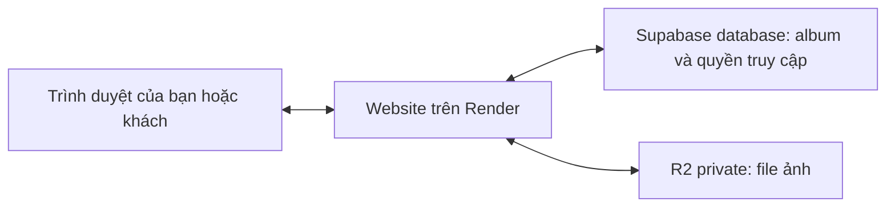

**Kế hoạch tích hợp Cloudflare R2 cho ChiCong Studio — bản thảo để cùng chốt**

Ngày lập: 14/10/2026, giờ Việt Nam. Đây là kế hoạch, chưa triển khai, chưa chuyển dữ liệu và chưa thay đổi mã ứng dụng. Căn cứ: mã nguồn hiện tại trong workspace, tài liệu dự án và tài liệu chính thức của nhà cung cấp. Trạng thái production và dung lượng thực tế cần kiểm kê lại trước khi thực hiện; không lấy số ảnh trong tài liệu cũ làm số hiện tại.

**1. Những điều đã chốt và còn mở**

| Nội dung | Trạng thái |
|---|---|
| Lập kế hoạch và giải thích trước khi code | Người dùng yêu cầu |
| Giữ kiểm tra quyền truy cập như hiện tại; chuyển kho trước | Người dùng đã chọn |
| Số ảnh mới mỗi tháng | Người dùng ước tính dưới 1.000 ảnh |
| Nội dung đợt đầu | Người dùng đã chọn ảnh portfolio và gallery khách; video để sau |
| Các phiên bản ảnh cần giữ | Người dùng đã chọn chỉ các bản web/JPG như hiện tại; không thêm nguồn JPEG/RAW |
| Ưu tiên chi phí | Người dùng đã chọn ưu tiên miễn phí, chấp nhận phí nhỏ khi vượt hạn mức; chưa đặt số tiền trần |
| Giữ gallery khách bao lâu | Chưa chốt; không tự đặt lịch xóa |
| R2 đã kích hoạt, tài khoản Cloudflare nào quản lý | Xác minh khi chuẩn bị môi trường |
| Khung giờ chuyển dữ liệu và người bấm deploy | Chốt trước triển khai; tài liệu hiện ghi deploy thủ công |

Phạm vi đợt đầu đã được làm rõ: ảnh portfolio và gallery khách, chỉ giữ các bản web/JPG hiện tại, R2 private, giữ cách khách xem/chọn/tải ảnh. Ưu tiên hạn mức miễn phí và theo dõi phí phát sinh; chưa có yêu cầu đặt trần tự ngừng upload. Video và lưu thêm file nguồn được để ngoài đợt đầu. Thời hạn giữ gallery và các bước chuẩn bị tài khoản/triển khai vẫn cần làm rõ khi phù hợp.

**2. Hiểu hệ thống bằng công việc trong một studio**

| Thành phần | Có thể hình dung là | Nhiệm vụ |
|---|---|---|
| Trình duyệt của bạn/khách | Quầy giao dịch | Hiển thị trang, gửi ảnh, chọn ảnh, nhận file tải |
| Website Node.js trên Render | Nhân viên studio | Kiểm tra đăng nhập, xử lý ảnh, quyết định ai xem được, tạo ZIP |
| Supabase PostgreSQL | Sổ quản lý | Lưu album, tên khách, mã ảnh, mật khẩu đã băm, lựa chọn và booking |
| Supabase Storage hiện tại | Kho file cũ | Giữ bytes của ảnh, khác với database |
| Cloudflare R2 dự kiến | Kho file mới | Nhận, giữ và trả file khi server có quyền yêu cầu |
| Tên miền chicongphoto.vn | Địa chỉ studio | Giúp người dùng tìm đúng website |

Một bản ghi database có thể nói “ảnh A thuộc album B, tên gốc CC-001.jpg, khách đã chọn”. Bản ghi đó không phải bức ảnh: file ảnh thực sự nằm trong Storage/R2. Vì vậy có thể giữ database ở Supabase và chuyển riêng kho file sang R2.

Bucket là một kho chứa các file. Object là một file cùng thông tin như tên khóa, kích thước, loại nội dung. API là cách phần mềm yêu cầu kho ghi/đọc/xóa. SDK là thư viện giúp lập trình viên gửi các yêu cầu đó. Access Key ID và Secret Access Key là thông tin xác thực của server, không phải mật khẩu gallery và không đưa vào trình duyệt.

Migration nghĩa là chuyển dữ liệu có kiểm chứng. Staging là môi trường thử tách khỏi website thật. Rollback là đưa hệ thống về phương án đã biết hoạt động. Checksum là mã tính từ nội dung file để phát hiện bản sao bị khác.

**3. Đường đi của ảnh sau đợt đầu**

Khi bạn upload:

1. Trình duyệt gửi ảnh và mã giúp nhận diện lần thử lại cho website.
2. Server kiểm tra quyền quản trị, loại ảnh, dung lượng và số pixel.
3. Server tạo WebP lớn, thumbnail và JPG tải xuống theo chất lượng hiện tại.
4. Server ghi các bản đã xử lý vào R2.
5. Khi đủ file, server lưu bản ghi ảnh vào database rồi xác nhận thành công.
6. Nếu thất bại giữa chừng, server báo rõ giai đoạn, cố dọn file đã ghi và cho phép thử lại theo cơ chế chống trùng.

Khi khách xem:

1. Trình duyệt yêu cầu URL ảnh trên chính website, như hiện tại.
2. Server đọc trạng thái album và kiểm tra phiên gallery khi cần.
3. Được phép thì server lấy file từ R2 và trả cho trình duyệt; không được phép thì không trả ảnh.

Khi khách tải lựa chọn:

1. Server kiểm tra đúng gallery và đúng những ảnh đang được chọn.
2. Một ảnh trả JPG; nhiều ảnh chuẩn bị ZIP theo giới hạn hiện tại.
3. Server kiểm tra lại quyền/lựa chọn trước khi gửi file đã chuẩn bị.
4. File tạm trên Render được dọn; R2 không phải nơi lưu ZIP lâu dài trong thiết kế này.

Trong đợt đầu, bucket private không cần bật r2.dev, không gắn domain public và không cần browser-to-R2 CORS, vì trình duyệt vẫn làm việc với website cùng tên miền. CORS chỉ cần thiết khi thiết kế cho trình duyệt gọi trực tiếp sang nguồn khác; nó không thay thế đăng nhập. [Tài liệu CORS](https://developers.cloudflare.com/r2/buckets/cors/)

**4. Bạn sẽ nhận được gì và những việc vẫn cần giải quyết riêng**

Kết quả mong muốn: đổi kho lưu file, tăng dư địa dung lượng, giữ link album/ảnh và cách quản trị. Database, lựa chọn của khách, thứ tự ảnh, phân phần và booking không phải chuyển nhà cung cấp trong đợt này.

Ảnh vẫn qua Render, nên phần băng thông Render gửi ra vẫn tồn tại. R2 không tự làm CPU xử lý ảnh nhanh hơn. [Băng thông Render](https://render.com/docs/outbound-bandwidth)

Render Free vẫn có cơ chế ngủ sau thời gian không có traffic; đổi Storage không loại bỏ thời gian khởi động lại của website. [Giới hạn Render Free](https://render.com/docs/free)

Tài liệu docs/upload-production-diagnostics-2026-10-14.md ghi lỗi upload 180 giây vẫn chưa rõ nguyên nhân cuối cùng. Kế hoạch phải đo riêng thời gian truyền ảnh, xử lý ảnh, ghi storage và ghi database. Không dùng việc đổi R2 để kết luận đã sửa lỗi đó. Các thông số xử lý ảnh và timeout không được thay đổi đồng thời chỉ để làm kết quả chuyển kho có vẻ nhanh hơn.

**5. Dung lượng và chi phí theo cách dễ dự tính**

Hiện bản web lớn và JPG tải xuống tối đa 2400px, thumbnail tối đa 900px. File Lightroom đầu vào không được lưu lâu dài. Trường tên file gốc trong database chỉ giữ tên, không giữ nội dung file gốc.

Một ảnh mới thường có ba file. Ảnh cũ có thể chỉ có hai WebP; JPG được tạo từ bản WebP lớn khi tải. Đưa ảnh cũ sang R2 không phục hồi được chi tiết file gốc đã không lưu.

Công thức dự tính: tổng dung lượng = các bản ảnh đang lưu + ảnh chân dung + bản sao cần giữ + file dư chưa dọn + nguồn/video nếu sau này bổ sung. Album ẩn hoặc lưu trữ vẫn chiếm chỗ khi file còn tồn tại.

Ví dụ minh họa, không phải kết quả đo toàn bộ kho: nếu tổng ba bản trung bình 2MB/ảnh, 500 ảnh mới/tháng tăng khoảng 1GB/tháng; 900 ảnh tăng khoảng 1,8GB/tháng. Sau sáu tháng lần lượt tăng khoảng 6GB hoặc 10,8GB, chưa cộng dữ liệu có sẵn. Vì vậy dưới 1.000 ảnh/tháng vẫn có thể vượt mức miễn phí nếu giữ nhiều tháng. Nên đo trung bình bằng tập ảnh đại diện trước khi quyết định thời hạn lưu.

R2 Standard hiện có hạn mức miễn phí hàng tháng 10GB-month, 1 triệu Class A và 10 triệu Class B; phần lưu trữ vượt mức là $0,015/GB-month. R2 không thu phí egress trực tiếp. Đây không phải trần hóa đơn hay cam kết chính sách vĩnh viễn. [Giá R2](https://developers.cloudflare.com/r2/pricing/)

Theo lựa chọn ưu tiên miễn phí và chấp nhận phí nhỏ của người dùng, đề xuất theo dõi dung lượng sử dụng, số request, lỗi upload và băng thông Render, cùng cảnh báo sớm trước hạn mức. Chưa đặt một số tiền trần hoặc tự ngừng upload khi vừa vượt phần miễn phí; “phí nhỏ” chưa phải quyền tự nâng gói hay bật dịch vụ trả phí khác. Dashboard nhà cung cấp là căn cứ đối chiếu hóa đơn; số byte trong ứng dụng chỉ là ước tính, nhất là với ảnh cũ/file dư. Nếu sau này cần chặn upload mới, cơ chế đó chỉ hạn chế tăng dung lượng, không chặn mọi khoản phí đọc file. Chi phí chuyển dữ liệu từ Supabase, bản backup, bucket thử và dịch vụ khác phải tính riêng.

Chưa có chính sách tự xóa gallery. Nếu sau này cần “giữ 90 ngày”, phải định nghĩa rõ thông báo, quyền gia hạn, bản sao và xử lý lựa chọn của khách trước khi làm tự động.

**6. Lộ trình triển khai và điều kiện qua từng bước**

| Bước | Công việc | Kết quả cần có trước bước tiếp |
|---|---|---|
| A — Chốt phạm vi | Ảnh, bản web/JPG, R2 private và ưu tiên chi phí đã chốt; làm rõ thời hạn lưu | Giữ đúng lựa chọn đã nhận; không tự suy ra quyền xóa ảnh hay nâng gói |
| B — Kiểm kê và đo | Xác nhận bản đang chạy, danh mục file, dung lượng, điểm nghẽn upload | Báo cáo hiện trạng và danh sách file cần chuyển |
| C — Chuẩn bị R2 thử | Bucket riêng tư, quyền tối thiểu, cấu hình thử | Ghi/đọc/xóa file thử được; truy cập công khai bị chặn |
| D — Tích hợp trên môi trường thử | Adapter R2, chọn provider rõ ràng, xử lý lỗi và kiểm thử | Các chức năng cũ hoạt động với R2, chưa ảnh hưởng web thật |
| E — Diễn tập chuyển và quay lại | Copy có resume, đối chiếu nội dung, giả lập lỗi | Có báo cáo đủ file và một lần diễn tập khôi phục đạt |
| F — Chuyển thật có kiểm soát | Backup, copy, khóa thay đổi media ngắn, đối chiếu lần cuối, đổi cấu hình | Khách xem/chọn/tải được và admin upload được trên kho mới |
| G — Theo dõi và kết thúc | Kiểm tra log, dữ liệu mới, backup, dung lượng | Vận hành ổn định; quyết định riêng việc dọn kho cũ |

Chưa chốt ngày công hay số phút tạm dừng upload: cần biết dung lượng thật, tốc độ copy/kiểm chứng và các lựa chọn còn mở. Thời gian sao chép không chỉ là dung lượng chia tốc độ mạng; còn số file, lượt đọc lại, retry và giới hạn dịch vụ.

**Bước B — kiểm kê chi tiết**

1. Xác nhận commit và cấu hình provider của bản chạy thật, không chỉ dựa vào mã local.
2. Lấy danh mục từ database cho mọi trạng thái album: published, private, draft, archived; lấy ảnh chân dung đang dùng từ settings.
3. Phân loại ảnh cũ hai bản và ảnh mới ba bản. Thiếu JPG ở ảnh cũ không tự động là lỗi.
4. Đối chiếu file thiếu, file dư và tổng số byte. Ảnh chân dung cũ và file sót sau upload lỗi được báo cáo riêng, không tự xóa trong migration.
5. Tạo manifest: mã file, loại nội dung, số byte, checksum, trạng thái copy và thời điểm kiểm tra. Giữ manifest kín vì có thông tin kho ảnh.
6. Đo một tập ảnh đại diện: ảnh nhỏ/lớn, nhiều chi tiết, dọc/ngang, ảnh cũ/mới, gallery riêng và portfolio. So sánh cùng file và cùng cấu hình xử lý.
7. Kiểm tra phương án backup cả database và media; JSON xuất ở giao diện không chứa ảnh và không phải backup đầy đủ.

**Bước C — chuẩn bị tài khoản và môi trường**

Bạn kiểm soát tài khoản Cloudflare và bước kích hoạt thanh toán nếu được yêu cầu. Khóa bí mật được nhập vào môi trường server hoặc nơi quản lý secrets; không gửi trong chat hay commit vào Git.

Dự kiến có bucket thử và bucket thật tách biệt, đều dùng Standard và private. Tên cuối cùng được ghi trong cấu hình; không hard-code tên riêng vào logic xử lý ảnh. Tạo token object chỉ cho bucket cần dùng, thay vì cấp quyền quản trị toàn tài khoản. [Hướng dẫn S3 và token R2](https://developers.cloudflare.com/r2/get-started/s3/)

Kiểm tra private trên cấu hình Cloudflare và thử truy cập không xác thực. Kiểm tra S3 thành công chỉ chứng minh server có quyền truy cập; không tự chứng minh mọi đường public đã bị tắt. Dữ liệu thử dùng ảnh không nhạy cảm; không sao chép ảnh khách vào một môi trường public.

**Bước D — phạm vi kỹ thuật dự kiến**

| Khu vực | Thay đổi dự kiến | Lý do |
|---|---|---|
| Lớp storage | Thêm R2 vào hợp đồng init/put/get/remove | Thay kho mà giữ logic album/gallery |
| Chọn provider | Một lựa chọn rõ local/supabase/r2 | Supabase database vẫn tồn tại nên không được đoán storage từ biến cũ |
| Kiểm tra startup | Yêu cầu DB bền vững và cấu hình đầy đủ của provider đã chọn | Không tự rơi về ổ đĩa tạm Render khi thiếu biến |
| SDK | Dùng thư viện S3 phù hợp với Node hiện tại | Tránh tự viết cơ chế ký yêu cầu |
| Upload | Giữ ba bản, chất lượng, mã retry và chống trùng | Không thay đổi trải nghiệm/chất lượng trong migration |
| Lỗi/hủy | Giữ timeout, tín hiệu hủy và mã lỗi đã làm sạch | Download hủy phải dừng đọc và giải phóng tài nguyên |
| Khởi tạo bucket | Tách thao tác quản trị khỏi runtime | Ứng dụng không cần quyền tạo/xóa kho |
| Công cụ chuyển | Kiểm kê, copy tiếp tục được, đối chiếu và báo cáo | Có bằng chứng đủ file và xử lý được gián đoạn |
| Tạm khóa thay đổi media | Chặn phía server các thao tác ghi media trong khung chuyển; báo rõ trên admin | Không chỉ dựa vào việc đóng một tab, tránh thay đổi từ thiết bị/phiên khác |
| Cấu hình/tài liệu | Ví dụ biến môi trường, hosting, vận hành, khôi phục | Chủ studio hiểu cách vận hành sau chuyển |

File dự kiến liên quan: studio/server/storage.mjs, studio/server/app.mjs, package.json và lockfile, .env.example, render.yaml, HOSTING.md, README.md, tài liệu vận hành và công cụ chuyển mới. Chưa cần đổi schema photos hoặc frontend cho phạm vi cơ sở; giữ mã file và URL cùng domain hiện tại.

Không tự đọc Supabase khi R2 lỗi để che lỗi chuyển dữ liệu. Nếu sau này cần cơ chế đọc hai kho, phải phân biệt rõ file không tồn tại với lỗi quyền, timeout và lỗi mạng. Trước mắt, kiểm chứng đủ rồi chuyển provider đơn nhất dễ vận hành hơn.

Khi xóa ảnh thất bại giữa các file, cần báo lỗi, cho phép thử lại và đối chiếu được. Xóa file đã không tồn tại phải an toàn khi retry. File dư sau cleanup lỗi cần được ghi nhận; không hứa mọi lỗi mạng đều dọn được ngay. Không mở rộng đợt này thành hệ thống xử lý nền lớn nếu chưa có nhu cầu thực tế.

**Bước E/F — quy trình chuyển dữ liệu thật**

1. Chuẩn bị phiên bản hỗ trợ cả Supabase và R2; chạy thử với dữ liệu riêng. Giữ một phiên bản đã kiểm chứng có khả năng chạy R2 để quay lại code khi cần.
2. Sao lưu database đầy đủ và files, kiểm tra khả năng đọc/khôi phục bản sao. Bảo vệ backup như dữ liệu khách thật.
3. Copy từ Supabase sang R2 với nguyên tên và nội dung. Không resize/nén lại. Giữ đúng Content-Type WebP/JPEG.
4. Công cụ copy giới hạn số tác vụ đồng thời, retry hữu hạn, lưu tiến độ để tiếp tục. Ghi đè khóa có sẵn chỉ khi quy tắc đối chiếu xác định an toàn; khác nội dung phải được báo ra.
5. Kiểm chứng file đích bằng số byte và SHA-256. Không mặc định ETag của mọi kiểu upload là mã băm nội dung. Với quy mô dự kiến, ưu tiên kiểm chứng toàn bộ file cần dùng.
6. Chọn khung giờ chuyển. Tạm khóa thao tác làm thay đổi media: upload, xóa ảnh/album, đổi chân dung và thay đổi trạng thái liên quan. Chờ upload đang chạy hoàn tất hoặc xử lý trạng thái chưa xác nhận. Booking và lựa chọn ảnh không cần bị đóng chỉ vì đổi kho.
7. Trong lúc đã khóa thay đổi media, chụp snapshot database cuối và lập manifest tương ứng; bảo đảm bản backup giữ đủ mọi file mà snapshot này tham chiếu. Copy phần phát sinh và đối chiếu các file đã xóa trong lúc copy trước. Kiểm tra lại đủ ảnh mọi trạng thái, thumbnail, JPG cần có và chân dung. Cặp snapshot/file nhất quán này dùng cho khôi phục sự cố, không dùng để ghi đè database hiện hành khi chỉ quay lại storage.
8. Đổi provider trên server theo cách deploy thủ công đã thống nhất. Giữ link website và database hiện hành. Có thể có gián đoạn ngắn do restart/deploy; không hứa zero downtime.
9. Khi còn khóa thay đổi media, kiểm tra xem ảnh, gallery, lựa chọn, tải JPG/ZIP và ảnh chân dung. Nếu không đạt, quay lại kho cũ khi danh mục còn đồng nhất.
10. Thực hiện upload thử có kiểm soát trong album thử riêng, xác nhận đủ ba file và retry không trùng; ghi nhận dữ liệu thử để đối chiếu/dọn sau. Từ lúc có dữ liệu ghi chỉ ở R2, rollback storage phải xử lý phần phát sinh.
11. Mở lại thao tác quản trị ảnh khi các kiểm tra đạt. Theo dõi lỗi và dung lượng; giữ kho cũ trong một thời hạn thống nhất, ví dụ 7–14 ngày nếu phù hợp với hạn mức và chi phí.
12. Dọn kho Supabase là quyết định riêng sau nghiệm thu và xác minh backup. Không xóa Supabase project vì database vẫn chạy ở đó.

**7. Quay lại khi có lỗi: ba tình huống khác nhau**

| Tình huống | Cách xử lý |
|---|---|
| Chưa mở lại ghi, hai kho đã khớp | Đổi provider về Supabase, kiểm tra lại URL và quyền |
| Đã có ảnh mới chỉ nằm ở R2 | Khóa thay đổi media, đồng bộ phần phát sinh về nguồn phù hợp, đối chiếu DB hiện hành rồi mới đổi |
| Lỗi code nhưng dữ liệu R2 vẫn đúng | Quay về phiên bản code đã kiểm chứng có hỗ trợ R2, giữ nguyên kho và database |

Supabase Free có thể không đủ chỗ chứa dữ liệu đã lớn lên trên R2. Vì vậy phương án quay lại không được mặc định phụ thuộc vào việc đưa toàn bộ dữ liệu về một kho cũ thiếu dung lượng. Cần xác minh sức chứa trước hoặc ưu tiên rollback code trong khi tiếp tục dùng R2.

Giữ nguyên bản Supabase cũ không phải backup đầy đủ cho những ảnh đăng sau chuyển. Không khôi phục toàn bộ database về snapshot cũ chỉ để đổi storage, vì có thể làm mất booking và lựa chọn khách phát sinh. Kế hoạch khôi phục phải giữ database hiện hành, đối chiếu danh mục hiện tại, không làm sống lại ảnh đã xóa.

**8. Các tình huống phải kiểm thử trước khi nghiệm thu**

| Nhóm | Tiêu chí |
|---|---|
| Ảnh công khai | Trang chủ, hero, portfolio, thumbnail, lightbox, ảnh chia sẻ mạng xã hội tải đúng bằng URL hiện có |
| Gallery riêng | Không đăng nhập không xem được ảnh; phiên gallery A không đọc được ảnh gallery B |
| Thu hồi quyền | Đổi mật khẩu vô hiệu phiên cũ; chuyển published sang private/draft/archived chặn người chưa có quyền, kể cả khi gửi ETag cũ hoặc HEAD |
| Chân dung | Chân dung hiện dùng tải được; URL chân dung bị thay/xóa không còn được phục vụ |
| Upload | File hợp lệ tạo đủ các bản, file sai bị từ chối, mất phản hồi rồi retry không trùng |
| Lỗi ghi | Lỗi ở bất kỳ bản ảnh hoặc lúc ghi database không được báo upload thành công sai; cleanup lỗi được ghi nhận |
| JPG/ZIP | Ảnh mới dùng JPG đã lưu; ảnh cũ tạo JPG từ WebP; đúng lựa chọn, thứ tự, tên Unicode và giới hạn hiện tại |
| Quyền khi tải | Đổi mật khẩu/trạng thái/lựa chọn trong lúc chuẩn bị ZIP ngăn gửi nội dung không còn được phép |
| Hủy | Hủy download dừng việc đọc R2 và giải phóng lượt xử lý/file tạm |
| Provider | Sai key, thiếu biến, sai bucket, timeout, file thiếu được phân biệt phù hợp; production không tự dùng local |
| Bảo mật log | Không lộ secret, cookie, nội dung ảnh hoặc URL chứa thông tin xác thực |
| Migration | Đủ mọi trạng thái album, đúng ảnh cũ/mới, chân dung; copy gián đoạn có thể tiếp tục; sai checksum phải bị phát hiện |
| Vận hành | Restart/deploy không mất ảnh; kiểm thử quay lại đạt; backup đọc/khôi phục được |

Tận dụng test hiện có về security, upload, storage và gallery-download; bổ sung test hợp đồng R2 và migration storage. migration.test.mjs hiện chủ yếu kiểm schema database, chưa thay thế test chuyển kho.

Kiểm tra browser desktop/mobile cho các luồng thực tế và chạy thử với bucket R2 riêng để xác nhận tương thích SDK/quyền/metadata. Kết quả local hoặc mock không thay cho thử kết nối R2 thật. Đo cùng tập ảnh trước/sau, tách thời gian xử lý khỏi thời gian storage; không hứa nhanh hơn một tỷ lệ khi chưa đo.

**9. Vận hành sau chuyển**

- Bạn tiếp tục đăng ảnh, tạo album và gửi link từ trang quản trị như hiện tại; không phải vào Cloudflare để upload từng ảnh.
- Theo dõi dung lượng và chi phí các dịch vụ trong giai đoạn đầu; thống nhất lịch kiểm tra định kỳ sau khi có số liệu. Chưa tạo automation trong bản kế hoạch này.
- Khi upload lỗi, dùng mã request để phân biệt truyền mạng, xử lý ảnh, ghi R2 hay ghi database; thử lại theo hàng đợi hiện tại.
- Giữ bản gốc ở nơi bạn đang quản lý. Nếu chọn lưu gốc trên R2, thiết kế đó được bổ sung riêng; kho đang hoạt động vẫn cần bản sao độc lập để bảo vệ trước xóa nhầm.
- Backup gồm database và media tương ứng. Cần có hướng dẫn khôi phục đã thử, không chỉ thông báo “đã có bản sao”.
- Kiểm tra file dư bằng đối chiếu danh mục; chỉ xóa sau khi xác nhận chúng không còn được cần dùng và có bản sao theo chính sách đã chọn.

**10. CDN và các mở rộng để sau**

Bạn đã chọn giữ cách kiểm tra quyền hiện tại. Vì thế đợt đầu không thêm bucket public, link private có chữ ký, domain media mới hay upload trực tiếp từ trình duyệt.

Nếu sau này cần CDN cho portfolio, thiết kế riêng một bản sao công khai chỉ gồm ảnh đã công bố. Custom domain cho phép dùng cache; r2.dev dành cho phát triển. [Public buckets](https://developers.cloudflare.com/r2/buckets/public-buckets/)

CDN giữ bản sao gần người xem để giảm tải server. Đổi lại, ẩn album phải ngừng phát URL, xóa bản public và xóa cache, có trạng thái báo lỗi/thử lại nếu chưa hoàn tất. Cần xử lý cả thumbnail, ảnh chân dung và ảnh được công khai lại. Không hệ thống nào thu hồi được bản đã tải về máy khách.

Link có chữ ký giống vé có hạn dùng: ai có link có thể sử dụng quyền của link trong thời gian hiệu lực. Đổi mật khẩu gallery trong database không tự làm vé đã cấp hết hiệu lực; đây là lý do chưa dùng nó để thay cách bảo vệ hiện tại. [Presigned URLs](https://developers.cloudflare.com/r2/api/s3/presigned-urls/)

Upload trực tiếp R2 có thể là hướng nghiên cứu khi đo được nghẽn truyền ảnh qua server. Nó cần kho tạm, kiểm tra file thật, xử lý ảnh sau upload, trạng thái đang xử lý/hoàn tất, retry và dọn file bỏ dở. Chỉ đưa file gốc lên R2 chưa tự tạo WebP/thumbnail/JPG.

Lưu nguồn cần quyết định JPEG/RAW, ai được tải, dung lượng, thời hạn giữ và xử lý ảnh đã xóa. Video cần thêm kiểm tra định dạng, poster, player, giới hạn upload và quyết định có chuyển mã/phát nhiều chất lượng hay không. Đây là các phạm vi riêng, không được coi là đã có chỉ vì R2 giữ được file.

**11. Các đầu ra cần có khi bắt đầu thực hiện**

1. Bản phạm vi cập nhật theo câu trả lời của bạn và bảng dung lượng dự kiến.
2. Thay đổi code hỗ trợ provider với kiểm thử, tài liệu cấu hình chỉ có placeholders.
3. Công cụ kiểm kê/copy/đối chiếu, manifest và biên bản diễn tập rollback.
4. Báo cáo test quyền gallery, upload và JPG/ZIP với R2.
5. Kịch bản triển khai từng bước, điểm quyết định quay lại và cách giữ dữ liệu mới.
6. Báo cáo sau chuyển: file cần dùng đã đủ, phần còn tồn tại ở kho cũ, lỗi còn mở và phương án backup.

Các lựa chọn chính về nội dung, bản ảnh, quyền truy cập và ưu tiên chi phí đã được người dùng trả lời. Tiếp tục ở bước lập kế hoạch; chỉ bắt đầu code khi người dùng yêu cầu thực hiện. Không tự xóa gallery, tạo nhắc lịch, kích hoạt dịch vụ trả phí hoặc triển khai production từ các câu trả lời về phạm vi.
