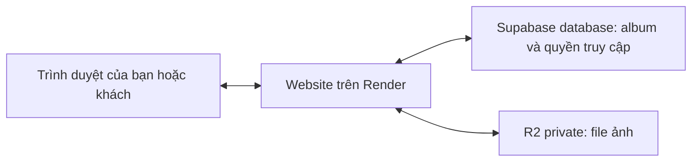

> **Tài liệu lịch sử — đã hợp nhất ngày 16/10/2026.** Đọc [kế hoạch triển khai R2 và backup chính](r2-implementation-plan.md) để có các quyết định và điều kiện hiện hành. Nội dung bên dưới được giữ làm lịch sử review; những câu hỏi/trạng thái cũ có thể đã được giải quyết trong bản hợp nhất.

**Kế hoạch tích hợp Cloudflare R2 cho ChiCong Studio — bản thảo để cùng chốt**

Ngày lập: 14/10/2026, giờ Việt Nam. Đây là kế hoạch, chưa triển khai, chưa chuyển dữ liệu và chưa thay đổi mã ứng dụng. Căn cứ: mã nguồn hiện tại trong workspace, tài liệu dự án và tài liệu chính thức của nhà cung cấp. Trạng thái production và dung lượng thực tế cần kiểm kê lại trước khi thực hiện; không lấy số ảnh trong tài liệu cũ làm số hiện tại.

Rà soát sâu ngày 15/10/2026: kiến trúc được giữ, các bước vận hành đã sửa theo chức năng mới trong workspace. HEAD lúc lấy mẫu là 0c6a493, có nhiều thay đổi chưa commit; kiểm thử dùng bản sao riêng với danh mục SHA-256. Không coi HEAD đơn lẻ hay bản sao này là bản production. Xem [biên bản xác minh](r2-plan-verification-2026-10-15.md) để phân biệt kết quả đã chạy, giới hạn hiện tại và các điều kiện còn thiếu.

Để chuẩn bị vòng xác nhận với chủ website, xem [danh sách chuẩn bị và câu hỏi trước triển khai](r2-preimplementation-checklist-2026-10-15.md). Tài liệu tách các quyết định trước code khỏi các điều kiện phải có trước khi thử cloud và chuyển website thật.

Cập nhật theo trao đổi tiếp ngày 15/10/2026: người dùng chốt giữ gallery tới khi tự xóa, giữ cách vào album bằng mật khẩu hiện tại, đồng ý đưa việc review/cải thiện lỗi phiên vào kế hoạch; vẫn yêu cầu làm rõ trước khi code. Đã có tài khoản Cloudflare nhưng chưa bật R2. Drive và ổ cứng đang giữ ảnh gốc/ảnh xuất Lightroom thành các bản riêng, xóa một nơi không tự xóa nơi kia; chưa có bằng chứng backup website đầy đủ. HEAD khi rà lại là 1ea50e8; kết quả 69 test trước đó thuộc snapshot cũ, không được coi là test bản mới.

**1. Những điều đã chốt và còn mở**

| Nội dung | Trạng thái |
|---|---|
| Lập kế hoạch và giải thích trước khi code | Người dùng yêu cầu |
| Giữ kiểm tra quyền truy cập như hiện tại; chuyển kho trước | Người dùng đã chọn |
| Số ảnh mới mỗi tháng | Người dùng ước tính dưới 1.000 ảnh |
| Nội dung đợt đầu | Người dùng đã chọn ảnh portfolio và gallery khách; video để sau |
| Các phiên bản ảnh cần giữ | Người dùng đã chọn chỉ các bản web/JPG như hiện tại; không thêm nguồn JPEG/RAW |
| Ưu tiên chi phí | Người dùng đã chọn ưu tiên miễn phí, chấp nhận phí nhỏ khi vượt hạn mức; chưa đặt số tiền trần |
| Giữ gallery khách bao lâu | Đã chốt: tới khi người dùng chủ động xóa; không tự xóa theo ngày |
| Mật khẩu album | Giữ cơ chế hiện tại; không thêm bước đăng nhập/OTP hoặc bắt mọi album có mật khẩu |
| Lỗi phiên khi đổi mật khẩu | Người dùng đồng ý review/cải thiện trong phạm vi dự kiến; chưa bắt đầu sửa code |
| R2 đã kích hoạt, tài khoản Cloudflare nào quản lý | Đã có tài khoản Cloudflare, chưa bật R2; xác minh tài khoản/region/quota khi chuẩn bị |
| Bản sao đang có | Ảnh gốc và ảnh xuất Lightroom trên Drive + ổ cứng, copy riêng; chưa xác nhận backup database/media website |
| Backup website | Đã chọn tự động hằng ngày lên Drive nếu tận dụng được hạ tầng hiện có; người dùng copy thêm xuống ổ cứng khi thuận tiện. Lịch sử giữ 30 ngày gần nhất nếu đủ dung lượng |
| Drive đích | Ngày 16/10 người dùng chỉ định Gmail cá nhân, còn khoảng 5TB theo thông tin cung cấp; chưa truy vấn tài khoản/quota |
| Khung giờ chuyển dữ liệu và người bấm deploy | Chốt trước triển khai; tài liệu hiện ghi deploy thủ công |

Phạm vi đợt đầu đã được làm rõ: ảnh portfolio và gallery khách, chỉ giữ các bản web/JPG hiện tại, R2 private, giữ cách khách xem/chọn/tải ảnh. Ưu tiên hạn mức miễn phí và theo dõi phí phát sinh; người dùng tiếp tục chấp nhận phí nhỏ, chưa chọn con số hoặc trần tự ngừng upload. Video và lưu thêm file nguồn được để ngoài đợt đầu. Gallery giữ tới khi tự xóa; backup hằng ngày lên Drive, lịch sử 30 ngày nếu đủ chỗ, bản local copy thủ công đã chốt. Nơi chạy sau kiểm chứng và điều kiện chuyển thật còn mở. Không yêu cầu người dùng chọn một số tiền tùy ý chỉ để tiếp tục lập kế hoạch; đưa dự toán sau khi đo dữ liệu thực.

**2. Hiểu hệ thống bằng công việc trong một studio**

| Thành phần | Có thể hình dung là | Nhiệm vụ |
|---|---|---|
| Trình duyệt của bạn/khách | Quầy giao dịch | Hiển thị trang, gửi ảnh, chọn ảnh, nhận file tải |
| Website Node.js trên Render | Nhân viên studio | Kiểm tra đăng nhập, xử lý ảnh, quyết định ai xem được, tạo ZIP |
| Supabase PostgreSQL | Sổ quản lý | Lưu album, tên khách, mã ảnh, mật khẩu đã băm, lựa chọn và booking |
| Supabase Storage hiện tại | Kho file cũ | Giữ bytes của ảnh, khác với database |
| Cloudflare R2 dự kiến | Kho file mới | Nhận, giữ và trả file khi server có quyền yêu cầu |
| Tên miền chicongphoto.vn | Địa chỉ studio | Giúp người dùng tìm đúng website |

Một bản ghi database có thể nói “ảnh A thuộc album B, tên gốc CC-001.jpg, khách đã chọn”. Bản ghi đó không phải bức ảnh: file ảnh thực sự nằm trong Storage/R2. Vì vậy có thể giữ database ở Supabase và chuyển riêng kho file sang R2.

Bucket là một kho chứa các file. Object là một file cùng thông tin như tên khóa, kích thước, loại nội dung. API là cách phần mềm yêu cầu kho ghi/đọc/xóa. SDK là thư viện giúp lập trình viên gửi các yêu cầu đó. Access Key ID và Secret Access Key là thông tin xác thực của server, không phải mật khẩu gallery và không đưa vào trình duyệt.

Migration nghĩa là chuyển dữ liệu có kiểm chứng. Staging là môi trường thử tách khỏi website thật. Rollback là đưa hệ thống về phương án đã biết hoạt động. Checksum là mã tính từ nội dung file để phát hiện bản sao bị khác.

**3. Đường đi của ảnh sau đợt đầu**

Khi bạn upload:

1. Trình duyệt gửi ảnh và mã giúp nhận diện lần thử lại cho website.
2. Server kiểm tra quyền quản trị, loại ảnh, dung lượng và số pixel.
3. Ảnh JPEG/PNG/WebP thông thường được server tạo WebP lớn, thumbnail và JPG. Gói .ccphoto đã chuẩn bị trên máy được server kiểm chứng định dạng, kích thước và checksum của ba bản, rồi giữ nguyên bytes; không encode lại.
4. Server ghi các bản đã xử lý vào R2.
5. Khi đủ file, server lưu bản ghi ảnh vào database rồi xác nhận thành công.
6. Nếu thất bại giữa chừng, server báo rõ giai đoạn và xử lý theo cơ chế chống trùng/biên nhận upload bền vững. Lỗi mất phản hồi không tự chứng minh file hoặc transaction chưa được lưu; chỉ dọn khi đã đối chiếu tham chiếu database. File dư được theo dõi và xử lý qua hàng đợi khi phù hợp.

Upload hiện còn có bỏ qua/ghi đè ảnh trùng tên. Ghi đè giữ mã ảnh và lựa chọn của khách nhưng thay khóa file. Chuyển kho phải giữ đầy đủ hành vi này và bảng photo_upload_receipts.

Khi khách xem:

1. Trình duyệt yêu cầu URL ảnh trên chính website, như hiện tại.
2. Server đọc trạng thái album và kiểm tra phiên khi gallery có mật khẩu. Gallery private không đặt mật khẩu hiện cho người giữ link truy cập; “private” ở đây không đồng nghĩa với bắt buộc đăng nhập. Kho R2 private vẫn luôn chỉ cho server đọc.
3. Được phép thì server lấy file từ R2 và trả cho trình duyệt; không được phép thì không trả ảnh.

Khi khách tải lựa chọn:

1. Server kiểm tra đúng gallery và đúng những ảnh đang được chọn.
2. Một ảnh trả JPG; nhiều ảnh chuẩn bị ZIP theo giới hạn hiện tại. Ngoài tải lựa chọn, gallery có nút tải một ảnh riêng, không yêu cầu ảnh đã được chọn. Tại HEAD 1ea50e8, giao diện portfolio đã ẩn nút tải/phóng to; API tải riêng theo album công khai vẫn tồn tại. Giữ giao diện mới, không nhầm ẩn nút là chặn API hoặc chống lưu ảnh.
3. Server kiểm tra lại quyền/lựa chọn trước khi gửi file đã chuẩn bị.
4. File tạm trên Render được dọn; R2 không phải nơi lưu ZIP lâu dài trong thiết kế này.

Trong đợt đầu, bucket private không cần bật r2.dev, không gắn domain public và không cần browser-to-R2 CORS, vì trình duyệt vẫn làm việc với website cùng tên miền. CORS chỉ cần thiết khi thiết kế cho trình duyệt gọi trực tiếp sang nguồn khác; nó không thay thế đăng nhập. [Tài liệu CORS](https://developers.cloudflare.com/r2/buckets/cors/)

**4. Bạn sẽ nhận được gì và những việc vẫn cần giải quyết riêng**

Kết quả mong muốn: đổi kho lưu file, tăng dư địa dung lượng, giữ link album/ảnh và cách quản trị. Database, lựa chọn của khách, thứ tự ảnh, phân phần và booking không phải chuyển nhà cung cấp trong đợt này.

Ảnh vẫn qua Render, nên phần băng thông Render gửi ra vẫn tồn tại. R2 không tự làm CPU xử lý ảnh nhanh hơn. [Băng thông Render](https://render.com/docs/outbound-bandwidth)

Render Free vẫn có cơ chế ngủ sau thời gian không có traffic; đổi Storage không loại bỏ thời gian khởi động lại của website. [Giới hạn Render Free](https://render.com/docs/free)

Tài liệu docs/upload-production-diagnostics-2026-10-14.md ghi lỗi upload 180 giây chưa rõ nguyên nhân cuối cùng tại thời điểm báo cáo. Workspace sau đó đã có upload .ccphoto và các thay đổi khác; chưa xác minh bản nào đang chạy production trong lượt review này. Phải đo riêng truyền ảnh, encode/kiểm chứng package, ghi storage và ghi database trên cùng baseline. Không quy lỗi còn tồn tại hoặc đã hết chỉ từ tài liệu cũ, và không dùng đổi R2 để kết luận đã sửa lỗi upload. Không đổi chất lượng hay timeout đồng thời chỉ để làm phép so sánh nhanh hơn.

**5. Dung lượng và chi phí theo cách dễ dự tính**

Hiện bản web lớn và JPG tải xuống tối đa 2400px, thumbnail tối đa 900px. File Lightroom đầu vào không được lưu lâu dài. Trường tên file gốc trong database chỉ giữ tên, không giữ nội dung file gốc.

Một ảnh mới thường có ba file. Ảnh cũ có thể chỉ có hai WebP; JPG được tạo từ bản WebP lớn khi tải. Đưa ảnh cũ sang R2 không phục hồi được chi tiết file gốc đã không lưu.

Công thức dự tính: tổng dung lượng = các bản ảnh đang lưu + ảnh chân dung + bản sao cần giữ + file dư chưa dọn + nguồn/video nếu sau này bổ sung. Album ẩn hoặc lưu trữ vẫn chiếm chỗ khi file còn tồn tại.

Ví dụ minh họa, không phải kết quả đo toàn bộ kho: nếu tổng ba bản trung bình 2MB/ảnh, 500 ảnh mới/tháng tăng khoảng 1GB/tháng; 900 ảnh tăng khoảng 1,8GB/tháng. Sau sáu tháng lần lượt tăng khoảng 6GB hoặc 10,8GB, chưa cộng dữ liệu có sẵn. Vì vậy dưới 1.000 ảnh/tháng vẫn có thể vượt mức miễn phí nếu giữ nhiều tháng. Người dùng đã chọn giữ tới khi tự xóa; phép đo dung lượng dùng để dự toán và cảnh báo, không để tự rút ngắn thời hạn giữ ảnh.

R2 Standard hiện có hạn mức miễn phí hàng tháng 10GB-month, 1 triệu Class A và 10 triệu Class B; phần lưu trữ vượt mức là $0,015/GB-month. R2 không thu phí egress trực tiếp. Đây không phải trần hóa đơn hay cam kết chính sách vĩnh viễn. [Giá R2](https://developers.cloudflare.com/r2/pricing/)

Theo lựa chọn ưu tiên miễn phí và chấp nhận phí nhỏ của người dùng, đề xuất theo dõi dung lượng sử dụng, số request, lỗi upload và băng thông Render, cùng cảnh báo sớm trước hạn mức. Chưa đặt một số tiền trần hoặc tự ngừng upload khi vừa vượt phần miễn phí; “phí nhỏ” chưa phải quyền tự nâng gói hay bật dịch vụ trả phí khác. Dashboard nhà cung cấp là căn cứ đối chiếu hóa đơn; số byte trong ứng dụng chỉ là ước tính, nhất là với ảnh cũ/file dư. Nếu sau này cần chặn upload mới, cơ chế đó chỉ hạn chế tăng dung lượng, không chặn mọi khoản phí đọc file. Chi phí chuyển dữ liệu từ Supabase, bản backup, bucket thử và dịch vụ khác phải tính riêng.

Trước khi đọc nội dung toàn kho, lập ngân sách nguồn: dung lượng × số lượt tải để hash/copy/backup/diễn tập + phần phát sinh + phần dành cho hoạt động website. Ưu tiên runner riêng có ổ lưu bền vững, không chạy copy hàng loạt trên Render phục vụ khách. Có thể tải một lượt vào bản sao riêng và tính hash trong lúc đọc, dùng bản này để chuyển/đối chiếu; final delta vẫn đối chiếu snapshot cuối. Không giả định quota còn nguyên hoặc đọc nhiều lần là miễn phí. [Supabase egress](https://supabase.com/docs/guides/platform/manage-your-usage/egress)

Render gửi file mới sang R2 cũng là outbound, bên cạnh Render gửi ảnh cho người xem. Phải kiểm tra gói và quota thực tế của workspace; ví dụ 900 ảnh × 2MB đã tạo khoảng 1,8GB upload ra kho mỗi tháng, chưa có lượt xem/tải. [Render bandwidth](https://render.com/docs/outbound-bandwidth)

Đợt đầu dùng số liệu và cảnh báo nhà cung cấp nếu tài khoản hỗ trợ; không ngầm xây một hệ thống billing riêng. Cloudflare Budget alerts theo chi phí usage của tài khoản, không phải trần thanh toán hay cảnh báo chính xác mốc dung lượng 10GB. Người nhận/ngưỡng được chốt khi cấu hình; chưa tạo cảnh báo hoặc automation trong lượt lập kế hoạch. [Budget alerts](https://developers.cloudflare.com/billing/manage/budget-alerts/)

Đã chốt không tự xóa gallery theo ngày. Xóa trên website chỉ tác động dữ liệu hoạt động theo chức năng hiện tại, không tự gửi lệnh xóa tới Drive/ổ cứng. Lịch sử backup website được chọn riêng là 30 ngày gần nhất nếu đủ chỗ; không hiểu “giữ đến khi tôi xóa” là lệnh xóa mọi bản sao. Nếu sau này đổi gallery sang “giữ 90 ngày”, phải xác định lại thông báo, gia hạn và xử lý lựa chọn khách trước khi làm tự động.

**6. Lộ trình triển khai và điều kiện qua từng bước**

| Bước | Công việc | Kết quả cần có trước bước tiếp |
|---|---|---|
| A — Chốt phạm vi | Ảnh, bản web/JPG, R2 private, mật khẩu hiện tại và giữ tới khi tự xóa đã chốt; làm rõ backup website | Giữ đúng lựa chọn đã nhận; không tự suy ra quyền xóa bản sao hay nâng gói |
| B — Kiểm kê và đo | Xác nhận bản đang chạy, danh mục file, dung lượng, điểm nghẽn upload | Báo cáo hiện trạng và danh sách file cần chuyển |
| C — Chuẩn bị R2 thử | Bucket riêng tư, quyền tối thiểu, cấu hình thử | Ghi/đọc/xóa file thử được; truy cập công khai bị chặn |
| D — Tích hợp trên môi trường thử | Adapter R2, chọn provider rõ ràng, xử lý lỗi và kiểm thử | Các chức năng cũ hoạt động với R2, chưa ảnh hưởng web thật |
| E — Diễn tập chuyển và quay lại | Copy có resume, đối chiếu nội dung, giả lập lỗi | Có báo cáo đủ file và một lần diễn tập khôi phục đạt |
| F — Chuyển thật có kiểm soát | Backup, copy, khóa thay đổi media ngắn, đối chiếu lần cuối, đổi cấu hình | Khách xem/chọn/tải được và admin upload được trên kho mới |
| G — Theo dõi và kết thúc | Kiểm tra log, dữ liệu mới, backup, dung lượng | Vận hành ổn định; quyết định riêng việc dọn kho cũ |

Chưa chốt ngày công hay số phút tạm dừng upload: cần biết dung lượng thật, tốc độ copy/kiểm chứng và các lựa chọn còn mở. Thời gian sao chép không chỉ là dung lượng chia tốc độ mạng; còn số file, lượt đọc lại, retry và giới hạn dịch vụ.

**Bước B — kiểm kê chi tiết**

1. Chốt một baseline bất biến gồm commit và mọi thay đổi được chọn đưa vào bản phát hành; đối chiếu với commit/config production. Nếu workspace đổi trong lúc review, lưu hash bản đã kiểm thử và rà lại phần thay đổi trước triển khai.
2. Lấy danh mục từ database cho mọi trạng thái album: published, private, draft, archived; lấy ảnh chân dung đang dùng từ settings.
3. Phân loại ảnh cũ hai bản và ảnh mới ba bản. Thiếu JPG ở ảnh cũ không tự động là lỗi.
4. Đối chiếu file thiếu, file dư và tổng số byte. Ảnh chân dung cũ và file sót sau upload lỗi được báo cáo riêng, không tự xóa trong migration.
5. Tạo manifest theo mapping photo.id → photos.filename hiện hành → object key của từng bản, kèm role, Content-Type, số byte, SHA-256 nội dung thực, nguồn/đích, snapshot ID, trạng thái copy và thời điểm kiểm tra. Không dựng key từ photo.id: sau ghi đè, ID khác filename. Giữ riêng tham chiếu portrait, file chờ cleanup và file không tham chiếu. upload_hash, receipt file_hash và .ccphoto sourceHash không thay thế checksum của từng object.
6. Đo một tập ảnh đại diện: ảnh nhỏ/lớn, nhiều chi tiết, dọc/ngang, ảnh cũ/mới, gallery riêng và portfolio. So sánh cùng file và cùng cấu hình xử lý.
7. Backup database phải gồm receipts, phiên/quyền và trạng thái cleanup tương ứng, ngoài album/lựa chọn/booking. JSON xuất ở giao diện không thay thế backup đầy đủ. Công cụ kiểm kê đọc bằng kết nối chỉ đọc trực tiếp, không gọi createApp/openDatabase của ứng dụng vì các hàm đó có thể chạy migration và worker xóa.

**Bước C — chuẩn bị tài khoản và môi trường**

Người dùng đã có tài khoản Cloudflare nhưng chưa kích hoạt R2. Bước kích hoạt sẽ được hướng dẫn trước khi thử cloud; chưa thực hiện trong giai đoạn review. Bạn kiểm soát tài khoản và bước xác nhận thanh toán nếu được yêu cầu. Khóa bí mật được nhập vào môi trường server hoặc nơi quản lý secrets; không gửi trong chat hay commit vào Git.

Dự kiến có bucket thử và bucket thật tách biệt, đều dùng Standard và private. Tên cuối cùng được ghi trong cấu hình; không hard-code tên riêng vào logic xử lý ảnh. Tạo token object chỉ cho bucket cần dùng, thay vì cấp quyền quản trị toàn tài khoản. [Hướng dẫn S3 và token R2](https://developers.cloudflare.com/r2/get-started/s3/)

Staging phải có database/schema, credentials, bucket và dữ liệu thử riêng; không kế thừa .env production. Worker cleanup chỉ được chạm dữ liệu thử. Không đưa cấu hình gửi email/calendar thật vào fixture. Diễn tập restore vào đích riêng, với worker tắt cho tới khi kiểm chứng mọi tham chiếu/queue đúng đích. Backup được giữ ngoài phạm vi quyền xóa của runtime.

Ghi lại vùng Render trước khi chọn vị trí bucket, đo đường server↔R2. Automatic/location hint không phải cam kết tối ưu theo vị trí khách xem. Endpoint phải khớp tài khoản và jurisdiction nếu có. [Vị trí dữ liệu R2](https://developers.cloudflare.com/r2/reference/data-location/)

Kiểm tra bằng Dashboard hoặc credential quản trị chỉ đọc riêng: r2.dev tắt, không custom domain public đang bật, không Worker/route có sẵn vô tình phát ảnh. Thử một object chắc chắn tồn tại qua từng đường đã cấu hình; bucket root không liệt kê file không phải bằng chứng private. Runtime Object Read & Write chỉ giới hạn bucket, không mở rộng thành quyền quản trị chỉ để audit. S3 thành công chỉ chứng minh server có quyền, không chứng minh mọi đường public đã tắt. [Quyền R2](https://developers.cloudflare.com/r2/api/tokens/), [Public access](https://developers.cloudflare.com/r2/buckets/public-buckets/)

**Bước D — phạm vi kỹ thuật dự kiến**

| Khu vực | Thay đổi dự kiến | Lý do |
|---|---|---|
| Lớp storage | Thêm R2 vào hợp đồng init/put/get/remove | Thay kho mà giữ logic album/gallery |
| Chọn provider | Một lựa chọn rõ local/supabase/r2 | Supabase database vẫn tồn tại nên không được đoán storage từ biến cũ |
| Kiểm tra startup | Yêu cầu DB bền vững và cấu hình đầy đủ của provider đã chọn | Không tự rơi về ổ đĩa tạm Render khi thiếu biến |
| SDK | Khóa phiên bản S3 SDK đã thử, region auto, endpoint và credentials tường minh | Không dùng nhầm AWS credential chain; thử checksum thực tế |
| Upload | Giữ ba bản, chất lượng, mã retry và chống trùng | Không thay đổi trải nghiệm/chất lượng trong migration |
| Lỗi/hủy | Giữ timeout, tín hiệu hủy và mã lỗi đã làm sạch | Download hủy phải dừng đọc và giải phóng tài nguyên |
| Khởi tạo bucket | Tách thao tác quản trị khỏi runtime | Ứng dụng không cần quyền tạo/xóa kho |
| Công cụ chuyển | Kiểm kê, copy tiếp tục được, đối chiếu và báo cáo | Có bằng chứng đủ file và xử lý được gián đoạn |
| Tạm khóa thay đổi media | Khóa dùng chung tồn tại qua restart, mọi tiến trình tuân thủ, theo dõi tác vụ ghi thực sự | Đóng kết nối HTTP không đồng nghĩa handler đã ngừng ghi |
| Worker cleanup | Có thể tạm dừng/chờ hoàn tất; drain đúng kho và kiểm chứng queue rỗng trước đổi provider | Queue hiện chưa chứa provider/bucket |
| Cấu hình/tài liệu | Ví dụ biến môi trường, hosting, vận hành, khôi phục | Chủ studio hiểu cách vận hành sau chuyển |

File dự kiến liên quan: storage.mjs, app.mjs, photo-upload.mjs, photo-deletion.mjs, prepared-photo.mjs, gallery-download.mjs, start.mjs, db.mjs khi cần trạng thái khóa; package/lockfile, cấu hình, tài liệu và công cụ chuyển. Chưa có lý do đổi schema photos chỉ để chuyển kho; trạng thái khóa/drain có thể cần bổ sung lưu bền vững. Giữ ID, filename, URL có version, receipts và các version của gallery/catalog. Nếu thêm thông báo bảo trì vào admin thì coi là thay đổi giao diện nhỏ có kiểm thử, không hứa tuyệt đối không sửa frontend.

SDK GET phải giữ deadline đến khi đọc xong body và đóng stream khi hủy; deadline tổng gồm retry, kết nối và body. Giữ ngân sách hiện có làm baseline rồi đo lại, không nhân timeout theo số retry ngoài ý muốn. Chỉ retry hữu hạn cho lỗi phù hợp; không retry liên tục lỗi quyền/validation, không tạo nhiều writer cho cùng key. Kiểm thử checksum mặc định của phiên bản SDK đã chọn với R2 thật; không tắt checksum theo phỏng đoán. [Cloudflare JS SDK](https://developers.cloudflare.com/r2/examples/aws/aws-sdk-js-v3/), [AWS checksum](https://docs.aws.amazon.com/sdk-for-javascript/v3/developer-guide/s3-checksums.html)

R2 không thay nguyên mô hình allowed_mime_types/file_size_limit của Supabase. Giữ kiểm tra tên key, MIME/nội dung thật, 20MiB input và 40MP; xác định giới hạn bản dẫn xuất từ kiểm kê và kiểm tra ở ứng dụng. 24MiB trong code cũ là mức tối thiểu cho cấu hình bucket, không chứng minh mọi file cũ dưới 24MiB vì bucket có thể cho mức lớn hơn/unlimited. Không tự loại file cũ hoặc áp trần mới mà chưa đối chiếu tương thích. Với kích thước ảnh hiện tại, chưa cần multipart upload chỉ để thay kho. [Giới hạn R2](https://developers.cloudflare.com/r2/platform/limits/)

Không tự đọc Supabase khi R2 lỗi để che lỗi chuyển dữ liệu. Nếu sau này cần cơ chế đọc hai kho, phải phân biệt rõ file không tồn tại với lỗi quyền, timeout và lỗi mạng. Trước mắt, kiểm chứng đủ rồi chuyển provider đơn nhất dễ vận hành hơn.

Giữ cách xóa hiện tại: transaction xóa tham chiếu hiển thị và ghi việc cleanup bền vững; thành công ở bước này thì ảnh đã ngừng hiện dù xóa bytes có thể chậm. Lỗi transaction khác với cleanup đang chờ. Worker retry việc xóa file; remove phải an toàn với object đã không tồn tại. Theo dõi queue, không báo sai rằng ảnh chưa bị xóa khỏi album khi database đã cập nhật.

Timeout/abort của PUT không chứng minh R2 chưa ghi; cả một lần HEAD trả không có ngay sau timeout cũng chưa đủ kết luận. Giữ trạng thái chưa xác định, đối chiếu lại bằng key/checksum và tham chiếu DB, chỉ đánh dấu dọn sạch sau kiểm chứng phù hợp. Không xóa bytes đang được DB tham chiếu khi mất xác nhận COMMIT. [R2 consistency](https://developers.cloudflare.com/r2/reference/consistency/)

**Bước E/F — quy trình chuyển dữ liệu thật**

1. Chuẩn bị bản tương thích cả Supabase/R2, các tính năng upload/ghi đè/receipts hiện tại và khóa/drain. Triển khai bản này vẫn dùng Supabase trước; kiểm chứng tất cả tiến trình phục vụ đã hiểu khóa, không còn bản cũ có thể ghi vượt khóa. Giữ bản đã kiểm chứng này làm đích rollback code.
2. Sao lưu database đầy đủ và files, kiểm tra khả năng đọc/khôi phục bản sao. Bảo vệ backup như dữ liệu khách thật.
3. Copy theo manifest hiện hành trên runner riêng, nguyên key/nội dung/Content-Type. Đích mới rỗng hoặc có manifest của cùng đợt chuyển; không tự ghi đè object không rõ nguồn. Giữ metadata cần thiết, không lấy chính sách public của nguồn làm cấu hình cho đích.
4. Công cụ copy giới hạn số tác vụ đồng thời, retry hữu hạn, lưu tiến độ để tiếp tục. Ghi đè khóa có sẵn chỉ khi quy tắc đối chiếu xác định an toàn; khác nội dung phải được báo ra.
5. Kiểm chứng file đích bằng số byte và SHA-256. Không mặc định ETag của mọi kiểu upload là mã băm nội dung. Với quy mô dự kiến, ưu tiên kiểm chứng toàn bộ file cần dùng.
6. Chọn khung giờ, bật khóa bền vững cho mọi đường thay đổi media: upload thường/.ccphoto, overwrite, xóa đơn/hàng loạt/album, chân dung kể cả thay tham chiếu trong settings và thay đổi trạng thái liên quan. Đợi tác vụ ghi thực sự về 0, kể cả client đã ngắt kết nối; nếu quá thời gian drain thì dừng chuyển và đối chiếu. Drain photo_cleanup trên Supabase cho tới rỗng rồi dừng worker; khi còn job lỗi thì chưa chuyển. Không chỉ căn cứ tab đã đóng hay server.close. Booking/lựa chọn có thể tiếp tục ngoài khoảng restart; không phục hồi DB cũ để đổi storage.
7. Khi tác vụ ghi bằng 0 và cleanup đã rỗng/dừng, lấy snapshot DB và manifest cuối. Delta gồm ảnh thêm, filename thay thế, file đã xóa và chân dung đổi; không chỉ so ID/số ảnh/ngày tạo. Xác minh backup bao phủ mọi tham chiếu của snapshot. Object thừa ở R2 được phân loại, chỉ dọn những key thuộc đợt chuyển khi đã đối chiếu không được dùng. Lưu danh mục xóa của nguồn để xử lý kho cũ khi cần. Cặp snapshot/file dùng cho khôi phục sự cố, không ghi đè DB hiện hành để rollback storage.
8. Giữ khóa media qua restart, đổi provider bằng deploy thủ công đã thống nhất; không để tiến trình Supabase cũ và R2 mới cùng nhận ghi. Worker đích chỉ được khởi động sau khi xác nhận queue/trạng thái khóa đúng. Giữ website/DB hiện hành; có thể gián đoạn ngắn khi deploy.
9. Khi còn khóa thay đổi media, kiểm tra xem ảnh, gallery, lựa chọn, tải JPG/ZIP và ảnh chân dung. Nếu không đạt, quay lại kho cũ khi danh mục còn đồng nhất.
10. Dùng cửa kiểm thử được giới hạn cho người vận hành/album thử, hoặc công cụ kiểm thử riêng; không mở khóa toàn bộ chỉ để thử một upload. Xác nhận ba file, prepared upload, overwrite và retry; ghi danh mục dữ liệu thử. Bất kỳ ghi mới nào ở R2, kể cả file thử, làm phát sinh nghĩa vụ đồng bộ nếu quay lại kho cũ.
11. Mở lại thao tác quản trị ảnh khi các kiểm tra đạt. Theo dõi lỗi và dung lượng; giữ kho cũ trong một thời hạn thống nhất, ví dụ 7–14 ngày nếu phù hợp với hạn mức và chi phí.
12. Dọn kho Supabase là quyết định riêng sau nghiệm thu và xác minh backup. Không xóa Supabase project vì database vẫn chạy ở đó.

**7. Quay lại khi có lỗi: ba tình huống khác nhau**

| Tình huống | Cách xử lý |
|---|---|
| Chưa mở lại ghi, hai kho đã khớp | Đổi provider về Supabase, kiểm tra lại URL và quyền |
| Đã có thêm/ghi đè/xóa sau chuyển | Khóa và drain trên R2, xử lý queue đúng R2, đồng bộ mọi filename hiện hành + portrait về đích đủ chỗ, đối chiếu rồi mới đổi |
| Lỗi code nhưng dữ liệu R2 vẫn đúng | Quay về phiên bản code đã kiểm chứng có hỗ trợ R2, giữ nguyên kho và database |

Supabase Free có thể không đủ chỗ chứa dữ liệu đã lớn lên trên R2. Vì vậy phương án quay lại không được mặc định phụ thuộc vào việc đưa toàn bộ dữ liệu về một kho cũ thiếu dung lượng. Cần xác minh sức chứa trước hoặc ưu tiên rollback code trong khi tiếp tục dùng R2.

Giữ nguyên bản Supabase cũ không phải backup đầy đủ cho những ảnh đăng sau chuyển. Không khôi phục toàn bộ database về snapshot cũ chỉ để đổi storage, vì có thể làm mất booking và lựa chọn khách phát sinh. Kế hoạch khôi phục phải giữ database hiện hành, đối chiếu danh mục hiện tại, không làm sống lại ảnh đã xóa.

**8. Các tình huống phải kiểm thử trước khi nghiệm thu**

| Nhóm | Tiêu chí |
|---|---|
| Ảnh công khai | Trang chủ, hero, portfolio, thumbnail, lightbox, ảnh chia sẻ mạng xã hội tải đúng bằng URL hiện có |
| Gallery riêng | Gallery có mật khẩu chặn khách chưa mở khóa và phiên gallery khác; gallery không mật khẩu vẫn hoạt động bằng link như hiện tại |
| Thu hồi quyền | Kiểm tra riêng bật/tắt/đổi mật khẩu và published → private có mật khẩu / private không mật khẩu / draft / archived. Private không mật khẩu không được kỳ vọng chặn người giữ link. GET/HEAD/ETag phải tuân thủ đúng từng trạng thái |
| Chân dung | Chân dung hiện dùng tải được; yêu cầu mới tới URL cũ sau khi thay/ẩn bị từ chối, không cam kết thu hồi bytes của request đã chạy |
| Upload | Ảnh thường và .ccphoto, checksum sai, skip/overwrite theo tên; ghi đè giữ lựa chọn/bìa/caption/section, đổi preview đúng; retry receipt cũ không phục hồi bản ảnh đã bị thay |
| Lỗi ghi | Lỗi ở bất kỳ bản ảnh hoặc lúc ghi database không được báo upload thành công sai; cleanup lỗi được ghi nhận |
| JPG/ZIP | Tải lựa chọn đúng ID; tải một ảnh riêng không cần chọn; album public theo slug và gallery đúng quyền; HEAD không đọc bytes; JPG legacy/mới, Unicode, limits, abort và dùng chung lượt xử lý |
| Quyền khi tải | JPG/ZIP kiểm tra lại quyền; tải lựa chọn kiểm tra lại danh sách trước khi gửi. Thay đổi hoàn tất trước lần kiểm tra này phải được phát hiện; không cam kết chặn nguyên tử mọi thay đổi trong lúc truyền |
| Hủy | Hủy download dừng việc đọc R2 và giải phóng lượt xử lý/file tạm |
| Provider | Sai key, thiếu biến, sai bucket, timeout, file thiếu được phân biệt phù hợp; production không tự dùng local |
| Bảo mật log | Không lộ secret, cookie, nội dung ảnh hoặc URL chứa thông tin xác thực |
| Migration | Mọi trạng thái, photo.id khác filename, overwrite giữa các lượt copy và sau cutover, ảnh cũ/mới, portrait; resume, key xung đột, checksum sai, timeout ghi không rõ kết quả |
| Khóa/cleanup | Client ngắt nhưng handler còn chạy, khóa qua restart, nhiều tiến trình, queue còn job/đang xóa, xóa hơn 24 job, fail giữa ba object; không đổi kho khi không chứng minh đã drain |
| Cô lập thử nghiệm | DB/schema/credentials/bucket/email/calendar tách biệt; restore không chạy cleanup vào nguồn thật; runtime không xóa được backup |
| Vận hành | Restart/deploy không mất ảnh; kiểm thử quay lại đạt; backup đọc/khôi phục được |

Tận dụng test hiện có về security, upload, storage và gallery-download; bổ sung test hợp đồng R2 và migration storage. migration.test.mjs hiện chủ yếu kiểm schema database, chưa thay thế test chuyển kho.

Kiểm tra browser desktop/mobile cho các luồng thực tế và chạy thử với bucket R2 riêng để xác nhận tương thích SDK/quyền/metadata. Kết quả local hoặc mock không thay cho thử kết nối R2 thật. Đo cùng tập ảnh trước/sau, tách thời gian xử lý khỏi thời gian storage; không hứa nhanh hơn một tỷ lệ khi chưa đo.

Giới hạn quyền đang được kiểm tra riêng: một request media đã bắt đầu có thể hoàn tất sau khi quyền thay đổi; file đã nhận không thu hồi được. Lượt xác minh 15/10 cũng tái hiện mở khóa bằng mật khẩu cũ đang xử lý đồng thời với đổi mật khẩu có thể tạo phiên mới còn hợp lệ. Đây là vấn đề có sẵn trong snapshot, không do R2; cần sửa và regression riêng trước khi tuyên bố cơ chế đổi mật khẩu đạt yêu cầu triển khai. Không ghi “đổi mật khẩu luôn vô hiệu mọi truy cập” khi chưa kiểm tra các race này. Chi tiết bằng chứng ở biên bản xác minh.

Đã tái hiện lại ba tình huống quyền trên bản sao HEAD 1ea50e8, kết quả stale unlock vẫn còn; không chạy production/PostgreSQL thật. Hướng sửa ưu tiên là cho cấp phiên phối hợp cùng khóa/transaction của đổi mật khẩu: đọc mật khẩu hiện hành, kiểm tra và ghi session trong thứ tự đã đồng bộ, chỉ cấp cookie khi commit thành công. Cần test trên SQLite và PostgreSQL trước nghiệm thu; không thêm tài khoản khách hoặc cơ chế phân quyền mới chỉ để sửa lỗi này.

**9. Vận hành sau chuyển**

- Bạn tiếp tục đăng ảnh, tạo album và gửi link từ trang quản trị như hiện tại; không phải vào Cloudflare để upload từng ảnh.
- Theo dõi dung lượng và chi phí các dịch vụ trong giai đoạn đầu; thống nhất lịch kiểm tra định kỳ sau khi có số liệu. Chưa tạo automation trong bản kế hoạch này.
- Khi upload lỗi, dùng mã request để phân biệt truyền mạng, xử lý ảnh, ghi R2 hay ghi database; thử lại theo hàng đợi hiện tại.
- Giữ bản gốc ở nơi bạn đang quản lý. Nếu chọn lưu gốc trên R2, thiết kế đó được bổ sung riêng; kho đang hoạt động vẫn cần bản sao độc lập để bảo vệ trước xóa nhầm.
- Backup gồm database và media tương ứng. Cần có hướng dẫn khôi phục đã thử, không chỉ thông báo “đã có bản sao”.
- Người dùng đang copy ảnh gốc/ảnh xuất Lightroom thành bản riêng trên Drive và ổ cứng. Giữ cách quản lý đó; chưa tích hợp Drive vào website. Đề xuất thêm thư mục backup website riêng có thời điểm phiên bản, gồm dữ liệu database, file ảnh đúng tên khóa và danh mục đối chiếu. Nơi lưu không tự bảo đảm tính đầy đủ; phải kiểm tra khôi phục.
- Nút “Sao lưu dữ liệu” hiện xuất JSON của tám bảng theo lượt đọc riêng, thiếu bytes ảnh, tài khoản quản trị, sessions, receipts và queue cleanup. Giao diện đã nhắc ảnh/admin cần sao lưu riêng; không coi JSON này là snapshot đầy đủ, nhất quán để chuyển kho. Backup database của nhà cung cấp cũng không bao gồm bytes Storage; media phải sao lưu riêng. [Supabase backups](https://supabase.com/docs/guides/platform/backups)
- Người dùng đã chọn ưu tiên backup website tự động hằng ngày lên Drive nếu tận dụng hạ tầng hiện có, lịch sử 30 ngày nếu đủ dung lượng; tự copy xuống ổ cứng khi thuận tiện. Không cam kết bản local luôn mới bằng Drive. Nơi chạy sau kiểm chứng, giờ chạy và kênh theo dõi lỗi còn mở. Backup phải tính cả booking/lựa chọn khách phát sinh khi chủ studio không đăng ảnh. Lịch hằng ngày không tự bảo đảm khôi phục mọi thay đổi ngay trước sự cố; dữ liệu sau lần thành công cuối có thể chưa được bảo vệ. Chưa tạo lịch tự động hoặc dịch vụ mới trong lượt lập kế hoạch.
- Backup hằng ngày phải giữ tính nhất quán khi có upload/overwrite/delete: database snapshot tham chiếu phiên bản nào thì bộ file phải chứa đúng phiên bản đó. Cần phối hợp cleanup hoặc cơ chế giữ file đang backup; bộ thiếu file không được đánh dấu hoàn tất. Ưu tiên đọc media mới/đổi và tái sử dụng bản đã xác minh khi phù hợp, không tải lại nguyên kho mỗi ngày. Job chạy tách tiến trình phục vụ website và chỉ dùng quyền phù hợp; không đặt scheduler chỉ trong vòng đời web process.
- Kiểm tra file dư bằng đối chiếu danh mục; chỉ xóa sau khi xác nhận chúng không còn được cần dùng và có bản sao theo chính sách đã chọn.

**Phần bổ sung: phương án backup hằng ngày đang đề xuất**

Repository hiện có GitHub Actions chạy test trên Linux, chưa có workflow backup hoặc script restore. Ưu tiên xem xét một job GitHub Actions riêng → thư mục backup website riêng trên Drive; đây là phần cần xây mới. Trước chọn phải kiểm tra Actions đang bật, hạn mức dùng chung của chủ repository, thời gian chạy thử và dung lượng Drive còn lại. Không dùng Actions artifacts làm kho ảnh dài hạn. [GitHub Actions billing](https://docs.github.com/en/billing/concepts/product-billing/github-actions)

Lịch GitHub có thể trễ/bỏ lượt; cần theo dõi tuổi của bản backup thành công cuối và có cách chạy bù. Chỉ thông báo job thất bại chưa phát hiện được lượt không khởi động. Không cam kết lúc nào cũng có bản mới trong vòng 24 giờ. [GitHub schedule](https://docs.github.com/en/actions/reference/workflows-and-actions/events-that-trigger-workflows#schedule)

Luồng tối thiểu dự kiến:

1. Một lượt backup có ID, trạng thái, deadline; không chồng với lượt khác hoặc chuyển kho.
2. Dùng cơ chế khóa media dự kiến, đợi tác vụ ghi thực sự hoàn tất và dừng/chờ cleanup. Chỉ dừng worker chưa đủ vì upload lỗi còn có thể xóa file trực tiếp.
3. Lấy một snapshot database nhất quán; dựng manifest từ chính snapshot đó, không đọc lại danh mục ở DB đã thay đổi.
4. Nếu chứng minh được key ảnh bất biến và tất cả đường xóa bytes tuân thủ bảo vệ, có thể mở lại quản trị ảnh sau snapshot, giữ các file snapshot cần cho tới khi backup xong. Nếu chưa chứng minh được thì bản đầu cần giữ khóa media trong lúc copy; phải đo và thông báo tác động, không hứa backup không bao giờ ảnh hưởng upload.
5. Runner sao lưu media mới/đổi, tái dùng file backup đã xác minh khi phù hợp; không sao chép lệnh xóa của kho hoạt động thành xóa backup. Bộ thiếu file, sai checksum hoặc thiếu bảo vệ phải thất bại, giữ nguyên bản tốt trước.
6. Lưu dữ liệu khách có bảo vệ phù hợp trong folder Drive riêng. Hoàn thiện kết nối tự động và nơi giữ khóa khôi phục nếu mã hóa; tài khoản Drive đang có không có nghĩa đã cấp quyền cho job. Không dùng credentials runtime website để xóa backup.
7. Sau kiểm chứng đủ, công bố trạng thái thành công rồi giải phóng bảo vệ. Runner chết/timeout/restart phải có cách phục hồi khóa; lượt mất bảo vệ không được tiếp tục tự báo thành công.
8. Thử khôi phục trên môi trường riêng. Cung cấp cách người dùng tải một bộ hoàn chỉnh xuống ổ cứng, biết snapshot thời điểm nào, không tải nhầm bản đang chạy.

Test cần có: snapshot giữ file A trong khi overwrite thành B; xóa ngay sau snapshot; upload còn rollback sau client ngắt; worker đang xóa/restart; thiếu thumbnail/JPG bắt buộc; Drive đầy/mất quyền; runner chết; không phá bản tốt trước; restore đủ ảnh legacy/mới/chân dung. Chính sách đã chọn ngày 16/10 là 30 ngày gần nhất nếu đủ dung lượng. Dọn theo thời điểm snapshot, không theo tuổi từng file: chỉ loại bytes không còn snapshot được giữ nào tham chiếu. Chỉ dọn sau bản mới hoàn chỉnh, bảo vệ bản tốt cuối khi job lỗi kéo dài kể cả bản đó quá cửa sổ 30 ngày; báo tình trạng quá cũ/thiếu chỗ. Không áp chính sách này lên R2 hoạt động hoặc ảnh gốc trên Drive. Chưa bật dọn tự động trong lượt lập kế hoạch.

Bộ xuất local phải tự chứa snapshot DB, manifest, toàn bộ bytes được tham chiếu kể cả file dùng chung từ các lần trước, thông tin phiên bản và hướng dẫn khôi phục. Test restore từ bộ này khi không dùng Drive/R2 nguồn. Ưu tiên một lệnh xuất bộ độc lập; chưa thêm UI backup/restore. Khi chỉ hỏng một file thì phục hồi đúng phiên bản file; khi xóa nhầm album thì mở snapshot riêng, đối chiếu dữ liệu hiện hành và xung đột trước khi nhập phần cần lấy. Không full-restore database cũ để cứu một album rồi làm mất booking/lựa chọn mới. Mất toàn bộ DB thì dữ liệu sau snapshot có thể không phục hồi được; không hứa giữ phần không còn nguồn. Không tái kích hoạt session cũ từ bản backup.

Drive đích là Gmail cá nhân đã được người dùng chỉ định; khoảng 5TB trống là thông tin người dùng cung cấp, chưa kiểm trực tiếp. Hướng kết nối ưu tiên OAuth của chủ Drive với drive.file cho file do công cụ tạo/quản lý, thêm giới hạn folder ID trong code; scope này không phải quyền khóa riêng một thư mục. Cần thử làm mới quyền trên runner, không để cấu hình External Testing hết refresh token sau bảy ngày trở thành cấu hình vận hành. Lưu secrets trực tiếp ở môi trường quản lý, không trong chat/Git. [Drive scopes](https://developers.google.com/workspace/drive/api/guides/api-specific-auth), [OAuth expiration](https://developers.google.com/identity/protocols/oauth2#expiration)

Drive API hiện công bố standard usage không thu thêm phí, đồng thời có kế hoạch tính phí khi vượt quota trong năm 2026. Kiểm tra lại quota/billing khi thiết lập; không mặc định API miễn phí vĩnh viễn hoặc tự bật billing. Không suy ra có quyền dùng hết 5TB chỉ vì người dùng báo còn chỗ. [Drive API limits](https://developers.google.com/workspace/drive/api/guides/limits)

**10. CDN và các mở rộng để sau**

Bạn đã chọn giữ cách kiểm tra quyền hiện tại. Vì thế đợt đầu không thêm bucket public, link private có chữ ký, domain media mới hay upload trực tiếp từ trình duyệt.

Nếu sau này cần CDN cho portfolio, thiết kế riêng một bản sao công khai chỉ gồm ảnh đã công bố. Custom domain cho phép dùng cache; r2.dev dành cho phát triển. [Public buckets](https://developers.cloudflare.com/r2/buckets/public-buckets/)

CDN giữ bản sao gần người xem để giảm tải server. Đổi lại, ẩn album phải ngừng phát URL, xóa bản public và xóa cache, có trạng thái báo lỗi/thử lại nếu chưa hoàn tất. Cần xử lý cả thumbnail, ảnh chân dung và ảnh được công khai lại. Không hệ thống nào thu hồi được bản đã tải về máy khách.

Link có chữ ký giống vé có hạn dùng: ai có link có thể sử dụng quyền của link trong thời gian hiệu lực. Đổi mật khẩu gallery trong database không tự làm vé đã cấp hết hiệu lực; đây là lý do chưa dùng nó để thay cách bảo vệ hiện tại. [Presigned URLs](https://developers.cloudflare.com/r2/api/s3/presigned-urls/)

Upload trực tiếp R2 có thể là hướng nghiên cứu khi đo được nghẽn truyền ảnh qua server. Nó cần kho tạm, kiểm tra file thật, xử lý ảnh sau upload, trạng thái đang xử lý/hoàn tất, retry và dọn file bỏ dở. Chỉ đưa file gốc lên R2 chưa tự tạo WebP/thumbnail/JPG.

Lưu nguồn cần quyết định JPEG/RAW, ai được tải, dung lượng, thời hạn giữ và xử lý ảnh đã xóa. Video cần thêm kiểm tra định dạng, poster, player, giới hạn upload và quyết định có chuyển mã/phát nhiều chất lượng hay không. Đây là các phạm vi riêng, không được coi là đã có chỉ vì R2 giữ được file.

**11. Các đầu ra cần có khi bắt đầu thực hiện**

1. Bản phạm vi cập nhật theo câu trả lời của bạn và bảng dung lượng dự kiến.
2. Thay đổi code hỗ trợ provider với kiểm thử, tài liệu cấu hình chỉ có placeholders.
3. Công cụ kiểm kê/copy/đối chiếu, manifest và biên bản diễn tập rollback.
4. Báo cáo test quyền gallery, upload và JPG/ZIP với R2.
5. Kịch bản triển khai từng bước, điểm quyết định quay lại và cách giữ dữ liệu mới.
6. Báo cáo sau chuyển: file cần dùng đã đủ, phần còn tồn tại ở kho cũ, lỗi còn mở và phương án backup.

Các lựa chọn chính về nội dung, bản ảnh, quyền truy cập và ưu tiên chi phí đã được người dùng trả lời. Tiếp tục ở bước lập kế hoạch; chỉ bắt đầu code khi người dùng yêu cầu thực hiện. Không tự xóa gallery, tạo nhắc lịch, kích hoạt dịch vụ trả phí hoặc triển khai production từ các câu trả lời về phạm vi.
